这组图片展示了一门名为《人工智能导论》的在线课程内容，主要围绕“人工智能”的定义、分类、发展历史、研究学派、基本研究内容以及应用领域等核心知识点进行讲解。以下是对每张图片内容的详细分析和总结：

------

### **1. 人工智能的定义（第一张图）**

**核心内容：**

- 定义：人工智能（Artificial Intelligence, AI）是用人工方法在机器（计算机）上实现智能，或使机器具备类人智能。

- 分类方式：

  - 按功能划分（模拟人的智能）

    ：

    1. 感知智能（视觉、听觉、触觉）
    2. 认知智能（语言理解、知识推理）
    3. 创造智能（灵感、顿悟）

  - 按层次划分（从弱到强）

    ：

    1. 弱人工智能（特定场景下的任务型AI，如语音助手）
    2. 通用人工智能（AGI）——能处理人类水平的任务，具备持续学习能力
    3. 超级人工智能（比人类更聪明）

> ✅ **重点提示**：这张图强调了两种分类维度：“模拟人的智能”与“智能层级”，帮助学生从不同角度理解AI。

------

### **2. 人工智能的学科定位与交叉性（第二张图）**

**核心内容：**

- 人工智能是一门**综合性学科**，旨在构建智能机器以模拟、延伸和扩展人类智能。
- 多学科融合结构图：
  - 上层来源学科：脑科学、认知科学、心理学、系统科学、计算机科学、控制论、信息论
  - 中间层：人工智能的核心能力（推理、学习、规划、感知、知识获取、搜索、不确定性处理等）
  - 下层应用方向：博弈、定理证明、语言图像理解、机器人学、专家系统

> ✅ **关键点**：AI不是孤立学科，而是多学科交叉的产物；其本质是将多种理论整合为智能系统。

------

### **3. 人工智能的发展历程（第三张图）**

**时间线梳理：**

| 阶段                 | 时间      | 特征                                       |
| -------------------- | --------- | ------------------------------------------ |
| 孕育期               | 1956年前  | 图灵测试提出、逻辑推理雏形                 |
| 形成期               | 1956–1969 | “人工智能”概念诞生，早期突破（如跳棋程序） |
| 知识应用期           | 1970–1989 | 专家系统兴起，应用于医疗、化学等领域       |
| 从学派分离到综合     | 1990–2000 | 不同学派融合，技术逐步成熟                 |
| 智能科学技术学科兴起 | 2000年后  | 神经网络、深度学习爆发，AI进入新纪元       |

> 📌 **重要事件节点**：

- 1950年：图灵提出“图灵测试”
- 1956年：达特茅斯会议正式提出“人工智能”
- 1982年：专家系统R1投入商业使用
- 1997年：深蓝战胜卡斯帕罗夫
- 2016年：AlphaGo击败李世石
- 2018年：Apollo无人驾驶上路测试

> ✅ **趋势总结**：AI经历了“高潮—低谷—复兴”的周期性发展，近年来因大数据和算力提升迎来爆发式增长。

------

### **4. 人工智能的研究学派（第四张图）**

**三大主流学派：**

1. **符号主义（Symbolicism）**
   - 又称逻辑主义、计算机学派
   - 原理：基于符号操作和逻辑推理（如专家系统）
   - 代表：规则引擎、知识图谱
2. **连接主义（Connectionism）**
   - 又称仿生学派、神经网络学派
   - 原理：模仿人脑神经元连接机制，通过训练学习模式
   - 代表：深度学习、CNN、RNN
3. **行为主义（Actionism）**
   - 又称进化主义、控制论学派
   - 原理：强调“感知—动作”闭环，注重环境交互
   - 代表：强化学习、机器人自主导航

> ✅ **对比意义**：三大学派分别对应“思维模拟”、“生物模拟”、“行为模拟”，共同推动AI演进。

------

### **5. 人工智能的基本研究内容（第五张图）**

**六大核心研究方向：**

1. 知识表示（如何存储知识？如语义网络、本体）
2. 知识推理（如何从已知推出未知？如演绎推理）
3. 知识应用（如何利用知识解决问题？如专家系统）
4. 机器学习（让机器自动学习规律）
5. 机器感知（视觉、听觉等输入处理）
6. 机器思维与行为（决策、规划、行动）

> ✅ **关键词**：这些内容构成了AI的技术骨架，尤其“知识+学习+感知”是现代AI的基础。

------

### **6. 人工智能的应用领域（第六张图）**

**主要应用方向包括：**

- 自动定理证明（形式化推理）
- 问题求解与博弈（如国际象棋、围棋）
- 专家系统（医疗诊断、故障排查）
- 模式识别（人脸识别、指纹识别）
- 机器视觉（图像识别、自动驾驶）
- 自然语言处理（翻译、语音助手）
- 人工神经网络（深度学习模型）
- 分布式AI与多Agent系统（协同智能体）

> ✅ **现实关联**：上述领域几乎覆盖了当前所有热门AI应用场景，如ChatGPT属于NLP，自动驾驶涉及视觉+感知+决策。

------

### 🔍 总结与归纳

| 维度         | 内容要点                                           |
| ------------ | -------------------------------------------------- |
| **定义**     | 实现机器类人智能的学科                             |
| **分类**     | 功能上分感知/认知/创造；层级上分弱AI/通用AI/超级AI |
| **发展史**   | 四个阶段 + 关键里程碑事件                          |
| **学派**     | 符号主义、连接主义、行为主义                       |
| **研究内容** | 知识表示、推理、学习、感知、思维、行为             |
| **应用领域** | NLP、CV、机器人、专家系统、博弈等                  |

------

### 💡 学习建议（针对考试或复习）

1. **记忆口诀法**：
   - “三智”：感知、认知、创造 → 模拟人类智能
   - “三阶”：弱AI → AGI → 超级AI → 层次递进
   - “三学派”：符号→连接→行为 → 对应逻辑、神经、控制
2. **画思维导图**：
   - 以“人工智能”为中心，分支出“定义→分类→发展→学派→内容→应用”
3. **结合案例理解**：
   - AlphaGo = 连接主义 + 机器学习 + 博弈
   - Siri = 自然语言处理 + 语音识别 + 专家系统
4. **关注热点**：
   - 当前主流是**连接主义**（深度学习），但**符号主义**仍在知识工程中发挥作用。

------

如果你正在准备期末考试，建议你：

- 把这六张图的内容整理成一份笔记大纲；
- 重点掌握**发展历程中的时间节点**和**三大学派的区别**；
- 结合实际例子来记忆抽象概念。

需要我帮你生成这份笔记的Word/PDF版本或者制作一张完整的思维导图吗？


帮我分析一下图片内容


Qwen3-Max

这组图片来自《人工智能导论》课程的第二章内容，主要围绕**知识表示的基础理论**展开，涉及“知识的概念与特性”、“命题逻辑”和“谓词逻辑”的核心知识点。以下是每张图的详细分析与总结，帮助你系统理解这部分内容。

------

## 🌟 **整体结构概览**

本章节属于人工智能中的**知识表示与推理**部分，是构建智能系统（如专家系统）的基础。主要内容包括：

1. **知识的基本概念**
2. **知识的特性**
3. **命题逻辑（Propositional Logic）**
4. **谓词逻辑（Predicate Logic）**
5. **谓词公式的性质与等价性**

------

### ✅ 图1：2.1.1 知识的概念

> **主题：什么是知识？如何形成知识？**

#### 🔍 内容解析：

- 信息之间有多种关联形式，最常见的是用“如果……，则……”来表达因果关系。
- 举了一个经典例子：“蚂蚁搬家 → 大雨将至”，这是人类通过长期观察建立的**经验性知识**。
- 在AI中：
  - “蚂蚁搬家” 是一个**事实**（Fact）
  - “如果蚂蚁搬家，则大雨将至” 是一条**规则**（Rule）

#### 💡 关键点：

- **知识 = 信息 + 关联（尤其是因果关系）**

- AI中常用“规则”来表示知识，例如：

  text

  

  

  

  ```
  1IF 蚂蚁搬家 THEN 大雨将至
  ```

> ✅ 这种“条件-结论”结构是**规则型知识表示法**的核心。

------

### ✅ 图2：2.1.2 知识的特性

> **主题：知识有哪些基本属性？**

#### 🔍 内容解析：

知识不是绝对真理，而是人类对客观世界的认识结晶，具有以下四个特性：

| 特性           | 解释                                                         |
| -------------- | ------------------------------------------------------------ |
| **相对正确性** | 在特定条件下成立，但可能随环境变化而失效（比如“蚂蚁搬家预示下雨”在城市中不一定准确） |
| **不确定性**   | 很多知识存在概率或模糊性（如天气预报说“70%会下雨”）          |
| **可表示性**   | 可以用某种语言或形式化方法表达出来（如逻辑、语义网络）       |
| **可利用性**   | 能被计算机存储、处理并用于推理决策                           |

#### 📌 强调重点：

- “**一定的条件和环境**” 是保证知识正确的前提 → 知识不是普适的！

> ✅ 例如：
>  “水在0°C结冰” —— 前提是标准大气压下；否则就不成立。

------

### ✅ 图3：2.2.1 命题逻辑

> **主题：什么是命题？命题逻辑的基础**

#### 🔍 内容解析：

- **命题（proposition）**：一个非真即假的陈述句。
- 判断是否为命题的标准：
  1. 是否为陈述句？
  2. 是否有唯一真值（T 或 F）？

#### ❌ 非命题的例子：

- “你吃饭了吗？” —— 疑问句，无真假
- “哇！好美！” —— 感叹句，无明确真值

#### ✅ 命题示例：

- “北京是中国首都。” → **真（T）**
- “地球是平的。” → **假（F）**

> ⚠️ 注意：命题必须能判断真假，且只有一个真值。

------

### ✅ 图4：2.2.3 谓词公式 —— 连接词与真值表

> **主题：复合命题的构造方式**

#### 🔍 内容解析：

使用**连接词**将简单命题组合成复杂命题。

| 连接词 | 符号  | 含义                   |
| ------ | ----- | ---------------------- |
| 非     | ¬P    | P不成立                |
| 与     | P ∧ Q | P和Q都为真             |
| 或     | P ∨ Q | P或Q至少一个为真       |
| 蕴含   | P → Q | 如果P为真，则Q必须为真 |
| 等价   | P ↔ Q | P和Q同真或同假         |

#### 📊 真值表总结：

| P    | Q    | ¬P   | P∧Q  | P∨Q  | P→Q  | P↔Q  |
| ---- | ---- | ---- | ---- | ---- | ---- | ---- |
| T    | T    | F    | T    | T    | T    | T    |
| T    | F    | F    | F    | T    | F    | F    |
| F    | T    | T    | F    | T    | T    | F    |
| F    | F    | T    | F    | F    | T    | T    |

> ✅ 特别注意：

- `P → Q` 在P为假时恒为真（即使Q为假），这称为“**空真**”。
- `P ↔ Q` 表示两个命题逻辑等价。

------

### ✅ 图5：2.2.3 谓词公式 —— 量词的应用

> **主题：如何用量词描述普遍性和存在性？**

设谓词 `F(x, y)` 表示“x 和 y 是朋友”。

#### 四种常见组合：

| 公式                 | 含义                                            |
| -------------------- | ----------------------------------------------- |
| (1) `(∀x)(∀y)F(x,y)` | 所有人都是彼此的朋友（全称+全称）               |
| (2) `(∀x)(∃y)F(x,y)` | 每个人都有至少一个朋友（全称+存在）             |
| (3) `(∃x)(∃y)F(x,y)` | 至少有两个人是朋友（存在+存在）                 |
| (4) `(∃x)(∀y)F(x,y)` | 存在一个个体 x，他和所有人都是朋友（存在+全称） |

> 🔁 记忆技巧：先看外层量词决定主语范围，再看内层决定对象。

> ✅ 实际应用：这类表达常用于**知识库建模**和**自动推理系统**。

------

### ✅ 图6：2.2.3 谓词公式 —— 辖域与变元分类

> **主题：什么是辖域？约束变元 vs 自由变元？**

#### 🔍 定义：

- **辖域（Scope）**：量词后面被作用的部分（可以是一个谓词或整个公式）。
- **约束变元（Bound Variable）**：出现在量词辖域内的同名变量。
- **自由变元（Free Variable）**：未被任何量词约束的变量。

#### ✅ 示例分析：

logic


```
1(∃x)(P(x,y) → Q(x,y)) ∪ R(x,y)
```

- `(∃x)` 的辖域是 `(P(x,y) → Q(x,y))`
- 其中的 `x` 是**约束变元**
- `R(x,y)` 中的 `x` 不在 `(∃x)` 的辖域内 → 是**自由变元**
- 所有的 `y` 都没有被量化 → 是**自由变元**

> ⚠️ 提醒：自由变元会导致公式含义不确定，通常需要显式定义。

------

### ✅ 图7：2.2.4 谓词公式的性质 —— 永真性与永假性

> **主题：什么叫做“永远为真”或“永远为假”？**

#### 🔍 定义：

- 永真（Tautology）

  ：在任意个体域 D 上，对所有解释都取真值 T。

  - 若对每个非空个体域都永真 → 称为**永真式**

- 永假（Contradiction）

  ：在任意个体域上都取假值 F。

  - 若对每个非空个体域都永假 → 称为**永假式**

#### ✅ 例子：

- `P ∨ ¬P` 是永真式（排中律）
- `P ∧ ¬P` 是永假式（矛盾律）

> ✅ 这些概念在逻辑推理和定理证明中非常重要。

------

### ✅ 图8：2.2.4 谓词公式的性质 —— 等价性

> **主题：哪些公式是等价的？**

#### 🔍 定义：

若两个谓词公式 `P` 和 `Q` 在同一个个体域上对所有解释都有相同真值，则称它们**等价**，记作：

text


```
1P ⇔ Q
```

#### 📊 常见等价式（重点掌握）：

| 名称     | 等价式                                                       |
| -------- | ------------------------------------------------------------ |
| 交换律   | P ∨ Q ⇔ Q ∨ P P ∧ Q ⇔ Q ∧ P                                  |
| 结合律   | (P ∨ Q) ∨ R ⇔ P ∨ (Q ∨ R) (P ∧ Q) ∧ R ⇔ P ∧ (Q ∧ R)          |
| 分配律   | P ∨ (Q ∧ R) ⇔ (P ∨ Q) ∧ (P ∨ R) P ∧ (Q ∨ R) ⇔ (P ∧ Q) ∨ (P ∧ R) |
| 德摩根律 | ¬(P ∨ Q) ⇔ ¬P ∧ ¬Q ¬(P ∧ Q) ⇔ ¬P ∨ ¬Q                        |
| 吸收率   | P ∨ (P ∧ Q) ⇔ P P ∧ (P ∨ Q) ⇔ P                              |
| 补余律   | P ∨ ¬P ⇔ T P ∧ ¬P ⇔ F                                        |
| 量词转换 | ¬(∃x)P ⇔ (∀x)(¬P) ¬(∀x)P ⇔ (∃x)(¬P)                          |
| 量词分配 | (∀x)(P ∧ Q) ⇔ (∀x)P ∧ (∀x)Q                                  |

> ✅ 这些等价式可用于**逻辑化简**和**推理推导**，是后续做计算题的关键工具。

------

## 🎯 总结与学习建议

### 📌 核心知识点梳理

| 类别           | 内容                                                         |
| -------------- | ------------------------------------------------------------ |
| **知识**       | 由信息关联而成，分为事实与规则；具有相对正确性、不确定性、可表示性、可利用性 |
| **命题逻辑**   | 非真即假的陈述句；真值为T/F；不能是疑问句/感叹句             |
| **谓词逻辑**   | 使用变量、谓词、量词（∀, ∃）表示更复杂的知识                 |
| **连接词**     | ¬, ∧, ∨, →, ↔ 构造复合命题，需熟记真值表                     |
| **量词**       | ∀：所有；∃：存在；两者可嵌套使用                             |
| **辖域与变元** | 约束变元 vs 自由变元 → 影响公式意义                          |
| **公式性质**   | 永真、永假、等价 → 是推理基础                                |

------

### 💡 学习技巧推荐

1. **画图记忆法**：
   - 画出“知识 → 信息 → 规则”的流程图
   - 用思维导图整理逻辑运算符及其真值表
2. **对比记忆法**：
   - 对比 `(∀x)(∃y)` 和 `(∃y)(∀x)` 的区别
   - 对比 `P → Q` 与 `Q → P` 的不同含义
3. **练习题训练**：
   - 判断句子是否为命题
   - 将自然语言翻译为谓词逻辑公式
   - 化简逻辑表达式（利用等价律）
4. **重点背诵**：
   - 五个基本连接词的真值表
   - 量词的四种组合含义
   - 常见等价式（尤其是德摩根律和量词转换）

------

### 📘 示例练习题（可尝试解答）

1. 将“所有人都喜欢猫”翻译为谓词逻辑。

   > 答案：`(∀x)L(x, 猫)`，其中 L(x, y) 表示“x 喜欢 y”

2. 判断下列公式是否永真：

   > `(∀x)(P(x) → P(x))` 答案：是，因为任何命题推出自身总是成立。

3. 化简：`¬(P ∨ Q)`

   > 答案：`¬P ∧ ¬Q`（德摩根律）

------

如果你需要我帮你制作一份**完整的知识点笔记PDF**、**思维导图**或者**配套练习题集**，我可以继续为你生成！是否需要？


帮我分析一下图片内容


Qwen3-Max

这组图片来自《人工智能导论》课程中关于**问题求解与知识表示**的核心内容，主要围绕“状态空间”和“产生式系统”两个关键概念展开。以下是每张图的详细分析、逻辑梳理与知识点总结，帮助你系统理解并掌握这部分内容。

------

## 🌟 **整体结构概览**

本部分内容属于 AI 中的 **“问题求解方法”** 和 **“知识表示技术”**，是构建智能系统（如专家系统）的基础。主要包括：

1. **状态空间法**：用图模型描述问题的所有可能状态及转换路径。
2. **产生式系统**：一种基于规则的知识表示与推理机制，广泛用于专家系统。

------

### ✅ 图1：2.3.1 问题的状态空间

> **主题：什么是状态空间？它由哪些部分构成？**

#### 🔍 内容解析：

- 状态空间是一个**图**，用来表示某个问题所有可能的状态及其之间的关系。
- 它包含四个集合：
  1. 所有可能的**状态集合 S**
  2. **操作符集合 O**（即从一个状态到另一个状态的操作）
  3. 初始状态集合 *s*0（S 的非空子集）
  4. 目标状态集合 G

> 因此，状态空间可记为四元组：
>
> (*S*,*O*,*s*0,*G*)

#### 🔁 求解路径定义：

- 从初始状态 *s*0 到目标状态 G 的一条路径称为 **求解路径**。
- 路径上的操作序列 *o*1,*o*2,...,*o**k* 是该问题的一个**解**。

#### 📊 示例表达：

*s*0*o*1*s*1*o*2*s*2→⋯*o**k**G*

> ✅ 本质：将问题转化为在状态图中寻找从起点到终点的路径。

------

### ✅ 图2：2.3.2 状态空间的图描述

> **主题：如何用图来可视化状态空间？**

#### 🔍 内容解析：

- 状态空间可以用

  有向图

  来表示：

  - **节点（Node）**：代表问题中的某个状态（如 *s*0,*s*1,...,*s*10）
  - **弧（Arc）**：代表状态之间的转换，即执行某个操作符 *o**i*

- 初始状态 *s*0 是根节点（起始点），目标状态 G 是终点。

#### 🎯 图中示例分析：

- 从 *s*0 出发，经过操作 *o*1,*o*2,*o*6,*o*10 可到达 *s*10，最终达到目标 G。
- 这条路径就是一条**求解路径**：*s*0*o*1*s*1*o*2*s*2*o*6*s*6*o*10*s*10→*G*

> ⚠️ 注意：实际问题中可能存在多条路径，需选择最优或可行的一条。

> ✅ 类比：就像你在迷宫中找出口，每个房间是状态，门是操作，走出迷宫就是找到解。

------

### ✅ 图3：2.4.1 产生式的基本形式 —— 不确定性事实知识

> **主题：如何表示不确定的事实？**

#### 🔍 内容解析：

- 对于不确定性知识（比如“可能下雨”、“大概是真的”），不能简单地用真/假表示。

- 使用

  四元组

  来表示：

  (对象,属性,值,置信度)

  或者

  (关系,对象1,对象2,置信度)

#### 💡 举个例子：

- “这只狗的名字可能是小黑” → 可表示为：

  text

  

  

  

  ```
  1(狗, 名字, 小黑, 0.7)
  ```

  表示我们有 70% 的信心认为它是叫小黑。

> ✅ 置信度范围：0 到 1，越接近 1 表示越可信。

------

### ✅ 图4：2.4.1 产生式的基本形式 —— 确定性规则知识

> **主题：如何表示因果关系？**

#### 🔍 内容解析：

- 规则知识用于描述事物间的因果关系。

- 基本形式为：

  text

  

  

  

  ```
  1IF P THEN Q
  ```

  或者符号形式：

  *P*→*Q*

#### 📌 含义解释：

- **P**：前提（前项），条件满足时才能触发
- **Q**：结论（后项），当 P 成立时应得出的结果或执行的动作

> ✅ 例如：
>
> text
>
> 
>
> 
>
> 
>
> ```
> 1IF 天气下雨 THEN 地面湿
> ```

> ✅ 本质：这是一种**条件判断机制**，常用于推理引擎。

------

### ✅ 图5：2.4.1 产生式的基本形式 —— 不确定性规则知识

> **主题：如何处理带有不确定性的规则？**

#### 🔍 内容解析：

- 当规则本身也存在不确定性时，需要引入**置信度**。

- 形式变为：

  text

  

  

  

  ```
  1IF P THEN Q (置信度)
  ```

  或

  *P*→*Q*(置信度)

#### 🧠 示例说明：

text


```
1IF 头痛 AND 流鼻涕 THEN 感冒 (0.8)
```

- 意思是：如果出现头痛和流鼻涕，那么有 80% 的可能性是感冒。
- “置信度”反映了这个推理结果的**可信程度**，而不是绝对成立。

> ✅ 关键点：这种表示方式支持模糊推理，在医疗诊断等场景中非常有用。

------

### ✅ 图6：2.4.2 产生式系统

> **主题：什么是产生式系统？它的组成结构是什么？**

#### 🔍 内容解析：

- **产生式系统**是一种常用的 AI 程序结构，也是一种**知识表示系统**。
- 它通过一组规则协同工作，逐步推导出结论。

#### 🧱 组成三大部分：

| 部分                                         | 功能                                     |
| -------------------------------------------- | ---------------------------------------- |
| **规则库（Rule Base）**                      | 存储所有产生式规则，如 `IF A THEN B`     |
| **推理机（Inference Engine）**               | 控制规则匹配与执行过程，决定使用哪条规则 |
| **综合数据库（Working Memory / Fact Base）** | 存放当前已知的事实、中间结果和最终结论   |

#### 🔄 工作流程简述：

1. 推理机扫描规则库，查找前提能与当前事实匹配的规则
2. 执行该规则，生成新事实并加入综合数据库
3. 重复上述过程，直到达到目标或无法继续

> ✅ 类比：就像医生看病 —— 依据病历（事实）、医学知识（规则）、进行诊断（推理）

------

### ✅ 图7：2.4.3 产生式系统求解问题的步骤

> **主题：产生式系统是如何一步步解决问题的？**

#### 🔍 步骤详解（共7步）：

1. **初始化综合数据库**：把初始已知事实送入数据库。

2. **建立规则库**：根据领域知识构建规则集合。

3. 匹配规则

   ：检查是否有未使用的规则，其前提能与当前事实匹配。

   - 若有 → 转第(4)步
   - 若无 → 转第(6)步

4. 执行规则

   ：

   - 标记该规则
   - 将其结论加入综合数据库
   - 若结论是操作，则执行操作

5. 检查是否已得解

   ：

   - 如果目标已在数据库中 → 结束
   - 否则 → 返回第(3)步

6. 请求用户提供更多信息

   ：

   - 若能提供 → 返回第(3)步
   - 否则 → 结束

7. **无可用规则 → 终止求解**

> ✅ 这是一个典型的**循环推理过程**，类似于“正向链式推理”。

------

### ✅ 图8：案例分析 — 字符变换问题

> **主题：用产生式系统解决具体问题**

#### 🔍 问题设定：

- 已知字符 A 和 B
- 目标：得到字符 F
- 有5条转换规则：
  1. *A*∧*B*→*C*
  2. *A*∧*C*→*D*
  3. *B*∧*C*→*G*
  4. *B*∧*E*→*F*
  5. *D*→*E*

#### 🧩 解题过程（手写推导）：

1. 初始事实：A, B
2. 应用规则 R₁：A ∧ B → C ⇒ 得到 C
3. 现在有 A, B, C
4. 应用规则 R₂：A ∧ C → D ⇒ 得到 D
5. 应用规则 R₅：D → E ⇒ 得到 E
6. 现在有 B, E
7. 应用规则 R₄：B ∧ E → F ⇒ 得到 F ✅

> ✅ 最终路径：A,B → C → D → E → F

#### 📌 总结：

- 通过不断应用规则，从初始状态逐步推出目标状态
- 每一步都依赖前面产生的事实
- 展现了**产生式系统的正向推理能力**

------

## 🎯 总结与核心要点提炼

### 🔹 一、状态空间法（State Space Search）

| 概念           | 说明                                        |
| -------------- | ------------------------------------------- |
| **状态空间**   | 所有可能状态 + 操作符 + 初始状态 + 目标状态 |
| **四元组表示** | (S, O, s₀, G)                               |
| **求解路径**   | 从 s₀ 到 G 的一条操作序列                   |
| **图模型**     | 节点=状态，边=操作，搜索路径=解             |

> ✅ 适用于：八数码、迷宫、旅行商等问题

------

### 🔹 二、产生式系统（Production System）

| 类型             | 表达形式                 | 特点                     |
| ---------------- | ------------------------ | ------------------------ |
| **确定性事实**   | (对象, 属性, 值, 置信度) | 如：(人, 年龄, 25, 1.0)  |
| **确定性规则**   | IF P THEN Q              | 条件→动作，强因果关系    |
| **不确定性规则** | IF P THEN Q (0.8)        | 支持模糊推理，更贴近现实 |

> ✅ 三大组件：
>
> - 规则库：存储知识
> - 推理机：控制逻辑
> - 综合数据库：存储事实

> ✅ 七步求解流程：初始化 → 构建规则 → 匹配 → 执行 → 检查 → 输入 → 终止

------

### 💡 学习建议 & 记忆技巧

1. **画图记忆法**：
   - 画出状态空间图（节点+边）
   - 画出产生式系统的三大模块框图
2. **类比学习法**：
   - 把“产生式系统”想象成“自动售货机”：
     - 输入硬币（事实）→ 匹配商品（规则）→ 输出饮料（结论）
3. **动手练习**：
   - 自己设计一个小问题（如：从苹果推出香蕉）
   - 写出规则，模拟推理过程
4. **重点背诵**：
   - 四元组定义
   - IF-THEN 形式
   - 产生式系统三个组成部分
   - 求解步骤（1~7）

------

### 📘 示例练习题（推荐尝试）

1. 用状态空间法描述“汉诺塔”问题。
2. 设计一个产生式系统，判断一个人是否发烧：
   - 若体温 > 38°C，则判定为发烧（置信度0.9）
   - 若出汗且脸色红，则也可能发烧（置信度0.6）
3. 给定规则：
   - IF A THEN B
   - IF B THEN C
   - IF C THEN D
   - 初始事实：A
   - 问：能否推出 D？请写出推理路径。

------

如果你需要我帮你整理一份**完整的讲义PDF**、**思维导图**或者**配套习题集**，我可以继续为你生成！是否需要？


帮我分析一下图片内容


Qwen3-Max

这组图片来自《人工智能导论》课程中关于**语义网络（Semantic Network）** 的教学内容，属于知识表示方法中的重要一环。以下是对你提供的 **9 张截图** 的系统性分析、知识点梳理与逻辑总结，帮助你全面掌握“语义网络”的核心概念和应用。

------

## 🌟 总体概述：什么是语义网络？

> **语义网络** 是一种用**带标识的有向图**来表示知识的方法，通过节点和弧的关系表达事物之间的语义联系。

### ✅ 核心思想：

- **节点（Node）**：表示概念、对象、事件、属性等
- **弧（Arc）**：表示两个节点之间的语义关系（如“是…的一种”、“位于…”）
- 每个节点和弧都带有**标签**，以便区分不同实体及其关系

> 🔍 类比理解：就像我们大脑中的“思维导图”，把世界万物以“关系网”的方式连接起来。

------

## 📚 详细解析每一部分

------

### 🔹 图1：2.5.1 语义网络的结构

> **主题：语义网络的基本定义**

#### ✅ 内容要点：

- 语义网络是一种**带标识的有向图**
- 组成要素：
  - **节点**：表示事物、概念、状态、动作等（如“鸟”、“飞翔”）
  - **弧**：表示节点间的语义关系（如“ISA”、“Have”）
- 所有节点和弧必须**带标签**，才能准确表达含义

> 💡 本质：图论 + 知识表示 = 语义网络
>  👉 例如：“猫 → ISA → 动物” 表示“猫是一种动物”

------

### 🔹 图2：2.5.2 基本的语义关系 —— 类属关系

> **主题：分类层次结构**

#### ✅ 三种类属关系：

| 关系                  | 含义                        | 示例                |
| --------------------- | --------------------------- | ------------------- |
| **ISA (Is-A)**        | 实例关系：A 是 B 的一个实例 | 鹦鹉 → ISA → 鸟     |
| **AMO (A-Member-Of)** | 成员关系：A 是 B 的成员     | 李琦 → AMO → 学生会 |
| **AKO (A-Kind-Of)**   | 种类关系：A 是 B 的一种类型 | 鸟 → AKO → 动物     |

> ⚠️ 区别重点：

- **ISA**：个体与类（具体 vs 抽象）
- **AMO**：个体与集合（成员身份）
- **AKO**：类别之间（种属）

> 🧠 记忆口诀：
>
> - “我是一个人” → ISA
> - “我是班级的一员” → AMO
> - “狗是一种动物” → AKO

------

### 🔹 图3：包含关系（聚集关系）

> **主题：整体与部分的关系**

#### ✅ 定义：

- 又称“聚集关系”（Aggregation）
- 描述具有组织或结构特征的**部分与整体**之间的关系
- 不具备**属性继承性**（即：轮胎的颜色 ≠ 汽车的颜色）

#### ✅ 常见关系：

- **Part-of**：某物是另一物的一部分
- **Member-of**：某物是集合的一个成员（注意与 AMO 区分）

#### ✅ 示例：

text


```
1轮胎 → Part-of → 汽车
```

> ❗ 注意：与类属关系的区别
> | 对比项 | 类属关系（如 AKO） | 包含关系（如 Part-of） |
> |--------|------------------|--------------------|
> | 是否继承属性 | ✅ 是 | ❌ 否 |
> | 关系方向 | 上下级分类 | 整体-部分 |
> | 示例 | 鸟 → AKO → 动物 | 轮胎 → Part-of → 汽车 |

------

### 🔹 图4：属性关系

> **主题：描述对象拥有什么特性或能力**

#### ✅ 两种常见属性关系：

| 关系     | 含义         | 示例                  |
| -------- | ------------ | --------------------- |
| **Have** | 具备某种属性 | 鸟 → Have → 翅膀      |
| **Can**  | 能够做某事   | 洗衣机 → Can → 洗衣服 |

> 💡 提示：

- “Have” 表示静态属性（拥有）
- “Can” 表示动态能力（能做什么）

> 🧠 小技巧：
>
> - 如果你想说“鸟有翅膀”，就用 Have
> - 如果你想说“洗衣机可以洗衣服”，就用 Can

------

### 🔹 图5：时间关系

> **主题：事件发生的先后顺序**

#### ✅ 定义：

- 描述不同事件发生的时间先后顺序
- **不具属性继承性**（前因不影响后果的属性）

#### ✅ 常见关系：

- **Before**：发生在……之前
- **After**：发生在……之后

#### ✅ 示例：

text


```
1香港回归 → After → 澳门回归
```

> 🕒 说明：虽然这两个事件有关联，但它们没有共享属性（比如颜色、大小），所以不能继承。

------

### 🔹 图6：位置关系

> **主题：空间上的相对位置**

#### ✅ 定义：

- 描述物体在空间中的位置关系
- 同样**不具备属性继承性**

#### ✅ 常见关系：

| 关系            | 含义     |
| --------------- | -------- |
| Located-on      | 在……之上 |
| Located-under   | 在……之下 |
| Located-inside  | 在……之中 |
| Located-outside | 在……之外 |
| Located-at      | 位于某地 |

#### ✅ 示例：

text


```
1清华大学 → Located-at → 北京
```

> 📍 实际应用：可用于地图导航、机器人路径规划等场景。

------

### 🔹 图7：因果关系

> **主题：原因与结果的逻辑联系**

#### ✅ 定义：

- 由于某一事物的发生而导致另一事物的发生
- 适合表示规则性知识（如“如果…则…”）

#### ✅ 常见形式：

- **If-then**：条件 → 结果

#### ✅ 示例：

text


```
1明天下雨 → If-then → 带雨伞
```

> 🧠 解读：这是一种典型的**推理规则**，可作为专家系统的知识基础。

> ⚠️ 注意：因果关系≠必然性，只是概率性的推断。

------

### 🔹 图8：相近关系（相似关系）

> **主题：事物之间的相似性**

#### ✅ 定义：

- 指不同事物在形状、内容、功能等方面相似或接近
- 也称为“相似关系”

#### ✅ 常见关系：

- **Similar-to**：相似于
- **Near-to**：靠近（地理或抽象意义上）

#### ✅ 示例：

text


```
1狗 → Similar-to → 狼
```

> 🤔 说明：狗和狼在外形、行为上有相似之处，但不是同一类。

> 🧠 应用场景：图像识别、推荐系统（找相似商品）、自然语言处理中的同义词判断。

------

### 🔹 图9：2.5.3 语义网络表示知识的一般步骤

> **主题：如何构建一个语义网络？**

#### ✅ 构建流程（共4步）：

1. **确定问题中所有对象及各对象的属性**
   - 例如：鸟、翅膀、飞翔、颜色等
2. **确定所讨论对象间的关系**
   - 如：鸟 → Have → 翅膀；鸟 → Can → 飞翔
3. **根据关系整理节点与弧**
   - 增加新节点、添加弧线、合并重复节点等
4. **将对象作为节点，关系作为弧，连接形成语义网络**
   - 最终得到一张完整的知识图谱

> ✅ 示例最终网络可能如下：

text


```
1[鸟] --ISA--> [动物]
2     --Have--> [翅膀]
3     --Can--> [飞翔]
4     --Located-at--> [天空]
```

------

## 🎯 总结：语义网络的核心要点

| 项目         | 内容                                           |
| ------------ | ---------------------------------------------- |
| **基本结构** | 带标识的有向图（节点+弧）                      |
| **节点代表** | 事物、概念、事件、属性、状态等                 |
| **弧代表**   | 各种语义关系（ISA, Part-of, Have, If-then 等） |
| **关键特点** | 图形化、直观、易于理解、支持推理               |
| **适用场景** | 知识库、问答系统、智能代理、搜索引擎           |

------

## 🧩 七类基本语义关系对比表

| 关系类型 | 英文缩写             | 含义      | 是否继承属性 | 示例                         |
| -------- | -------------------- | --------- | ------------ | ---------------------------- |
| 类属关系 | ISA                  | 实例      | ✅ 是         | 鹦鹉 → ISA → 鸟              |
| 类属关系 | AMO                  | 成员      | ✅ 是         | 李琦 → AMO → 学生会          |
| 类属关系 | AKO                  | 种类      | ✅ 是         | 鸟 → AKO → 动物              |
| 包含关系 | Part-of              | 部分-整体 | ❌ 否         | 轮胎 → Part-of → 汽车        |
| 属性关系 | Have                 | 拥有      | ✅ 是         | 鸟 → Have → 翅膀             |
| 属性关系 | Can                  | 能力      | ✅ 是         | 洗衣机 → Can → 洗衣服        |
| 时间关系 | Before / After       | 时间先后  | ❌ 否         | 香港回归 → After → 澳门回归  |
| 位置关系 | Located-*            | 空间位置  | ❌ 否         | 清华大学 → Located-at → 北京 |
| 因果关系 | If-then              | 因果      | ❌ 否         | 下雨 → If-then → 带伞        |
| 相近关系 | Similar-to / Near-to | 相似/接近 | ❌ 否         | 狗 → Similar-to → 狼         |

> ✅ 特别提醒：
>
> - **具备属性继承性** 的关系：ISA、AMO、AKO、Have、Can
> - **不具备属性继承性** 的关系：Part-of、Time、Location、If-then、Similar-to

------

## 🛠️ 实践建议 & 学习技巧

### ✅ 如何快速掌握？

1. **画图记忆法**：

   - 每学一种关系，就画一个小图（如：鸟 → ISA → 动物）
   - 多练几遍，形成视觉记忆

2. **联想记忆法**：

   - 把每种关系对应到生活中熟悉的例子
   - 如：Part-of → 轮胎是汽车的一部分

3. **对比学习法**：

   - 对比“类属”和“包含”、“ISA”和“Part-of”
   - 明确它们的本质区别（是否继承属性）

4. **动手练习题推荐**：

   > 请用语义网络表示以下信息：
   >
   > - 小明是学生会的成员
   > - 学生会是学校的一部分
   > - 小明有书包
   > - 他每天去教室上课
   > - 上课在上午进行
   > - 教室位于教学楼内

   > 🧩 答案提示：
   >
   > text
   >
   > 
   >
   > 
   >
   > 
   >
   > ```
   > 1[小明] --AMO--> [学生会]
   > 2       --Have--> [书包]
   > 3       --Go-to--> [教室]
   > 4[学生会] --Part-of--> [学校]
   > 5[教室] --Located-in--> [教学楼]
   > 6[上课] --Time--> [上午]
   > ```

------

## 📚 推荐拓展阅读

如果你对语义网络感兴趣，可以进一步了解：

- **知识图谱（Knowledge Graph）**：现代 AI 中广泛应用的语义网络扩展
- **WordNet**：英文词汇数据库，基于语义网络构建
- **RDF（Resource Description Framework）**：Web 上的标准知识表示格式

------

需要我为你生成一份 **语义网络的知识点总结PDF** 或 **配套练习题集** 吗？我可以继续帮你整理！是否需要？


帮我分析一下图片内容


Qwen3-Max

这组图片是《人工智能导论》课程中关于**语义网络知识表示**的**实际案例分析**，展示了如何将自然语言描述的知识转化为结构化的语义网络图。下面我们来详细解析这两张图的内容、逻辑和教学意义。

------

## 🧩 图1：案例文本描述（原始信息）

> **原文内容：** 现有动物猫、狗、猪、羊，它们都是哺乳动物。斯芬克斯猫是猫，但是它没有毛。松狮是狗，长得像狮子。野猪是猪，但是生活在森林中。山羊和绵羊都是羊，但是山羊头上长着角，绵羊没有，绵羊能产羊毛，但是山羊不能。

### ✅ 信息提取与分类

我们可以从这段文字中提取出以下几类信息：

| 类别         | 内容                                                         |
| ------------ | ------------------------------------------------------------ |
| **整体分类** | 猫、狗、猪、羊 → 都是哺乳动物 → 动物                         |
| **种属关系** | 斯芬克斯猫 → 是猫；松狮 → 是狗；野猪 → 是猪；山羊/绵羊 → 是羊 |
| **属性差异** | - 斯芬克斯猫：无毛 - 松狮：长得像狮子 - 野猪：生活在森林 - 山羊：有角，不能产毛 - 绵羊：无角，能产毛 |

> 💡 关键点：虽然这些动物都属于“哺乳动物”，但它们在具体特征上存在差异，需要通过语义网络清晰表达。

------

## 🧩 图2：手绘语义网络图（知识建模结果）

这是根据上述文本构建的**语义网络图**，用红色手写标注的方式呈现了节点和弧的关系。

### 🔍 整体结构分析

这是一个典型的**层次化语义网络**，以“动物”为顶层概念，向下逐层细化。

text


```
1[动物]
2   ↓ AKO
3[哺乳动物]
4   ├── AKO → [猫] 
5   │      ↓ AKO
6   │     [斯芬克斯猫] → Not-Have → [毛]
7   │
8   ├── AKO → [狗]
9   │      ↓ AKO
10   │     [松狮] → Similar-to → [狮子]
11   │
12   ├── AKO → [猪]
13   │      ↓ AKO
14   │     [野猪] → Located-at → [森林]
15   │
16   └── AKO → [羊]
17          ├── AKO → [山羊] → Have → [羊角]
18          └── AKO → [绵羊] → Have → [羊毛]
```

------

## 📌 逐项解析语义网络中的关系

### 1. **类属关系（AKO）**

- **AKO（A-Kind-Of）** 表示“是一种”的种属关系。
- 所有子类都继承父类的通用属性（如“哺乳动物”会哺乳、胎生等）。

#### 示例：

- `猫` → AKO → `哺乳动物`
- `斯芬克斯猫` → AKO → `猫`
- `松狮` → AKO → `狗`
- `野猪` → AKO → `猪`
- `山羊` / `绵羊` → AKO → `羊`

> ✅ 说明：这种层级结构体现了**分类体系**，便于推理和知识组织。

------

### 2. **属性关系（Have / Not-Have）**

- **Have**：表示某个实体具有某种属性
- **Not-Have**：表示不具有某属性（负向属性）

#### 示例：

- `斯芬克斯猫` → Not-Have → `毛`
  👉 虽然是猫，但没有毛，打破一般认知
- `山羊` → Have → `羊角`
- `绵羊` → Have → `羊毛`
- `山羊` → Not-Have → `羊毛`（隐含）
- `绵羊` → Not-Have → `羊角`（隐含）

> ⚠️ 注意：这里使用了**显式否定**（Not-Have），避免误解“所有猫都有毛”。

------

### 3. **相近关系（Similar-to）**

- `松狮` → Similar-to → `狮子`
  👉 强调外貌相似，而非种类相同
- 这不是 ISA 或 AKO，而是**相似性**关系

> 💡 应用场景：图像识别、推荐系统、比喻理解

------

### 4. **位置关系（Located-at）**

- `野猪` → Located-at → `森林`
  👉 描述其生活环境

> ✅ 说明：位置关系用于空间信息建模，不参与属性继承。

------

## 🎯 案例的核心教学目标

这个案例旨在帮助学生掌握以下几个关键技能：

### ✅ 1. **从自然语言到形式化知识表示的转换能力**

- 将一段描述性的文字，提炼成结构化的语义网络
- 学习如何识别不同类型的语义关系

### ✅ 2. **正确使用各类语义关系**

- 区分 AKO（种属）、ISA（实例）、Have（属性）、Similar-to（相似）、Located-at（位置）等

### ✅ 3. **处理例外情况（异常值）**

- 如“斯芬克斯猫没有毛”、“山羊不能产毛”
- 使用 **Not-Have** 显式表达反常属性，防止错误推理

### ✅ 4. **建立层次化知识体系**

- 构建一个可扩展的分类树，支持后续推理（如：“哪些动物有角？”）

------

## 🧠 推理示例（基于该语义网络）

假设我们提出问题：

### ❓ “哪种动物没有毛？”

🔍 推理路径：

- 查找所有 `Not-Have → 毛` 的节点
- 发现：`斯芬克斯猫` → Not-Have → 毛 ✅ 答案：**斯芬克斯猫**

------

### ❓ “哪些动物能产羊毛？”

🔍 推理路径：

- 查找 `Have → 羊毛` 的节点
- 发现：`绵羊` → Have → 羊毛 ✅ 答案：**绵羊**

------

### ❓ “什么动物长得像狮子？”

🔍 推理路径：

- 查找 `Similar-to → 狮子` 的节点
- 发现：`松狮` → Similar-to → 狮子 ✅ 答案：**松狮**

------

## 📝 总结：本案例的价值

| 方面         | 价值                                                         |
| ------------ | ------------------------------------------------------------ |
| **教学意义** | 展示了语义网络的实际应用过程                                 |
| **知识表示** | 实现了从自然语言到图形化知识模型的转化                       |
| **关系类型** | 全面覆盖了 AKO、Have、Not-Have、Similar-to、Located-at 等核心关系 |
| **异常处理** | 教会如何表达“特例”（如无毛猫）                               |
| **可扩展性** | 可继续添加新物种或新属性                                     |

------

## 🛠️ 建议练习题（巩固学习）

请尝试自己画出以下语义网络：

> 已知：
>
> - 金鱼是鱼，生活在水中
> - 鲸鱼是哺乳动物，但生活在水中
> - 企鹅是鸟，不会飞，但会游泳
> - 海豚是哺乳动物，会游泳

👉 请用语义网络表示以上信息，并标注每条弧的关系类型。

------

需要我帮你把这个案例整理成一份 **PPT大纲** 或 **思维导图模板** 吗？也可以生成对应的 **考试答题模板**！是否需要？


帮我分析一下图片内容


Qwen3-Max

这组图片是关于 **语义网络表示法** 的教学内容，系统地介绍了语义网络的起源、基本结构、常见语义关系以及实际应用案例。以下是对你提供的 **5 张图** 的全面分析与知识总结，帮助你深入理解“语义网络”这一人工智能中的核心知识表示方法。

------

## 🎯 总体概述：什么是语义网络？

> **语义网络（Semantic Network）** 是一种用**带标签的有向图**来表示知识的方法，通过节点和弧的关系表达事物之间的语义联系。

### ✅ 核心组成：

- **节点（Node）**：表示概念、对象、事件、属性等
- **弧（Arc）**：表示节点间的语义关系（如“是…的一种”、“拥有”）

> 💡 哲学基础：人类记忆由“概念间联系”构成 → 语义网络模拟人脑联想机制

------

## 🔍 图1：语义网络的定义与起源（P36）

### 📌 内容要点：

> - 语义网络由 **奎廉（J.R. Quillian）于1968年** 提出，最初是一种**心理学模型**，用于解释人类如何通过概念关联进行记忆。
> - 1972年，西蒙（Simon）在其自然语言理解系统中采用该方法，推动其在AI领域的应用。

### ✅ 定义解析：

> “语义网络是通过概念及其语义关系来表示知识的一种**网络图**，由**节点**和**弧**组成。”

- 节点：表示事物、概念、属性（如“小信使”、“鸽子”、“鸟窝”）
- 弧：表示语义联系（如“是一只”、“是一种”、“占有者”）

### 🧩 示例图解：

text


```
1[小信使] ——是一只——→ [鸽子] ——是一种——→ [鸟]
2         ↑           ↑             ↑
3        占有者       占有物        是
4         ↓           ↓             ↓
5      [占有] ——开始于——→ [春天] ——是——→ [时间]
6                   ↓
7                 [秋天] ——是——→ [时间]
```

#### ✅ 语义解读：

> “小信使”这只鸽子从春天到秋天占有一个窝。

> 🧠 分析：

- `小信使` 是 `鸽子` 的实例 → ISA 关系
- `鸽子` 是 `鸟` 的一种 → AKO 关系
- `占有` 是一个事件/情况，连接了多个实体
- 时间范围：从春天到秋天 → 使用“开始于”、“结束于”

> ⚠️ 注意：“占有”是一个**事件节点**，它作为中心连接了所有参与者和时间段。

------

## 🔍 图2：语义网络的各种语义联系（P37）

这张图展示了语义网络中最常见的五类语义关系，并辅以典型示例。

### 1️⃣ **ISA / AKO（is a / a kind of）—— 类属关系**

| 关系    | 含义                        | 示例           |
| ------- | --------------------------- | -------------- |
| **ISA** | 实例关系：A 是 B 的一个实例 | 张三是教师     |
| **AKO** | 种类关系：A 是 B 的一种类型 | 猎豹是哺乳动物 |

> ✅ 特点：

- 支持**属性继承**（如“教师”有职称，“张三”也继承此属性）
- 构成分类层次结构（树状图）

> 🔄 补充说明：

- 在某些文献中，ISA 和 AKO 可互换使用
- 但严格来说：
  - ISA = 实例 → 类（个体 → 抽象）
  - AKO = 类 → 上级类（种 → 属）

------

### 2️⃣ **Part-of —— 聚集关系（整体-部分）**

> 描述某物是另一物的一部分

#### 示例：

- `两只手` → part-of → `人体`

> ✅ 特点：

- 不具备属性继承性（手的颜色 ≠ 人的颜色）
- 多用于描述物理结构或组织结构

------

### 3️⃣ **谓词关系（Predicate Relations）—— 动作与角色**

> 表达动作（谓词）及其参与者（主语、宾语等）

#### 示例：

text


```
1give: 
2  giver → John
3  recipient → Mary
4  object → war and peace
5
6read:
7  subject → Mary
8  object → war and peace
```

> ✅ 特点：

- 模拟自然语言中的句子结构
- 支持复杂事件建模（如“John 给 Mary 一本书”）

> 💡 进阶：可以引入逻辑运算符（与、或、非），实现更复杂的推理

------

### 4️⃣ **属性关系（Attribute Relations）**

> 描述对象的属性值

#### 示例：

- `John` → sex → `male`
- `John` → age → `30`
- `John` → height → `180cm`
- `John` → profession → `programmer`

> ✅ 特点：

- 属性值通常是原子数据（数字、字符串）
- 支持快速查询（如“谁是程序员？”）

------

### 5️⃣ **泛化（Generalization）**

> 即 AKO 层次结构，体现类别之间的上下级关系

#### 示例：

text


```
1[动物]
2  ├── [哺乳动物] ——AKO——→ [猎豹, 老虎, 长颈鹿...]
3  └── [鸟类动物] ——AKO——→ [鸵鸟, 企鹅, 海燕...]
```

> ✅ 作用：

- 构建知识库的分类体系
- 支持归纳推理（如“所有哺乳动物都会呼吸”）

------

## 🔍 图3：语义网络示例（复杂事件建模）

### 📌 场景描述：

> “张磊每天都和班长李明一起骑自行车上学。”

### ✅ 语义网络结构解析：

text


```
1[张磊] ——isa——→ [学生]
2       ↓
3     [事件] ——agent——→ [张磊]
4              ↓
5            [学校] ——object——→ [事件]
6              ↓
7            [上学] ——isa——→ [事件]
8              ↓
9          [骑自行车] ——action——→ [上学]
10              ↓
11           [自行车1] ——isa——→ [自行车]
12                     ↓
13                    [交通工具]
14
15[李明] ——isa——→ [学生]
16       ↓
17     [事件] ——agent——→ [李明]
18       ↓
19     [班长] ——managed——→ [李明]
```

### 🔍 重点关系解析：

| 关系        | 含义     | 示例                     |
| ----------- | -------- | ------------------------ |
| **isa**     | 是一种   | 张磊是学生               |
| **agent**   | 执行者   | 张磊执行“骑车”行为       |
| **object**  | 对象     | 上学的对象是学校         |
| **action**  | 动作     | “骑自行车”是“上学”的动作 |
| **managed** | 管理关系 | 李明是班长，管理班级事务 |
| **ako**     | 是一种   | 自行车是一种交通工具     |

> ✅ 特点：

- 将一句话拆解为多个实体和关系
- 包含**事件节点**（事件）、**动作节点**（骑自行车）、**角色节点**（agent）
- 展现了多层语义结构：人物 → 角色 → 行动 → 工具 → 目的地

> 🧠 学习提示：
>
> - 语义网络不仅能表示静态事实，还能表示动态事件
> - 是构建**事件知识图谱**的基础

------

## 🔍 图4 & 图5：课堂练习（手机信息建模）

### 📌 任务：

> 设有两个事实：
>
> 1. 李明的手机是华为品牌，黑色，Nova 14
> 2. 张华的手机是苹果品牌，白色，iPhone17

> 请用语义网络描述出来。

### ✅ 正确答案解析（图5）：

text


```
1[李明] ——是——→ [人]
2       ↓ 所有者
3    [手机1] ——型号——→ [Nova14]
4           ——品牌——→ [华为]
5           ——颜色——→ [黑色]
6           ——是一种——→ [手机]
7                      ——是一种——→ [通信工具]
8
9[张华] ——是——→ [人]
10       ↓ 所有者
11    [手机2] ——型号——→ [iPhone17]
12           ——品牌——→ [苹果]
13           ——颜色——→ [白色]
14           ——是一种——→ [手机]
15                      ——是一种——→ [通信工具]
```

### 🔍 详细分析：

| 节点  | 关系   | 目标节点 | 说明     |
| ----- | ------ | -------- | -------- |
| 李明  | 是     | 人       | 类属关系 |
| 李明  | 所有者 | 手机1    | 拥有关系 |
| 手机1 | 型号   | Nova14   | 属性     |
| 手机1 | 品牌   | 华为     | 属性     |
| 手机1 | 颜色   | 黑色     | 属性     |
| 手机1 | 是一种 | 手机     | 类属     |
| 手机  | 是一种 | 通信工具 | 泛化     |

> ✅ 特点：

- 使用统一命名规范（如“手机1”、“手机2”）区分不同实例
- 明确标注每个属性的类型（型号、品牌、颜色）
- 构建了通用类“手机”和“通信工具”，支持扩展性

------

## 🎯 总结：语义网络的核心要点

| 项目         | 内容                                                  |
| ------------ | ----------------------------------------------------- |
| **提出者**   | J.R. Quillian (1968)                                  |
| **本质**     | 心理学模型 + AI知识表示方法                           |
| **结构**     | 节点（概念）+ 弧（语义关系）                          |
| **常用关系** | ISA/AKO、part-of、attribute、predicate、time/location |
| **优势**     | 直观、易懂、支持推理、可扩展                          |
| **局限**     | 缺乏形式化逻辑表达能力（需结合其他方法）              |

------

## 🧩 七类典型语义关系汇总表

| 关系类型   | 英文             | 含义      | 示例             | 是否继承属性 |
| ---------- | ---------------- | --------- | ---------------- | ------------ |
| ISA/AKO    | is a / a kind of | 实例/种类 | 张三是教师       | ✅ 是         |
| Part-of    | part-of          | 整体-部分 | 手是人体的一部分 | ❌ 否         |
| Attribute  | have/is          | 属性      | John 的年龄是30  | ✅ 是         |
| Predicate  | give/read        | 动作关系  | John 给 Mary 书  | ✅ 是（角色） |
| Time       | begin-at/end-at  | 时间      | 开始于春天       | ❌ 否         |
| Location   | located-at       | 位置      | 野猪在森林       | ❌ 否         |
| Similar-to | similar-to       | 相似      | 松狮像狮子       | ❌ 否         |

------

## 🛠️ 学习建议 & 实践技巧

### ✅ 如何快速掌握？

1. **画图记忆法**：每学一种关系就画一个小图
2. **分步建模**：先确定对象 → 再找关系 → 最后连线
3. **对比学习**：比较 ISA vs AKO、Part-of vs ISA
4. **动手练习**：尝试将日常句子转化为语义网络

### ✅ 推荐练习题：

> 请用语义网络表示以下句子：
>
> - 小明每天早上7点起床，吃早餐后去上学。
> - 他的书包里有一本数学书和一支笔。

> 💡 提示：涉及时间、动作、物品、容器等多重关系。

------

需要我为你生成一份 **语义网络知识点总结PDF** 或 **配套习题集** 吗？也可以帮你把这几页内容整理成 **PPT大纲** 或 **思维导图模板**！是否需要？


帮我分析一下图片内容


Qwen3-Max

10:33:42

这组图片是关于 **人工智能中“框架表示法”（Frame Representation）** 的教学内容，系统地介绍了框架的一般结构、表示知识的步骤，并通过一个地震新闻案例进行了实际应用演示。以下是对你提供的 **5 张图** 的全面分析与知识总结。

------

## 🎯 总体概述：什么是框架（Frame）？

> **框架（Frame）** 是一种用于描述对象属性的数据结构，广泛应用于人工智能中的知识表示和推理系统。

它是一种**面向对象的知识表示方法**，特别适合表达具有固定结构的事物（如事件、角色、概念等），常用于自然语言理解、专家系统、语义网络扩展等领域。

------

## 🔍 图1：框架的一般结构（2.6.1）

### ✅ 核心定义：

> 框架（frame）是一种描述对象属性的数据结构，由若干个节点和关系构成的网络。

- 对象可以是一个物体、事件或概念。
- 框架由多个称为“**槽**”（slot）的结构组成。
- 每个槽又可划分为若干个“**侧面**”（facet）。
- 槽用于描述对象某一方面的属性；
- 侧面用于描述该属性的一个方面（如值域、默认值、约束条件等）。
- 槽和侧面所具有的属性值分别称为 **槽值** 和 **侧面值**。

### 🔍 关键术语解析：

| 术语       | 英文        | 含义                     | 示例                         |
| ---------- | ----------- | ------------------------ | ---------------------------- |
| **框架**   | Frame       | 描述某一类事物的整体结构 | “地震”框架                   |
| **槽**     | Slot        | 表示对象的一个属性       | 地点、时间、震级             |
| **侧面**   | Facet       | 描述槽的某个方面         | 默认值、允许值范围、是否必填 |
| **槽值**   | Slot Value  | 槽的具体取值             | 震级 = 8.5                   |
| **侧面值** | Facet Value | 侧面的具体取值           | 允许值范围：0~10             |

> 💡 类比理解：
>
> - 框架 ≈ 一张表格模板（如“学生信息表”）
> - 槽 ≈ 表格中的列名（如姓名、年龄）
> - 侧面 ≈ 列的附加规则（如“年龄必须为正整数”）
> - 槽值 ≈ 单元格内容（如“张三”、“20岁”）

------

## 🔍 图2：框架的基本格式（表格形式）

### ✅ 结构化表示方式：

text


```
1<框架名>
2┌────────────┬───────────────┬────────────────────────────┐
3│ 槽名1:     │ 侧面名11       │ 侧面值111, 侧面值112, ..., 侧面值11p1 │
4├────────────┼───────────────┼────────────────────────────┤
5│            │ 侧面名12       │ 侧面值121, 侧面值122, ..., 侧面值12p2 │
6│            │ ...            │ ...                            │
7│            │ 侧面名1m       │ 侧面值1m1, ..., 侧面值1mpm    │
8├────────────┼───────────────┼────────────────────────────┤
9│ 槽名2:     │ 侧面名21       │ 侧面值211, ..., 侧面值21p1      │
10│            │ 侧面名22       │ 侧面值221, ..., 侧面值22p2      │
11│            │ ...            │ ...                            │
12│            │ 侧面名2m       │ 侧面值2m1, ..., 侧面值2mpm    │
13├────────────┼───────────────┼────────────────────────────┤
14│ ...        │ ...            │ ...                            │
15├────────────┼───────────────┼────────────────────────────┤
16│ 槽名n:     │ 侧面名n1       │ 侧面值n11, ..., 侧面值n1p1      │
17│            │ 侧面名n2       │ 侧面值n21, ..., 侧面值n2p2      │
18│            │ ...            │ ...                            │
19│            │ 侧面名nm       │ 侧面值nm1, ..., 侧面值nmpm    │
20├────────────┼───────────────┼────────────────────────────┤
21│ 约束:      │ 约束条件1      │                                │
22│            │ 约束条件2      │                                │
23│            │ ...            │                                │
24│            │ 约束条件n      │                                │
25└────────────┴───────────────┴────────────────────────────┘
```

### ✅ 说明：

- `<框架名>`：表示这个框架的主题（如“地震”、“学生”）
- 每行代表一个“槽”，每个槽下有多个“侧面”
- 最后一行是“约束条件”，限制哪些值可以填入槽中

> ⚠️ 注意：这种表格形式只是逻辑上的组织方式，实际实现中可能以树状或对象形式存储。

------

## 🔍 图3：框架表示知识的步骤（2.6.2）

### ✅ 三个基本步骤：

#### （1）分析待表示知识中的对象及其属性，合理设置框架中的槽。

> - 明确你要建模的对象是什么？（如“地震”）
> - 提取其关键属性：地点、时间、震级、伤亡人数、财产损失等
> - 将这些属性作为“槽”加入框架

#### （2）考察各对象间的各种联系，使用槽名描述上下层框架间的关系。

> - 常用的槽名包括：
>   - **ISA槽**：表示实例与类的关系（如“地震3” ISA “地震”）
>   - **AKO槽**：a kind of（种类关系）
>   - **INSTANCE槽**：具体实例指向通用框架
>   - **Part-of槽**：整体-部分关系（如“手臂” Part-of “人体”）

> ✅ 示例：
>
> text
>
> 
>
> 
>
> 
>
> ```
> 1<地震3>
> 2  ISA: <地震>
> 3  地点: 下斯洛文尼亚
> 4  时间: 今天
> ```

#### （3）对各层对象的槽和侧面进行合理的组织安排，避免信息重复。

> - 使用继承机制减少冗余（如所有地震都有“震级”槽）
> - 通过层级结构管理通用性与特异性

> 💡 提示：框架支持**层次化结构**，上层框架定义共性，下层补充个性。

------

## 🔍 图4 & 图5：案例分析 —— 用框架表示地震报道

### 📌 新闻原文：

> 今天，一次强度为里氏8.5级的强烈地震袭击了下斯洛文尼亚地区，造成25人死亡和5亿美元的财产损失。下斯洛文尼亚地区主席说，多年来，靠近萨迪壕金斯断层的重灾区一直是一个危险地区，这是本地区发生的第3号地震。

### ✅ 手写框架表示结果：

text


```
1框架名：<地震3>
2
3地点：下斯洛文尼亚
4时间：今天
5伤亡人数：25
6财产损失：5亿美元
7震级：8.5
8断层：萨迪壕金斯
```

### 🔍 分析与优化建议：

#### ✅ 正确之处：

- 准确提取了关键信息并转化为槽值
- 使用“框架名”明确标识这是一个具体的地震事件
- 属性命名清晰，符合常识

#### ✅ 可改进之处（进阶设计）：

##### 1. 添加**侧面**（facets）增强表达力：

| 槽名     | 侧面     | 侧面值  |
| -------- | -------- | ------- |
| 震级     | 默认值   | 0       |
| 震级     | 允许范围 | [0, 10] |
| 震级     | 数据类型 | 数字    |
| 财产损失 | 单位     | 美元    |
| 财产损失 | 精度     | 亿级    |

##### 2. 构建**层次结构**：

text


```
1<地震>（通用框架）
2├── 震级: 数字 [0,10]
3├── 地点: 地理位置
4├── 时间: 日期
5├── 伤亡人数: 整数 ≥0
6├── 财产损失: 金额
7└── 断层: 断层名称
8
9<地震3>（实例）
10├── ISA: <地震>
11├── 震级: 8.5
12├── 地点: 下斯洛文尼亚
13├── 时间: 今天
14├── 伤亡人数: 25
15├── 财产损失: 5亿美元
16└── 断层: 萨迪壕金斯
```

> ✅ 这样做可以实现**属性继承**，避免重复定义公共槽。

##### 3. 加入**约束条件**：

- `伤亡人数 ≥ 0`
- `震级 ∈ [0,10]`
- `财产损失 > 0`

> 这些约束可以在推理时自动验证数据合法性。

------

## 🎯 总结：框架表示法的核心要点

| 项目         | 内容                                       |
| ------------ | ------------------------------------------ |
| **提出者**   | Minsky（1974年）                           |
| **本质**     | 面向对象的知识表示结构                     |
| **核心元素** | 框架 → 槽 → 侧面 → 槽值/侧面值             |
| **优势**     | 结构清晰、易于扩展、支持继承与推理         |
| **适用场景** | 事件描述、角色建模、自然语言理解、专家系统 |
| **局限**     | 不易处理复杂逻辑推理（需结合其他方法）     |

------

## 🛠️ 学习建议 & 实践技巧

### ✅ 如何快速掌握？

1. **从简单开始**：先画出单一对象的框架（如“人”、“书”）
2. **逐步增加细节**：添加槽、侧面、约束
3. **构建层次结构**：创建通用框架 + 实例框架
4. **对比练习**：将同一段文字用语义网络和框架两种方式表示，比较优劣

### ✅ 推荐练习题：

> 请用框架表示以下句子：
>
> - 小明是一名大学生，就读于北京大学计算机系，今年20岁，身高180cm。
> - 他每天早上7点起床，吃早餐后去上课。

> 💡 提示：
>
> - 创建“学生”框架（通用）
> - 创建“小明”框架（实例）
> - 设置槽：姓名、年龄、学校、专业、身高、作息习惯等

？


帮我分析一下图片内容


Qwen3-Max

这组图片是关于 **人工智能中“推理”（Reasoning）** 的核心知识点讲解，系统地介绍了推理的基本概念、分类方式及其在智能系统中的应用。以下是对你提供的 **9 张图** 的全面分析与知识总结。

------

## 🎯 总体概述：什么是推理？

> **推理** 是人工智能的核心能力之一，指从已知事实出发，运用已有知识和策略，推导出新结论的过程。

它模拟人类的思维过程，是专家系统、自然语言理解、自动规划等 AI 应用的基础。

------

# ✅ 第1张图：3.1.1 推理的概念

### 🔹 核心定义：

> **推理是指从已知事实出发，按照某种策略，运用已掌握的知识，推导出其中蕴含的事实性结论或归纳出某些新的结论的过程。**

### 🔍 关键点解析：

| 术语             | 解释                                 |
| ---------------- | ------------------------------------ |
| **已知事实**     | 初始数据或前提条件（如“小明发烧了”） |
| **策略**         | 推理规则或方法（如演绎、归纳）       |
| **已掌握的知识** | 知识库中的规则、事实、模式           |
| **推导/归纳**    | 两种主要推理方式                     |

> 💡 类比理解：
>  就像医生根据症状（事实）、医学知识（知识库），判断病因（结论）

### 🔹 补充说明：

- 推理所用的事实分为两类：
  1. **初始证据**：用户输入的问题相关事实
  2. **中间结论**：推理过程中产生的临时结果，可作为后续推理的依据

> ✅ 示例：
>
> - 初始证据：“病人发烧”
> - 中间结论：“可能是感冒”
> - 最终结论：“建议服用退烧药”

> ⚠️ 智能系统的推理由“**推理机**”完成 —— 即实现推理逻辑的程序模块。

------

# ✅ 第2~5张图：3.1.2 推理方式及分类（一）——按逻辑基础分类

## 1️⃣ 演绎推理（Deductive Reasoning）

### 🔹 定义：

> 从一般性的知识出发，推出适用于个别情况的结论。
>  是一种 **“从一般到个别”** 的推理方式。

### 🔹 典型模式：三段论式（Syllogism）

#### 三段论结构：

text


```
1① 大前提：所有哺乳动物都会呼吸。（一般性知识）
2② 小前提：猫是哺乳动物。（具体事实）
3③ 结论：猫会呼吸。（特例结论）
```

> ✅ 特点：

- 结论必然包含在前提之中
- 若前提为真，则结论一定为真（形式有效）

> 💡 教学手写注释：“所有的打字机系统都是分配系统” → 可能是比喻说明通用性

### 🔹 重要性质：

> **不能增殖新知识**
>  因为结论只是把已有知识“揭示出来”，并未创造新内容。

> 🌟 例如：
>  “所有人都是会死的” + “苏格拉底是人” → “苏格拉底会死”
>  这个结论已经隐含在前两个命题中。

------

## 2️⃣ 归纳推理（Inductive Reasoning）

### 🔹 定义：

> 从大量特殊事例出发，归纳出一般性结论的推理过程。
>  是一种 **“从个别到一般”** 的推理方式。

### 🔹 分类：

| 类型               | 描述                        | 特点                       |
| ------------------ | --------------------------- | -------------------------- |
| **完全归纳推理**   | 考察全部对象 → 得出普遍结论 | 结论可靠但不实用（需穷举） |
| **不完全归纳推理** | 只考察部分对象 → 推出结论   | 常见于机器学习、统计推理   |

### 🔹 手写示例解析：

> - “每台计算机检测合格 → 计算机是合格的” ← 完全归纳
> - “随机抽取部分计算机，质量合格 → 所有计算机都合格” ← 不完全归纳

> ❗ 注意：不完全归纳得出的结论**不一定为真**，但可能成立（概率性）

### 🔹 与演绎的区别：

| 对比项       | 演绎推理             | 归纳推理           |
| ------------ | -------------------- | ------------------ |
| 方向         | 一般 → 个别          | 个别 → 一般        |
| 是否增殖知识 | ❌ 否（仅揭示）       | ✅ 是（创造新知识） |
| 结论可靠性   | 高（若前提真则必真） | 低（可能为假）     |
| 应用场景     | 逻辑证明、数学定理   | 数据挖掘、机器学习 |

> ✅ 教学重点强调：
>
> > “**归纳推理是增殖新知识的过程**”
> >  “**演绎推理只是将已有知识揭露出来**”

------

## 3️⃣ 默认推理（Default Reasoning）

### 🔹 别名：缺省推理（Default Inference）

### 🔹 定义：

> 在知识不完整的情况下，假设某些条件已经具备，从而进行推理。

### 🔹 核心思想：

> 如果无法证明某件事不成立，就**默认它是成立的**，并以此为基础继续推理。

### 🔹 手写案例解析：

> - 人工测试题：
>   - 假设：大多数学生都会编程
>   - 推理：所以测试题可以包含编程题
>   - 实际上：如果发现有人不会编程，这个假设就被打破

> ✅ 示例：
>
> - “鸟通常会飞” → 看到一只鸟 → 默认它会飞（除非知道是企鹅）
> - “成年人有工作” → 某人年龄25岁 → 默认他有工作

> 💡 这种推理常用于处理**常识性问题**，是现实世界中常见的一种非严格逻辑。

------

# ✅ 第6~8张图：3.1.2 推理方式及分类（二）——其他分类维度

## 4️⃣ 按知识确定性分类

### （1）确定性推理（Certain Reasoning）

- 使用的知识都是确定的（非真即假）
- 推出的结论也是确定的
- 无第三种状态（不存在“可能”、“大概”）

> ✅ 例子：经典逻辑、布尔代数、命题逻辑

### （2）不确定性推理（Uncertain Reasoning）

- 使用的知识不确定（模糊、概率性）
- 推出的结论也不确定，真值介于“真”与“假”之间

> ✅ 包括：

- **概率推理**（贝叶斯网络）
- **模糊推理**（隶属度函数）
- **可信度推理**

> 📌 手写补充：
>
> - “可能性推理（概率论）”
> - “模糊推理（模糊集）”

> 💡 为什么需要不确定性推理？
>  因为现实世界充满不确定性！比如天气预报、医疗诊断、自动驾驶决策。

------

## 5️⃣ 按推理过程中是否反复分类

### （1）单调推理（Monotonic Reasoning）

- 新知识加入后，**结论只增加不减少**
- 推理过程向前推进，不会回溯
- 如：演绎推理、经典逻辑系统

> ✅ 特点：

- 结论呈单调递增趋势
- 不会出现矛盾或撤销之前结论的情况

### （2）非单调推理（Non-monotonic Reasoning）

- 新知识可能导致**原有结论被否定**
- 推理过程可能出现反复或回退

> ✅ 典型场景：

- 默认推理（如“鸟会飞”→ 发现是企鹅 → 改变结论）
- 知识更新导致旧结论失效

> 💡 示例：
>
> - “我看到一只鸟 → 它会飞”
> - “后来得知它是企鹅 → 它不会飞”
> - 结论被修正 → 非单调

> ⚠️ 注意：非单调推理更贴近人类实际思维方式！

------

## 6️⃣ 按是否使用启发性知识分类

### （1）启发式推理（Heuristic Reasoning）

- 在推理中引入**与问题相关的经验、技巧、策略**
- 目的是加快推理速度，找到最优解或近似解

> ✅ 例子：

- 下棋时选择“控制中心”的策略
- 搜索算法中使用A*启发函数
- 医生根据经验快速判断病情

> 📌 手写注释：“与问题相关且能加速推理过程的知识” → 即**启发性知识**

### （2）非启发式推理

- 严格按照逻辑规则进行推理
- 不依赖经验或技巧
- 通常是机械化的、穷举式的

> ✅ 例子：

- 真值表法验证命题
- 枚举所有可能路径

> 💡 对比：
> | 类型 | 是否用启发 | 优点 | 缺点 |
> |------|-------------|------|-------|
> | 启发式 | ✅ 是 | 快速高效 | 可能错过最优解 |
> | 非启发式 | ❌ 否 | 完整准确 | 效率低，耗时长 |

------

# 🧠 总结：推理方式分类体系（思维导图版）

text


```
1推理方式分类
2├── 按逻辑基础
3│   ├── 演绎推理（一般 → 个别）【三段论】
4│   ├── 归纳推理（个别 → 一般）【完全 / 不完全】
5│   └── 默认推理（缺省假设）
6│
7├── 按知识确定性
8│   ├── 确定性推理（非真即假）
9│   └── 不确定性推理（概率 / 模糊）
10│
11├── 按推理过程是否反复
12│   ├── 单调推理（结论只增不减）
13│   └── 非单调推理（可修改、回退）
14│
15└── 按是否使用启发性知识
16    ├── 启发式推理（利用经验加速）
17    └── 非启发式推理（纯逻辑）
```

------

# ✅ 学习建议 & 实践技巧

### 🔍 如何快速掌握？

1. **对比记忆法**：将演绎 vs 归纳、单调 vs 非单调等成对概念对比学习
2. **画图辅助**：用流程图表示三段论、归纳过程
3. **结合实例**：找生活中的例子练习不同推理类型

### 🧩 练习题推荐：

#### Q1：判断以下属于哪种推理？

> “今天下雨了，所以我带伞了。”
>  → 属于**默认推理**（默认下雨要带伞）

#### Q2：请写出一个完整的三段论。

> 大前提：所有金属都能导电
>  小前提：铜是金属
>  结论：铜能导电

#### Q3：解释为何归纳推理能“增殖新知识”？

> 因为它从具体观察中提炼出普遍规律，而这些规律原本不在前提中。

------

需要我为你生成一份 **《人工智能推理知识点总结PDF》** 或 **配套练习题集** 吗？也可以帮你整理成 **PPT大纲** 或 **思维导图模板**！是否需要？


帮我分析一下图片内容


Qwen3-Max

你提供的图片内容是《人工智能导论》课程中关于**逻辑推理规则**和**谓词逻辑的子句集化简过程**的教学内容。以下是对这些图片内容的详细分析与总结：

------

### 🌟 一、整体主题

这组图片主要讲解了两个核心知识点：

1. **推理规则的一般形式**
2. **如何将一个复杂的谓词公式转化为子句集（用于自动定理证明）**

这是人工智能领域中**知识表示与推理**部分的重要基础，尤其是在**归结原理（resolution principle）** 和 **自动推理系统** 中应用广泛。

------

## 🔹 第一部分：3.2.1 推理规则的一般形式

### 1. 假言推理（Modus Ponens）

- 形式

  ：

  *P*,*P*→*Q*⇒*Q*

- **解释**：如果前提 `P` 为真，且 `P → Q` 为真，则可以推出 `Q` 为真。

- 例子

  （手写）：

  > 圆形是正方形
  >  如果圆形是正方形，则其四边相等
  >  ⇒ 其四边相等

⚠️ 注意：这个例子在现实中不成立（因为“圆形是正方形”是假命题），但用于说明推理结构。

✅ 这是一种**肯定前件**的推理方式。

------

### 2. 拒取式推理（Modus Tollens）

- 形式

  ：

  *P*→*Q*,¬*Q*⇒¬*P*

- **解释**：如果 `P → Q` 成立，而 `Q` 不成立（即 ¬Q），则可推出 `P` 不成立（即 ¬P）。

- 例子

  （手写）：

  > 如果吃多了，肚子会胀
  >  肚子不胀
  >  ⇒ 没有吃多

✅ 这是**否定后件**来否定前件的经典推理。

------

### 3. 三段论式推理（Hypothetical Syllogism）

- 形式

  ：

  *P*→*Q*,*Q*→*R*⇒*P*→*R*

- **解释**：若 `P→Q` 和 `Q→R` 都为真，则可推出 `P→R`。

- 例子

  （手写）：

  > 知识分子应该受到尊重
  >  教师是知识分子
  >  ⇒ 教师应该受到尊重

✅ 属于**链式推理**，常用于演绎推理。

------

## 🔹 第二部分：3.3.1 子句集（Clause Set）

这部分是将任意谓词公式转换为**子句集**的过程，目的是为了便于使用**归结法**进行自动推理。

目标是把复杂公式变成一系列合取的析取式（即子句的集合），例如：

{*A*∨*B*,¬*A*∨*C*,…}

### 步骤详解（共9步）

#### （1）消去蕴含和双向蕴含

利用等价变换消除 `→` 和 `↔` 符号：

- *P*→*Q*≡¬*P*∨*Q*
- *P*↔*Q*≡(¬*P*∨*Q*)∧(¬*Q*∨*P*)

> 示例：
>
> (∀*x*)(∃*y*)(*P*(*x*,*y*)∨*Q*(*x*,*y*))→*R*(*x*,*y*)⇒(∀*x*)(∃*y*)(¬(*P*(*x*,*y*)∨*Q*(*x*,*y*))∨*R*(*x*,*y*))

------

#### （2）否定符号移至紧邻谓词位置（德摩根律 + 量词对偶）

- 利用逻辑恒等式移动

   

  ```
  ¬
  ```

  ：

  - ¬(*P*∧*Q*)≡¬*P*∨¬*Q*
  - ¬(*P*∨*Q*)≡¬*P*∧¬*Q*
  - ¬(∀*x*)*P*(*x*)≡(∃*x*)¬*P*(*x*)
  - ¬(∃*x*)*P*(*x*)≡(∀*x*)¬*P*(*x*)

> 目标：让所有否定只作用于原子公式。

------

#### （3）变元标准化（Variable Standardization）

- 在同一个量词辖域内，不同变量名不能冲突。
- 将受约束的变量重新命名，避免混淆。

> 示例：
>
> (∀*x*)*P*(*x*)≡(∀*y*)*P*(*y*),(∃*x*)*P*(*x*)≡(∃*y*)*P*(*y*)

------

#### （4）化为前束形（Prenex Normal Form）

- 把所有量词移到公式的最前面。
- 保持量词相对顺序不变。

> 示例：
>
> (∀*x*)*Q*(*x*)∧(∃*y*)*R*(*x*,*y*)⇒(∀*x*)(∃*y*)*Q*(*x*)∧*R*(*x*,*y*)

⚠️ 注意：不能改变量词顺序，否则可能改变语义。

------

#### （5）消去存在量词（Skolemization）

分为两种情况：

##### ① 存在量词不在全称量词辖域内：

直接用一个新的个体常量代替该变量。

> 如：(∃*x*)*P*(*x*) 可替换为 *P*(*a*)，其中 a 是新常量。

##### ② 存在量词在全称量词辖域内：

引入 **Skolem 函数** 来表示依赖关系。

> 如：
>
> (∀*x*1)(∀*x*2)(∃*y*)*P*(*x*1,*x*2,*y*)⇒(∀*x*1)(∀*x*2)*P*(*x*1,*x*2,*f*(*x*1,*x*2))
>
> 其中 *f*(*x*1,*x*2) 是 Skolem 函数。

📌 关键点：Skolem 函数的作用是“隐藏”存在的那个值，使表达式不再包含存在量词。

------

#### （6）化为 Skolem 标准形（Skolem Standard Form）

- 形式为：

  (∀*x*1)(∀*x*2)⋯(∀*x**n*)*M*(*x*1,*x*2,…,*x**n*)

- 其中 M 是不含量词的合取式（母式）。

- 使用分配律展开：

  - *P*∨(*Q*∧*R*)≡(*P*∨*Q*)∧(*P*∨*R*)
  - *P*∧(*Q*∨*R*)≡(*P*∧*Q*)∨(*P*∧*R*)

> 目的是将整个公式变为多个子句的合取。

------

#### （7）消去全称量词

- 因为所有变量都被全称量化，且顺序已无关紧要，
- 所以可以直接省略全称量词。
- 但仍然默认所有变量都是全称量化的。

> 如：
>
> (∀*x*)(∀*y*)(*P*(*x*)∨*Q*(*y*))⇒*P*(*x*)∨*Q*(*y*)

------

#### （8）消去合取词，形成子句集

- 将母式中的合取分解为多个子句。
- 各子句之间是逻辑“与”的关系。

> 示例：
>
> (*P*(*x*)∨*Q*(*x*))∧(*R*(*x*)∨*S*(*x*))⇒{*P*(*x*)∨*Q*(*x*), *R*(*x*)∨*S*(*x*)}

------

#### （9）子句变元标准化

- 对每个子句内部的变量重新命名，确保任意两个子句中没有相同的变量名。
- 防止变量名冲突导致错误推理。

> 示例： 若有两个子句都含 `x`，则第二个子句中的 `x` 改为 `y`。

> 最终结果：
>
> {¬*P*(*x*)∨*R*(*x*,*f*(*x*)), ¬*Q*(*y*)∨*R*(*y*,*f*(*y*))}

------

## ✅ 总结：从谓词公式到子句集的完整流程

| 步骤 | 操作                            |
| ---- | ------------------------------- |
| 1    | 消除 →、↔                       |
| 2    | 移动 ¬ 至谓词前                 |
| 3    | 变元标准化                      |
| 4    | 化为前束形                      |
| 5    | 消去 ∃（引入 Skolem 常量/函数） |
| 6    | 化为 Skolem 标准形（分配律）    |
| 7    | 消去 ∀（保留隐含含义）          |
| 8    | 分解合取式 → 子句集             |
| 9    | 子句间变元标准化                |

------

## 💡 应用意义

- **归结推理**（Resolution）：子句集是归结算法的基础。
- **自动定理证明**：计算机可以通过对子句集进行归结来验证命题真假。
- **AI 知识库推理**：如专家系统、逻辑编程（Prolog）等。

------

## ❗ 注意事项

1. **Skolem 函数不是真实函数**，只是形式上的替代工具。
2. **不能随意更改量词顺序**，否则会改变语义。
3. **变量重命名必须一致**，防止误判。
4. **例子中的逻辑关系需符合实际语义**，教学示例有时仅用于演示结构。

------

## 📝 补充建议

如果你正在学习这一部分内容，建议：

- 多做练习题，尤其是“将谓词公式转为子句集”的题目。
- 理解每一步的**逻辑等价性**，而不是死记步骤。
- 结合图形或表格辅助记忆推理规则。

------

如有需要，我可以为你整理一份**完整的转换流程图**或提供**习题解析**。是否需要？


帮我分析一下图片内容


Qwen3-Max

11:39:27

你提供的这组图片内容是关于**人工智能中谓词逻辑推理的核心方法——归结原理（Resolution Principle）及其应用：归结反演（Resolution Refutation）** 的详细讲解。下面我将逐图分析、解释并系统总结这些内容，帮助你深入理解其逻辑结构和实际意义。

------

## 🌟 一、整体主题

这组图片围绕两个核心概念展开：

1. **归结原理（Resolution Principle）**
2. **归结反演（Resolution Refutation）**

它们是自动定理证明中的关键技术，广泛应用于：

- AI 中的知识推理
- 逻辑编程（如 Prolog）
- 自动化数学证明系统

------

# 🔹 图片 1：3.3.2 归结原理 —— 不可满足性与子句集的关系

> **原文摘要：** 对谓词公式的不可满足性分析可以转化为对其子句集的不可满足性分析。
>  子句集中只要有一个子句为不可满足，则整个集合不可满足。
>  空子句是不可满足的，包含空子句的子句集一定不可满足。

### ✅ 分析：

#### ✔️ 关键点 1：不可满足性的转化

- 谓词公式是否“不可满足”（即在所有解释下都为假），等价于它的**子句集**是否不可满足。
- 这是因为我们已经把原公式标准化成了合取范式（CNF），每个子句之间是“且”的关系。

> 例如：
>
> (*P*∨*Q*)∧(¬*P*∨*R*)
>
> 若这个合取式恒为假 → 则至少一个子句恒为假 → 整体不可满足。

#### ✔️ 关键点 2：子句之间的合取关系

- 所有子句以“合取”连接 → 只要有一个子句不成立，整体就不成立。
- 因此：**只要存在一个不可满足的子句 → 全体不可满足**。

#### ✔️ 关键点 3：空子句（Empty Clause）

- 空子句表示 `[]` 或 `⊥`，代表矛盾（无任何文字组成）。
- 它在逻辑上是**永假**（永远不成立），所以是不可满足的。
- 如果通过归结推导出**空子句**，说明前提集合自相矛盾 → 原命题成立。

📌 **结论**：

> 推理目标就是：从已知前提推出**空子句**，从而证明某个结论为真。

------

# 🔹 图片 2：3.3.2 归结原理 —— 归结时的注意事项（第1条）

> **原文摘要：** 若子句 *C*1 与 *C*2 有相同变元，需改名，否则无法做最一般合一（MGU），导致不能归结。

### ✅ 示例解析：

设：

- *C*1=¬*P*(*x*)∨*Q*(*b*)
- *C*2=*P*(*a*)∨*R*(*x*)

⚠️ 注意：两个子句都有变量 `x`，但含义不同！

#### 步骤如下：

1. **识别互补文字对**：
   - ¬*P*(*x*) 和 *P*(*a*) 是互补文字（一正一负）
   - 可以尝试归结
2. **进行合一（Unification）**：
   - 求 ¬*P*(*x*) 与 *P*(*a*) 的合一替换
   - 得到替换：*σ*={*x*/*a*}
3. **构造归结式**：
   - 从 *C*1 中去掉 ¬*P*(*x*)，代入 *σ* 得：*Q*(*b*)
   - 从 *C*2 中去掉 *P*(*a*)，代入 *σ* 得：*R*(*a*)
   - 合并得归结式：*Q*(*b*)∨*R*(*a*)

✅ 手写部分补充了更规范的形式：

- 更改变量名避免冲突：令 *C*2=*P*(*a*)∨*R*(*y*)
- 避免混淆，保证统一性

> 所以最终结果应为：
>
> *C*12=*Q*(*b*)∨*R*(*y*)

### ❗ 为什么需要改名？

- 如果不改名，`x` 在两个子句中同时出现，可能被错误地绑定。
- 改名后，确保每个变量独立，不影响合一过程。

------

# 🔹 图片 3：3.3.2 归结原理 —— 注意事项（第2、3条）

> **原文摘要：** （2）不能同时消去两个互补文字对
>  （3）若子句内部有可合一的文字，应在归结前先简化

### ✅ 解释：

#### ✔️ 第2条：只能消去一对互补文字

- 例如：

  *C*1=¬*P*(*x*)∨*Q*(*x*),*C*2=*P*(*a*)∨¬*Q*(*b*)

- 有两个互补对：¬*P*(*x*)/*P*(*a*) 和 *Q*(*x*)/¬*Q*(*b*)

- ❌ 错误做法：同时消去这两个对 → 得到空子句

- ✅ 正确做法：只允许消去一对，其余保留

> 原因：**归结是一种演绎推理**，必须保持逻辑有效性。同时消去两对会破坏推理链。

#### ✔️ 第3条：内部化简（因子化）

- 如果子句内含有可合一的文字，应先合并。

- 例如：

  *C*=*P*(*x*)∨*P*(*a*)

- 由于

   

  *x*

   

  和

   

  *a*

   

  可合一（用

   

  *x*/*a*

  ），则可化简为：

  *C*′=*P*(*a*)

- 称为“因子”（Factor），这是为了减少冗余，提高效率。

📌 小结：

> 归结前做好预处理，包括：
>
> - 变量重命名
> - 内部化简（因子）
> - 单对归结

------

# 🔹 图片 4：3.3.2 归结原理 —— 二元归结式的定义（基于因子）

> **原文摘要：** 若 *C*1 与 *C*2 无公共变元，则它们的二元归结式可能是以下四种之一： ① *C*1 与 *C*2 的归结式
>  ② *C*1​ 的因子与 *C*2​ 的归结式
>  ③ *C*1​ 与 *C*2​ 的因子的归结式
>  ④ *C*1​ 的因子与 *C*2​ 的因子的归结式

### ✅ 解读：

- “因子”是指通过**最一般合一**（MGU）对子句内部进行压缩后的简化形式。
- 例如：*P*(*x*)∨*P*(*a*)⇒*P*(*a*) 是一个因子。
- 引入因子的概念是为了让归结更加灵活，能覆盖更多情况。

> ⚠️ 实际操作中，我们通常先对子句做因子化处理，再进行归结。

🎯 目标：使归结尽可能完整，避免遗漏有效推理路径。

------

# 🔹 图片 5 & 6：3.3.3 归结反演（Resolution Refutation）

> **核心思想**：使用**反证法**来证明定理。

### ✅ 步骤详解：

#### （1）将前提表示为谓词公式

- 设前提为：*A*1∧*A*2∧⋯∧*A**n*

#### （2）否定结论，并加入前提

- 设待证结论为 *B*

- 构造新公式：

  *G*=*A*1∧*A*2∧⋯∧*A**n*∧(¬*B*)

#### （3）求 *G* 的子句集 *S*

- 使用前面讲过的步骤（化为 CNF、Skolem 化等）

#### （4）应用归结原理，证明 *S* 不可满足

- 如果能推出**空子句**，说明 *G* 不可满足
- 即：假设 ¬*B* 成立会导致矛盾 → 所以 *B* 必须为真

### ✅ 举个例子：

> 已知：
>
> - 所有人都是会死的
> - 苏格拉底是人
>
> 要证：苏格拉底会死

**步骤如下**：

1. 前提：
   - (∀*x*)(*H*(*x*)→*D*(*x*))
   - *H*(*s*)
2. 结论：*D*(*s*)
3. 否定结论：¬*D*(*s*)
4. 构造 *G*=(∀*x*)(*H*(*x*)→*D*(*x*))∧*H*(*s*)∧¬*D*(*s*)
5. 化为子句集：
   - ¬*H*(*x*)∨*D*(*x*)
   - *H*(*s*)
   - ¬*D*(*s*)
6. 归结：
   - 从 ¬*H*(*x*)∨*D*(*x*) 和 *H*(*s*) 得：*D*(*s*)
   - 与 ¬*D*(*s*) 归结 → 空子句！
7. 得出矛盾 → 说明 ¬*D*(*s*) 错误 → *D*(*s*) 为真

✅ 定理得证！

------

## 🧩 总结：归结原理与归结反演流程图

text


```
1[已知前提]        [待证结论 B]
2     ↓                   ↓
3[转为谓词公式 A₁ ∧ ... ∧ Aₙ]    [¬B]
4     ↓                     ↓
5         ┌───────────────┐
6         │  构造 G = A₁∧...∧Aₙ∧¬B  │
7         └───────────────┘
8                  ↓
9          [化为子句集 S]
10                  ↓
11      [反复应用归结原理]
12                  ↓
13           [是否推出空子句？]
14          ↗                ↘
15       是 ←→ 说明 ¬B 错误 → B 为真
```

------

## ✅ 核心要点归纳

| 概念                  | 说明                                     |
| --------------------- | ---------------------------------------- |
| **子句集**            | 多个析取式组成的合取式，用于归结推理     |
| **不可满足性**        | 所有赋值下都不成立，等价于矛盾           |
| **空子句**            | 表示矛盾，是归结成功的标志               |
| **最一般合一（MGU）** | 使得两个表达式一致的最小替换             |
| **归结**              | 从两个子句中消去一对互补文字，得到新子句 |
| **因子**              | 子句内部可合一的文字合并后的简化形式     |
| **归结反演**          | 用反证法证明定理的技术                   |

------

## 💡 学习建议

1. **多动手练习**：亲自完成“从公式到子句集再到归结”的全过程。
2. **掌握合一算法**：这是归结的关键步骤。
3. **注意变量命名规则**：防止混淆。
4. **理解归结的本质**：它是**逻辑推理的一种形式化实现**，不是简单的代数运算。

## 🔍 图片内容解析

### 标题：6.3.5 蚁群算法的主要特点

该部分系统总结了**蚁群算法（Ant Colony Optimization, ACO）** 的关键特性，从**并行性、自组织性、分布式协同、鲁棒性和参数简洁性**五个方面展开。

------

### ✅ 一、并行性（Parallelism）

> **原文**：“蚁群算法本质上是一种并行的算法。每只蚂蚁搜索的过程彼此独立，仅通过信息素进行通信。”

#### 解读：

- 每只“蚂蚁”是一个独立的个体，在搜索过程中可以**同时运行**，互不干扰。
- 它们之间没有直接的指令或控制关系，唯一的交互方式是**在路径上留下信息素**。
- 这种机制使得算法天然支持**并行计算**，适合多核处理器或分布式系统。

> 🌟 类比：就像现实中一群蚂蚁各自行动，但通过气味（信息素）间接协调。

------

### ✅ 二、自组织性（Self-Organization）

> **原文**：“蚁群算法是一种自组织的算法……单个蚂蚁无序地寻找解，经过一段时间演化后，自发趋向于寻找接近最优解的一些解。”

#### 解读：

- 初始阶段，蚂蚁的行为是随机且无序的。
- 随着时间推移，**信息素浓度高的路径被更多蚂蚁选择**，形成正反馈。
- 最终整个群体呈现出一种**有序结构**——即集中于最优路径附近。
- 这种“由乱到治”的过程体现了**自组织行为**：无需中央指挥，局部规则导致全局智能。

> 🧠 关键词：**正反馈 + 局部交互 → 全局秩序**

------

### ✅ 三、基于多主体的分布式协同优化机制

> **原文**：“蚁群算法是一种基于多主体的智能算法……具有分布式的协同优化机制。”

#### 解读：

- “多主体”指多个蚂蚁个体。
- 每个蚂蚁只根据当前环境（如信息素强度）做出决策，不依赖全局知识。
- 所有蚂蚁共同作用，最终实现**集体智慧**。
- 整个系统没有中心控制器，而是通过**松散耦合的信息交换**完成任务。

> 💡 类似于人类社会中“看不见的手”——个体自由决策，却推动整体效率提升。

------

### ✅ 四、较强的鲁棒性（Robustness）

> **原文**：“蚁群算法具有较强的鲁棒性。对初始路线要求不高，且在搜索过程中不需要人工调整。”

#### 解读：

- 不需要精心设计初始解（不像某些梯度法需好起点）。
- 即使个别蚂蚁走错路，也不会影响整体性能。
- 算法能自动适应变化，具备一定的容错能力。
- 在实际应用中可减少人为干预，提高自动化水平。

> ⚠️ 注意：虽然鲁棒性强，但仍需合理设置参数（如信息素挥发率），否则可能收敛过慢或陷入局部最优。

------

### ✅ 五、参数数目少，设置简单

> **原文**：“其次，蚁群算法的参数数目少，设置简单，易于将其应用到其他组合优化问题的求解上。”

#### 解读：

- 主要参数包括：
  - 信息素挥发因子 *ρ*
  - 信息素重要性系数 *α*
  - 启发信息权重 *β*
  - 蚂蚁数量 *m*
  - 迭代次数等
- 相较于遗传算法（交叉概率、变异率、种群大小、编码方式等），参数更少，调参难度较低。
- 易于移植到不同场景（如TSP、VRP、调度问题等）。

> 🎯 优点：**通用性强、易于实现、适合初学者入门**

------

## 📌 总结：蚁群算法的五大特点一览表

| 特点               | 内容说明                         | 实际意义                   |
| ------------------ | -------------------------------- | -------------------------- |
| **并行性**         | 多只蚂蚁独立搜索，仅靠信息素通信 | 支持高效并行计算           |
| **自组织性**       | 从无序→有序，自发形成最优路径    | 无需人工干预，体现自然智能 |
| **分布式协同**     | 多主体协作，无中心控制           | 增强系统的灵活性和可靠性   |
| **鲁棒性强**       | 对初始条件不敏感，抗干扰能力强   | 适用于复杂不确定环境       |
| **参数少、易配置** | 参数数量有限，调节简单           | 快速部署，便于推广         |

------

## 💡 拓展思考

1. **为什么说蚁群算法是“智能”的？**
   - 因为它模拟了自然界中生物群体的智能行为，实现了“**弱个体 + 强集体**”的效果。
2. **如何进一步提升蚁群算法性能？**
   - 引入局部搜索（如2-opt）
   - 动态调整参数（自适应ACO）
   - 与其他算法结合（如GA+ACO混合）
3. **应用场景推荐**：
   - 旅行商问题（TSP）
   - 车辆路径规划（VRP）
   - 网络路由优化
   - 生产调度
   - 机器学习特征选择

------

## ✅ 结论

这张图片清晰地概括了**蚁群算法的核心优势**：

> **“并行、自组织、分布式、鲁棒、易用”** ——这些特性使其成为解决复杂组合优化问题的重要工具之一。

如果你正在学习人工智能、智能优化或运筹学相关内容，掌握这些特点是理解和应用蚁群算法的基础。

------

如你需要，我可以为你提供：

- 蚁群算法的Python代码示例（求解TSP）
- 与遗传算法的对比表格
- 参数调优建议

欢迎继续提问！


帮我分析一下图片内容


Qwen3-Max

你提供的这组图片内容，系统地介绍了**机器学习的基础概念、术语、分类和应用场景**，属于人工智能领域中的核心入门知识。下面我将对每一张图进行详细分析与整合，帮助你全面理解机器学习的基本框架。

------

## 🧩 总体结构概览

这些图片按逻辑顺序组织为以下五个部分：

1. **7.1.1 人工智能的概念** —— 定义机器学习
2. **7.1.2 机器学习的相关术语** —— 基础名词解释
3. **7.1.3 机器学习的分类** —— 按形式和目标分类
4. **7.1.4 机器学习的应用场景** —— 实际应用示例
5. **7.2.1 什么是监督学习** —— 重点讲解有监督学习流程

我们逐一深入解析。

------

## ✅ 一、7.1.1 人工智能的概念：什么是机器学习？

> **原文**：“目前，机器学习还没有一个公认且准确的定义……”

### 🔍 分析：

- 说明了“机器学习”是一个仍在发展中的学科，尚无统一标准定义。
- 列举了三位学者的观点，从不同角度描述其本质：

#### （1）模拟人类学习活动

> “机器学习是研究如何用机器模拟人类学习活动的一门学科。”
>  → 强调**模仿人类认知过程**，如记忆、推理、归纳等。

#### （2）获取新知识并识别已有知识

> “研究机器如何获取新知识和新技能，并识别现有知识。”
>  → 强调**知识的动态积累与提取能力**。

#### （3）自主提升系统性能

> “自主获取新知识和新技能，不断提升系统性能。”
>  → 突出**自我进化**特性，体现“智能”的核心——持续优化。

### 💡 总结：

> **机器学习 = 让计算机通过数据自动学习规律，进而做出决策或预测的过程。**

------

## ✅ 二、7.1.2 机器学习的相关术语

这是理解整个流程的关键基础。

### 核心术语解释（附图中标注）：

| 术语                  | 含义                               | 作用                   |
| --------------------- | ---------------------------------- | ---------------------- |
| **训练**              | 执行算法，从数据中学习模型的过程   | 构建模型的核心步骤     |
| **训练数据**          | 用于训练的数据集合                 | 提供学习样本           |
| **训练样本**          | 单个训练数据点（如一条记录）       | 最小单位               |
| **训练集**            | 所有训练样本组成的集合             | 输入给模型的学习材料   |
| **验证样本 / 验证集** | 用来调整模型参数、防止过拟合的样本 | 调参阶段使用           |
| **测试样本 / 测试集** | 从未见过的新数据，用于评估模型     | 衡量泛化能力           |
| **测试**              | 使用模型对未知数据做预测           | 应用阶段               |
| **泛化能力**          | 模型在新数据上的表现能力           | 决定模型是否真正“学会” |

> ⚠️ 注意区分三类数据的作用：

- **训练集**：教模型
- **验证集**：调优模型（选择超参数）
- **测试集**：最终评价模型性能（不可参与训练！）

> 📌 小贴士：通常数据划分比例为 `6:2:2` 或 `7:1:2`（训练:验证:测试）

------

## ✅ 三、7.1.3 机器学习的分类

分为两种维度：**按学习形式** 和 **按学习目标**

### ① 按学习形式分类（输入数据是否有标签）

| 类型           | 特点                              | 示例                             |
| -------------- | --------------------------------- | -------------------------------- |
| **有监督学习** | 数据带有标签（已知结果）          | 分类、回归任务（如垃圾邮件识别） |
| **无监督学习** | 数据无标签，需自行发现结构        | 聚类、降维（如客户分群）         |
| **半监督学习** | 结合少量标注数据 + 大量未标注数据 | 图像分类中只标注部分图像         |
| **强化学习**   | 通过环境反馈（奖励/惩罚）学习策略 | 游戏AI、机器人控制               |

> 🔍 关键区别：

- 有监督：知道“正确答案”，目标是模仿；
- 无监督：不知道答案，目标是发现隐藏模式；
- 强化学习：没有明确答案，只有奖惩信号，需探索最优策略。

------

### ② 按学习目标分类

| 类型         | 目标输出                       | 典型方法 | 应用场景 |
| ------------ | ------------------------------ | -------- | -------- |
| **概念学习** | 学习某种“概念”（如“猫”是什么） | 示例学习 | 图像分类 |
| **规则学习** | 学习一组规则（如“如果…则…”）   | 决策树   | 医疗诊断 |
| **函数学习** | 学习一个数学函数映射关系       | 神经网络 | 回归预测 |
| **类别学习** | 对对象进行分类                 | 聚类分析 | 用户画像 |

> 🎯 说明：

- “函数学习”最常见于深度学习，比如用神经网络拟合房价与面积的关系；
- “类别学习”常指聚类任务，不依赖标签，而是根据相似性分组。

------

## ✅ 四、7.1.4 机器学习的应用场景

展示了机器学习在**语音**和**图像**两大领域的实际应用。

### 🔊 语音数据相关应用

| 应用         | 描述                   | 技术支撑                      |
| ------------ | ---------------------- | ----------------------------- |
| **语音识别** | 将语音转为文字或指令   | 深度学习（RNN/LSTM）、ASR     |
| **语音合成** | 文本 → 语音输出        | TTS（Text-to-Speech）         |
| **语音交互** | 实现人机对话           | 语音助手（如Siri、小爱同学）  |
| **机器翻译** | 自然语言互译           | NLP + 神经网络（Transformer） |
| **声纹识别** | 通过声音特征识别人身份 | 生物特征识别                  |

> 💡 例子：你在手机上说“打开音乐”，就是先**语音识别**成文本，再由系统执行命令。

------

### 🖼️ 图像数据相关应用

| 应用         | 描述                    | 技术支撑              |
| ------------ | ----------------------- | --------------------- |
| **文字识别** | 识别图像中的字符（OCR） | CNN、CRNN             |
| **指纹识别** | 通过细节特征比对身份    | 图像处理 + 模式匹配   |
| **人脸识别** | 通过面部特征识别人脸    | FaceNet、DeepFace     |
| **形状识别** | 判断手绘图形的类别      | 几何特征提取 + 分类器 |

> 📌 OCR（光学字符识别）是典型应用，广泛用于发票扫描、车牌识别等。

------

## ✅ 五、7.2.1 什么是有监督学习？（重点图解）

### 🔍 文字定义：

> “有监督学习是利用含有标签的数据集对学习模型进行训练，然后得到预测模型，最后利用测试集对模型性能进行评估的学习方法。”

### 📈 流程图解析（关键组件）：

text

编辑


```
1[训练样本] → [特征向量] + [标签]
2                  ↓
3           [机器学习算法]
4                  ↓
5              [预测模型]
6                  ↓
7[测试样本] → [特征向量] → [预测模型] → [预测结果] → [对比真实标签]
```

#### 步骤详解：

1. **输入训练样本**
   - 包括两部分：
     - **特征向量**：描述样本的属性（如身高、体重）
     - **标签**：对应的真实结果（如性别：男/女）
2. **模型训练**
   - 算法学习特征与标签之间的映射关系（即“函数”）
   - 如：线性回归、决策树、支持向量机、神经网络等
3. **模型测试**
   - 给出新的测试样本（只有特征，无标签）
   - 模型预测其标签
   - 与真实标签比较，计算准确率、误差等指标

> ✅ 举个例子：
>
> - 你想预测房价 → 输入：面积、地段、房龄（特征），输出：价格（标签）
> - 用大量带价格的房子数据训练模型
> - 然后输入一套新房的信息，让模型预测价格

------

## 🧠 综合总结：机器学习全景图

| 维度         | 内容                                               |
| ------------ | -------------------------------------------------- |
| **定义**     | 让机器从数据中学习规律，实现分类、预测、决策等功能 |
| **核心流程** | 数据 → 训练 → 模型 → 测试 → 预测                   |
| **关键术语** | 训练集、测试集、验证集、泛化能力                   |
| **主要类型** | 有监督、无监督、半监督、强化学习                   |
| **学习目标** | 概念、规则、函数、类别                             |
| **应用场景** | 语音识别、图像识别、翻译、推荐系统等               |

------

## ✅ 学习建议与拓展

### ✔️ 推荐学习路径：

1. 先掌握基本概念（本章内容）
2. 学习经典算法（线性回归、KNN、决策树）
3. 实践项目（如用Python实现鸢尾花分类）
4. 进阶到深度学习（神经网络、CNN、RNN）

### ✔️ 工具推荐：

- Python库：`scikit-learn`, `TensorFlow`, `PyTorch`
- 平台：Google Colab、Jupyter Notebook

### ✔️ 常见误区提醒：

- ❌ 不要混淆训练集和测试集（不能用测试集训练！）
- ❌ 不要忽略验证集的作用（避免过拟合）
- ❌ 不要以为“越多数据越好”——质量比数量更重要

------

## 🎯 结语

这套图文资料非常清晰地构建了**机器学习的知识框架**，适合初学者快速建立体系认知。它不仅讲清楚了“**是什么**”、“**有哪些术语**”、“**怎么分类**”，还给出了“**能做什么**”的实际案例。

如果你正在准备考试、写论文或自学AI，这份内容是非常宝贵的参考资料！

------

如你需要，我可以为你提供：

- 一张完整的**机器学习知识导图**
- 一个简单的**Python代码示例**（如用sklearn实现分类）
- 各类学习方法的**对比表格**

欢迎继续提问！


帮我分析一下图片内容


Qwen3-Max

16:29:31

你提供的这组图片内容，围绕**机器学习中的分类任务**展开，重点讲解了两种经典的有监督学习算法：**K近邻分类算法（KNN）** 和 **决策树分类算法（DTC）**。这些内容属于机器学习的核心基础知识点，适合初学者系统理解分类问题的原理与实现。

下面我将逐图分析、整合并深入解读这些知识，帮助你全面掌握这一部分内容。

------

## 🧩 总体结构概览

本系列图片分为以下几个部分：

1. **分类任务概述** —— 列出常用分类算法
2. K近邻分类算法（KNN）
   - 原理说明
   - 算法步骤
   - 案例演示（k=3 vs k=9）
3. 决策树分类算法（DTC）
   - 定义与结构
   - 三要素：决策节点、分支、叶子节点
   - 构建流程：特征选择 → 树生成 → 剪枝

我们逐一解析。

------

# ✅ 一、7.2.2 分类任务：总体介绍

> **原文**：“在机器识别研究中，分类任务中常用的核心算法有 K近邻分类算法、决策树分类算法、贝叶斯分类算法、支持向量机分类算法和人工神经网络等。”

### 🔍 分析：

- 这是一个**分类任务的算法清单**，展示了机器学习中常见的几种经典分类模型。
- 所列算法均为**有监督学习方法**，即训练数据包含标签（已知类别）。
- 本节聚焦于前两个算法：**KNN** 和 **决策树**。

> ✅ 小贴士：
>  “分类”是机器学习中最基本的任务之一，目标是将输入样本分配到预定义的类别中。例如：
>
> - 邮件是否为垃圾邮件？（二分类）
> - 图像中是什么动物？（多分类）

------

# ✅ 二、K近邻分类算法（K-Nearest Neighbors Classification, KNNC）

## 📌 核心思想

> “观其友，识其人” —— 一个样本的类别由它最接近的邻居决定。

### 🔍 原理简述：

从训练集中找到与待分类样本“距离最近”的 **k 个邻居**，然后根据这 k 个邻居中多数所属的类别来判断该样本的类别。

### ✅ 算法步骤（5步）：

| 步骤 | 内容                                           |
| ---- | ---------------------------------------------- |
| (1)  | 计算已知训练集中每个点与当前待分类点之间的距离 |
| (2)  | 按照距离从小到大排序                           |
| (3)  | 取出距离最小的前 k 个点                        |
| (4)  | 统计这 k 个点分别属于哪个类别及其频次          |
| (5)  | 采用“少数服从多数”原则，确定最终类别           |

> ⚠️ 注意：
>
> - 距离通常使用欧氏距离（Euclidean Distance），但也可以用曼哈顿距离、余弦相似度等。
> - k 的取值会影响结果，需通过实验调优。

------

## 🎯 案例分析：三角形归类问题

### 🖼️ 图形说明：

- 正方形代表一类（设为 A 类）
- 圆形代表另一类（设为 B 类）
- 三角形是待分类的新样本
- 目标：判断三角形属于哪一类？

------

### 🔹 情况1：k = 3（图1）

> 结果：最近的3个邻居中有 **2个圆 + 1个正方形**

→ 圆的数量更多 → 三角形被归为 **圆形所在的类别**

✅ 解释：
 这是典型的“局部信息主导”策略——只看身边最近的几个朋友。

------

### 🔹 情况2：k = 9（图2）

> 结果：最近的9个邻居中有 **4个圆 + 5个正方形**

→ 正方形数量更多 → 三角形被归为 **正方形所在的类别**

✅ 解释：
 当 k 较大时，考虑范围更广，可能受全局分布影响更大。

------

### 💡 关键结论：

| 参数 k | 影响                           | 优缺点                   |
| ------ | ------------------------------ | ------------------------ |
| k 很小 | 对噪声敏感，容易过拟合         | 敏感性强，能捕捉局部细节 |
| k 很大 | 平滑效果强，但可能忽略局部模式 | 更稳健，但可能导致欠拟合 |

> 📌 推荐做法：使用交叉验证选择最优 k 值。

------

# ✅ 三、决策树分类算法（Decision Tree Classification, DTC）

## 📌 定义与特点

> “决策树分类是一种通过对样本数据进行学习，构建一个决策树模型，实现对新数据分类和预测的算法。”

### ✅ 特点：

- 是一种**直观、可解释性强**的分类方法
- 使用一系列“如果...那么...”规则进行判断
- 可以处理数值型和类别型特征
- 易于可视化和理解

------

## 🌲 决策树的结构组成

如图所示，决策树由三个主要部分构成：

| 组件         | 符号 | 含义                                           |
| ------------ | ---- | ---------------------------------------------- |
| **决策节点** | 椭圆 | 表示某个特征（属性），如“是否拥有房产”         |
| **分支**     | 线条 | 表示该特征的不同取值（如“是”或“否”）           |
| **叶子节点** | 矩形 | 表示最终的分类结果（如“可以偿还”、“无力偿还”） |

> 📌 示例路径：
>
> - 是否拥有房产？→ 是 → 可以偿还
> - 是否拥有房产？→ 否 → 是否结婚？→ 是 → 可以偿还
> - 是否拥有房产？→ 否 → 是否结婚？→ 否 → 平均月收入 >5000？→ 是 → 可以偿还；否则 → 无力偿还

------

## 🛠️ 决策树学习的三大步骤

### ① 特征选择（Feature Selection）

- 选择对分类最有帮助的特征作为分裂依据
- 常用指标：
  - **信息增益**（Information Gain）：选择使熵减少最多的特征
  - **信息增益比**（Gain Ratio）：修正信息增益偏向多值特征的问题
  - **基尼系数**（Gini Index）：衡量数据不纯度，越小越好

> ✅ 目标：每次分裂都能最大程度地“区分不同类别”

------

### ② 决策树的生成（Tree Generation）

- 递归地选择最佳特征进行划分
- 重复此过程直到满足停止条件（如所有样本同属一类、无可用特征等）

> 例如：先选“是否拥有房产”，再选“是否结婚”，最后选“平均月收入”

------

### ③ 决策树的剪枝（Pruning）

- 为了防止**过拟合**（模型过于复杂，只记住训练数据而失去泛化能力）
- 方法：
  - **预剪枝**：在生成过程中提前终止树的增长
  - **后剪枝**：先生成完整树，再自底向上删除不必要的子树

> ✅ 剪枝后的树虽然简单，但泛化性能更好！

------

## 🧠 总结对比：KNN vs 决策树

| 对比维度         | K近邻分类（KNN）             | 决策树分类（DTC）    |
| ---------------- | ---------------------------- | -------------------- |
| **原理**         | 基于相似性（距离）           | 基于规则（逻辑判断） |
| **训练过程**     | 不需要显式训练，直接存储数据 | 需要构建树结构       |
| **预测速度**     | 慢（每次都要计算距离）       | 快（只需遍历树）     |
| **可解释性**     | 差（黑箱）                   | 强（规则清晰可见）   |
| **对异常值敏感** | 是（尤其k小）                | 否（相对鲁棒）       |
| **适用场景**     | 小数据集、高维空间           | 大数据集、结构化数据 |

------

## 🎯 实际应用案例参考

| 应用     | 使用算法 | 说明                     |
| -------- | -------- | ------------------------ |
| 医疗诊断 | 决策树   | 如根据症状判断疾病类型   |
| 信用评估 | 决策树   | 如判断客户是否能还款     |
| 图像分类 | KNN      | 在小型图像库中快速匹配   |
| 推荐系统 | KNN      | 找出与用户兴趣相似的人群 |

------

## ✅ 学习建议与拓展

### ✔️ 如何更好地理解和记忆？

- 画一张**KNN流程图**：输入 → 距离计算 → 排序 → 选k个 → 投票 → 输出
- 画一棵**决策树**，尝试自己设计一个简单的分类问题（比如“买不买房”）

### ✔️ 推荐练习题：

1. 给定一组二维坐标点，手动完成一次 K=3 的分类
2. 设计一个关于“学生能否考上大学”的决策树（特征：成绩、家庭背景、努力程度）

------

## 📌 最终总结

这组图片系统地介绍了机器学习中两大经典分类算法：

1. **K近邻算法**：基于“邻居投票”的思想，简单有效，适合小规模数据；
2. **决策树算法**：基于“规则推理”的结构，易于理解，广泛应用于实际业务系统。

两者都体现了有监督学习的基本范式：**利用带标签的数据训练模型，用于未来预测**。


# 章

好的，下面是对《16-17生成式计算与大模型.pdf》中 **第 1.1 节** 和 **第 1.2 节** 的 **更细致、更深入的逐点解析**，包括技术细节、原理说明、关键概念和上下文逻辑。

---

## **1.1 ChatGPT 与大模型简介（深度详解）**

### **1.1.1 ChatGPT 引领大模型 AI 热潮**

- **发布背景**：  
  ChatGPT 并非从零开始构建的新模型，而是基于 **GPT-3.5（即 InstructGPT 的改进版）**，通过引入 **人类反馈强化学习（RLHF）** 和大量对话微调数据，使其具备了前所未有的交互能力。
  
- **核心突破**：
  - **泛化对话能力**：能理解模糊、不完整甚至矛盾的用户指令；
  - **上下文记忆**：支持多轮对话，维持语义连贯性（依赖 Transformer 的自回归特性）；
  - **任务多样性**：无需重新训练即可完成多种 NLP 任务（zero-shot / few-shot 能力）。

> 💡 **关键点**：ChatGPT 的“智能感”主要来自 RLHF 对齐人类偏好，而非单纯参数量增长。

---

### **1.1.2 GPT 系列演进（时间线 + 技术跃迁）**

| 时间    | 模型                  | 参数量                   | 关键技术/创新                                                |
| ------- | --------------------- | ------------------------ | ------------------------------------------------------------ |
| 2018.6  | GPT-1                 | 1.18 亿                  | 首次使用 **Transformer 解码器** + **无监督预训练 + 有监督微调** 范式 |
| 2019    | GPT-2                 | 15 亿                    | 提出“语言建模即通用任务”的思想；因担心滥用未立即开源         |
| 2020    | GPT-3                 | 1750 亿                  | 实现 **in-context learning**（上下文学习），few-shot 性能显著提升 |
| 2022.3  | GPT-3.5 (InstructGPT) | ~1750 亿                 | 引入 **RLHF**：用人类标注排序 → 训练奖励模型 → PPO 微调策略  |
| 2022.11 | ChatGPT               | 基于 GPT-3.5             | 优化对话格式、安全过滤、长上下文处理（早期约 4K tokens）     |
| 2023    | GPT-4                 | ~1 万亿（稀疏 MoE 架构） | 支持多模态（文本+图像输入）、更强推理、更长上下文（32K+）    |

> 📌 **MoE（Mixture of Experts）**：GPT-4 并非全参数激活，而是动态选择部分“专家子网络”，在保持高容量的同时控制推理成本。

---

### **1.1.3 ChatGPT 的功能特点（细化分类）**

| 功能类别             | 具体能力示例                                       |
| -------------------- | -------------------------------------------------- |
| **基础 NLP**         | 分词、词性标注、命名实体识别（NER）、句法分析      |
| **文本理解**         | 情感分析、意图识别、问答匹配、阅读理解             |
| **文本生成**         | 写故事、写邮件、写代码、生成诗歌、广告文案         |
| **推理能力**         | 数学题求解（需 CoT）、逻辑推理、常识判断           |
| **多语言支持**       | 支持数十种语言的翻译与生成（非对称性能，英语最强） |
| **工具调用（后期）** | 可调用插件（如 WolframAlpha、浏览器）扩展能力边界  |

> ⚠️ 注意：早期 ChatGPT（GPT-3.5）**不具备实时联网能力**，知识截止于 2021 年。

---

### **1.1.4 ChatGPT 的技术特点（逐项深入）**

#### （1）**Transformer 架构**
- 完全摒弃 RNN/CNN，采用 **自注意力机制**；
- 并行计算能力强，适合大规模 GPU 训练；
- 自回归生成：每次预测下一个 token，逐步构建输出序列。

#### （2）**超大规模参数与数据**
- GPT-3 训练数据：约 **570GB 文本**（清洗后）；
- GPT-4 训练数据 > **400TB**（含代码、书籍、网页等）；
- 参数规模带来 **涌现能力（Emergent Abilities）**：如复杂推理、指令遵循等在小模型中不存在的能力。

#### （3）**提示学习（Prompt Learning） & 指令微调（Instruction Tuning）**
- **传统微调**：为每个任务单独训练一个模型头；
- **指令微调**：将所有任务统一为“指令-输出”格式（如：“将以下英文翻译成中文：Hello → 你好”）；
- 使模型学会“遵循指令”，实现跨任务泛化。

#### （4）**RLHF（Reinforcement Learning from Human Feedback）**
三阶段流程：
1. **监督微调（SFT）**：用人工编写的高质量问答对微调 GPT-3；
2. **奖励模型训练（RM）**：收集人类对多个回答的排序（A > B > C），训练一个打分模型；
3. **PPO 强化学习**：用 RM 作为 reward，通过近端策略优化（PPO）更新语言模型策略，使其生成更受人类偏好的回答。

> ✅ 效果：显著减少胡编乱造（hallucination）、有害内容、无关回答。

#### （5）**思维链（Chain-of-Thought, CoT）**
- 在 prompt 中加入“让我们一步一步思考”等引导语；
- 模型会显式生成中间推理步骤，再给出最终答案；
- 对数学、逻辑类问题效果显著（如 GSM8K 数据集准确率大幅提升）。

> 🧠 CoT 本质是利用大模型的 **内部推理路径外显化**，模拟人类解题过程。

---

### **1.1.5 行业应用与挑战（扩展）**

#### 华为“盘古气象大模型”案例
- **传统方法**：数值天气预报（NWP）依赖物理方程 + 超算，耗时数小时；
- **盘古方案**：
  - 使用 **3D Earth-Specific Transformer**；
  - 输入全球气象格点数据（如温度、气压、湿度）；
  - 直接预测未来 1 小时至 7 天的天气场；
- **优势**：
  - 速度比 ECMWF 快 **10,000 倍**；
  - 精度在中期预报（3–7 天）上超越传统方法；
- **意义**：首次证明大模型可在 **科学计算领域** 替代传统仿真。

#### Hinton 的“灵魂四问”（伦理反思）
1. **真实性**：AI 是否应被允许生成虚假信息？
2. **就业冲击**：自动化是否会导致大规模失业？
3. **智能超越**：是否应追求超越人类的通用智能？
4. **控制风险**：若 AI 失控，人类是否有“关机按钮”？

> 🔒 当前对策：内容过滤、事实核查、可解释性研究、AI 安全对齐（Alignment）。

---

## **1.2 Transformer 与大模型计算原理（深度技术剖析）**

### **1.2.1 大模型技术栈五大核心环节（逐层拆解）**

#### （1）**标记化（Tokenization）**
- **目标**：将文本转为模型可处理的离散单元；
- **常用方法**：
  - **Byte Pair Encoding (BPE)**：GPT 系列使用；
    - 从字符开始，迭代合并高频字节对；
    - 平衡词汇表大小与 OOV（未登录词）问题；
  - 示例：  
    `"unhappiness"` → `["un", "happ", "iness"]`（若这些是高频子词）

#### （2）**嵌入（Embedding）**
- 每个 token 映射为 **d 维向量**（如 d=12288 for GPT-3）；
- 包含：
  - **Token Embedding**：词义表示；
  - **Positional Embedding**：位置信息（因 Transformer 无顺序感知）；
    - GPT 使用 **可学习的位置嵌入**（而非原始 Transformer 的正弦函数）；

#### （3）**注意力机制（Attention）**
- 核心公式：
  \[
  \text{Attention}(Q, K, V) = \text{softmax}\left(\frac{QK^T}{\sqrt{d_k}}\right)V
  \]
- **Q, K, V 来源**：输入嵌入分别通过三个线性变换得到；
- **缩放因子** \( \sqrt{d_k} \)：防止点积过大导致 softmax 梯度消失；
- **Masking**：GPT 使用 **因果掩码（causal mask）**，确保预测第 t 个 token 时只能看到 1~t-1。

#### （4）**预训练（Pretraining）**
- **任务**：标准语言建模（Next Token Prediction）；
- **损失函数**：交叉熵损失；
- **数据规模**：千亿级 token；
- **训练成本**：GPT-3 训练耗电 ≈ 126 个美国家庭一年用电量。

#### （5）**微调（Fine-tuning）**
- **全参数微调**：成本高，易过拟合；
- **高效微调（PEFT）**：如 LoRA（Low-Rank Adaptation），只训练低秩矩阵，冻结主干；
- **指令微调**：使用 Alpaca、FLAN 等合成或人工指令数据集。

---

### **1.2.2 Transformer 核心结构（GPT 解码器视角）**

GPT 仅使用 **Transformer Decoder**，且 **去掉 Encoder-Decoder Attention 层**，结构如下（每层重复 N 次）：

1. **Masked Multi-Head Self-Attention**
   - 多头：将 Q, K, V 投影到 h 个子空间（如 h=96 for GPT-3）；
   - 每头独立计算注意力，最后拼接并通过线性层融合；
2. **Add & Norm（残差连接 + LayerNorm）**
   - \( \text{output} = \text{LayerNorm}(x + \text{Attention}(x)) \)
3. **Position-wise Feed-Forward Network (FFN)**
   - 两层 MLP：\( \text{FFN}(x) = \max(0, xW_1 + b_1)W_2 + b_2 \)
   - 隐藏层维度通常是 embedding 维度的 4 倍（如 12288 → 49152）；
4. **再次 Add & Norm**

> 🔄 整个模型是 **纯前馈 + 自回归**，无循环结构。

---

### **1.2.3 注意力机制（QKV）详解（带类比与计算示例）**

假设输入句子：`["I", "love", "AI"]`，嵌入维度 d=4。

1. **生成 Q, K, V**（简化为单头）：
   - 每个词通过 \( W_Q, W_K, W_V \) 矩阵变换得到 Q, K, V 向量；
2. **计算注意力分数**：
   - \( \text{score}_{ij} = Q_i \cdot K_j \)
   - 如 `love` 对 `AI` 的关注度 = Q_love · K_AI
3. **缩放 & Softmax**：
   - 除以 \( \sqrt{4} = 2 \)，再 softmax 得权重；
4. **加权求和 V**：
   - 输出 = \( \sum_j \text{weight}_{ij} \cdot V_j \)

> 🎯 结果：每个词的输出表示都融合了上下文信息，且权重由语义相关性决定。

---

### **1.2.4 大模型应用流程（工程视角）**

```mermaid
graph LR
A[海量原始文本] --> B(Tokenization + Cleaning)
B --> C[Pretraining: Next Token Prediction]
C --> D[Base Model e.g., GPT-3]
D --> E[Instruction Tuning with SFT]
E --> F[Human Preference Data Collection]
F --> G[Reward Model Training]
G --> H[PPO Fine-tuning with RLHF]
H --> I[Deployed ChatGPT]
I --> J[User Interaction + Safety Filtering]
```



---

## 总结

- **1.1 节** 不仅介绍 ChatGPT 是什么，更揭示其背后 **技术演进路径**（GPT-1 → GPT-4）、**训练范式革命**（RLHF）、**能力边界**（CoT、多任务）及 **社会影响**（伦理、行业变革）；
- **1.2 节** 则从 **底层计算原理** 出发，详解从文本到向量、从注意力到生成的完整 pipeline，强调 **Transformer 如何支撑大模型的“智能”**。

如需进一步展开某一点（如 RLHF 数学推导、BPE 算法、CoT 实验效果等），欢迎继续提问！

# 章


## 一、句法分析在自然语言处理中的地位

根据文档 **1.2 自然语言处理关键技术** 和 **1.3 词法、句法及语义分析** 部分：

> **句法分析（Syntactic Parsing）** 是对句子和短语的结构进行分析，目的是：
>
> - 找出词、短语等成分之间的**结构关系**；
> - 确定每个成分在句子中所起的**语法作用**（如主语、谓语、宾语等）。

文档指出：“在语言自动处理的研究中，**句法分析的研究是最为集中的**，这与乔姆斯基（Chomsky）的贡献是分不开的。”

------

## 二、句法分析的理论基础：上下文无关文法（CFG）

### 1. 定义

上下文无关文法（Context-Free Grammar, CFG）是乔姆斯基提出的形式化语法描述方法，用于刻画自然语言的句法结构。

一个 CFG 可表示为四元组：
 **G = (T, N, S, P)**

- **T**：终结符集合（如单词：the, man, killed...）
- **N**：非终结符集合（如 S=句子, NP=名词短语, VP=动词短语...）
- **S**：起始符号（通常是 S，代表整个句子）
- **P**：产生式规则集（重写规则）

### 2. 文档示例

文档给出了一个英语子集的 CFG 规则（见 1.3 节）：

```
1(1) S → NP + VP  
2(2) NP → N  
3(3) NP → ART + N  
4(4) VP → V  
5(5) VP → V + NP  
6(6) ART → the | a  
7(7) N → man | deer  
8(8) V → killed | likes
```

并用该文法分析句子：**“The man killed a deer.”**

------

## 三、句法分析树（Parse Tree）详解

### 1. 什么是句法分析树？

- 是一种**树形结构**，用于可视化句子的层次化语法结构。
- **根节点**：起始符 **S**（代表整个句子）
- **内部节点**：非终结符（如 NP, VP）
- **叶节点**：终结符（即实际单词）

> ✅ 文档明确指出：“在句法分析树中，初始符号总是出现在树根上，终止符则是出现在叶上。”

### 2. 构建过程（以 “The man killed a deer.” 为例）

根据上述 CFG 规则，推导过程如下：

```
1S  
2→ NP + VP                          （规则1）  
3→ ART + N + VP                     （规则3）  
4→ the + man + VP                   （规则6,7）  
5→ the + man + V + NP               （规则5）  
6→ the + man + killed + NP          （规则8）  
7→ the + man + killed + ART + N     （规则3）  
8→ the + man + killed + a + deer    （规则6,7）
```

### 3. 对应的句法分析树结构


```
1                S
2               / \
3             NP   VP
4            / \   / \
5          ART  N V   NP
6          /    | |   / \
7        the   man killed ART N
8                         /   \
9                        a   deer
```

> 📌 此树清晰展示了：
>
> - 主语（NP: "the man"）
> - 谓语（VP: "killed a deer"）
> - 宾语（NP: "a deer"）

### 4. 分析树的作用

- 揭示句子的**层次结构**和**成分功能**；
- 为后续**语义分析**、**机器翻译**、**问答系统**等提供结构化输入；
- 支持**歧义消解**（不同树对应不同理解）。

------

## 四、句法分析树的扩展：主动句 vs 被动句

文档在 1.3 节还举了一个重要例子：

- **主动句**：Mary hit Bill
- **被动句**：Bill was hit by Mary

> ⚠️ 两者具有**不同的句法分析树**（因为词序和结构不同），但它们的**语义表示可以相同**。

为此，文档引入了**格文法（Case Grammar）** 的概念：

- 通过

  语义角色（Semantic Roles）

  

  ```
  1Hit(Agent: Mary, Dative: Bill)
  ```

> ✅ 这说明：**句法分析树反映表层结构，而语义分析需超越句法，捕捉深层语义角色。**

------

## 五、句法分析的挑战（文档提及）

1. **歧义问题**：
   - **组合歧义**：如“他的确切地址” vs “这块肉的确切得不错”；
   - **结构歧义**：同一句子可能有多个合法分析树（如“咬死了猎人的狗”）。
2. **语言差异**：
   - 英语：词间有空格，**分词容易，但形态复杂**（时态、复数等）；
   - 汉语：**无空格，分词困难**，需依赖词典和上下文解决切分歧义。

------

## 六、小结：句法分析树的核心要点

| 项目         | 内容                                           |
| ------------ | ---------------------------------------------- |
| **目的**     | 揭示句子的语法结构和成分关系                   |
| **理论基础** | 上下文无关文法（CFG）                          |
| **表现形式** | 树状结构，根为 S，叶为单词                     |
| **关键价值** | 为语义理解、信息抽取、机器翻译等提供结构化输入 |
| **局限性**   | 无法直接表达语义；存在结构歧义                 |
| **进阶方向** | 结合语义角色标注（如格文法）、依存句法分析等   |

------

> 💡 **总结**：
>  在您提供的文档中，**句法分析树**被作为连接**形式语法**与**自然语言理解**的关键桥梁。它不仅是 NLP 的经典技术，也为后续**知识图谱构建**（如从句子中抽取“实体-关系-实体”三元组）提供了结构基础。

如需进一步了解**依存句法分析**、**CKY 算法**或**神经句法分析器**（如基于 Transformer 的 parser），也可继续提问！

根据您上传的《14-15自然语言处理与知识图谱.pdf》文件内容，除了句法分析树之外，以下是该PPT其他主要内容的介绍：

### 一、自然语言处理（NLP）概述

#### 1. NLP的基本概念

- 自然语言处理旨在让计算机能够理解、解释和生成人类语言。
- 涵盖了从文本分类、情感分析到机器翻译等多个领域。

#### 2. NLP的发展历程

- 早期基于规则的方法：通过手动编写语法规则来解析文本。
- 统计方法时期：利用大规模语料库进行概率模型训练。
- 深度学习时代：使用神经网络自动学习特征表示。

### 二、词法分析

- **分词**：将连续的字符序列切分为有意义的语言单元（如单词）。
- **词性标注**：确定每个单词在句子中的语法类别（名词、动词等）。
- **命名实体识别（NER）**：识别并分类文本中的人名、地名等特定实体。

### 三、句法及语义分析

除了之前详细介绍的句法分析外，还包括：

- **语义分析**：探讨如何赋予文本意义，包括词汇语义学和组合语义学。
- **语用分析**：考虑上下文信息对文本理解的影响。

### 四、知识图谱简介

#### 1. 知识图谱定义

- 是一种结构化的语义知识库，用于以符号形式描述物理世界中的概念及其相互关系。
- 通常由节点（实体）和边（关系）组成。

#### 2. 构建流程

- 数据采集：收集来自不同来源的数据。
- 实体识别与链接：识别文档中的实体，并将其链接到知识图谱中的对应节点。
- 关系抽取：从文本中提取实体间的关系，并添加到图谱中。

#### 3. 应用场景

- 智能搜索：提供比传统关键词匹配更精确的结果。
- 推荐系统：基于用户兴趣和行为推荐相关内容或商品。
- 问答系统：直接回答用户提出的自然语言问题。

# 章

## 一、AI发展主线：从知识驱动到融合智能

### 1.1 AI发展的三大时代（技术主线：神经网络 + 强化学习）

| 时代                        | 核心范式                | 典型方法                                           | 局限性                                                       |
| --------------------------- | ----------------------- | -------------------------------------------------- | ------------------------------------------------------------ |
| **知识时代**（1950s–1980s） | **符号主义 / 知识驱动** | 专家系统、产生式规则、语义网络、逻辑推理           | 依赖人工构建知识库，难以泛化，知识获取瓶颈（“知识工程”难题） |
| **学习时代**（1980s–2010s） | **连接主义 / 数据驱动** | 决策树、SVM、神经网络、深度学习（CNN/RNN）         | 擅长感知任务（图像/语音），但缺乏**目标导向**和**长期规划**能力 |
| **融合时代**（2010s–至今）  | **行为主义 + 连接主义** | **深度强化学习（DRL）**、大模型+RLHF、知识图谱+LLM | 目标：构建能**自主决策、持续学习、与环境交互**的通用智能体   |

> ✅ **关键转折点**：2016年 **AlphaGo** 成功将深度神经网络（策略网络 + 价值网络）与蒙特卡洛树搜索（MCTS）及强化学习结合，击败人类围棋冠军，标志着“学习+决策”融合范式的成熟。

------

## 二、智能体（Agent）：人工智能的基本单元

### 2.1 智能体的定义与本质

- **形式化定义**：
   智能体是一个**映射函数**：

  Agent:Percept Sequence→Action

  即：将从启动到当前时刻的所有感知输入序列，映射为一个行动。

- **物理实现**：

  - **传感器（Sensors）**：摄像头、麦克风、GPS、API调用等（输入）
  - **执行器（Actuators）**：电机、屏幕、扬声器、API控制等（输出）

- **核心公式**：

  > **智能体 = 体系结构（Architecture） + 程序（Program）**

------

### 2.2 智能体设计框架：PEAS模型（必须明确的四个要素）

PPT通过**五个典型案例**详细说明了PEAS的应用：

#### 案例1：智能家居助理

- **P（性能）**：用户满意度、能耗、响应速度
- **E（环境）**：家庭房间、家电设备、用户位置
- **A（执行器）**：开关灯、调节空调、播放音乐
- **S（传感器）**：语音指令、温度传感器、人体红外

#### 案例2：城市交通信号控制

- **P**：车辆平均等待时间、通行效率、排放量
- **E**：十字路口、车流、行人、天气
- **A**：红绿灯相位切换
- **S**：地磁线圈、摄像头、雷达

#### 案例3：辩论系统（如IBM Project Debater）

- **P**：论点说服力、逻辑一致性、反驳有效性
- **E**：辩论话题、对手发言、观众反应
- **A**：生成反驳语句、提出新论点
- **S**：语音识别、文本理解、情感分析

#### 案例4：游戏AI（如Atari、星际争霸）

- **P**：游戏得分、胜率、资源利用率
- **E**：游戏画面、状态变量、对手行为
- **A**：键盘/鼠标操作、单位调度
- **S**：屏幕像素、游戏内存状态

#### 案例5：空气质量预测与调控

- **P**：PM2.5预测误差、治理成本
- **E**：城市区域、工厂、气象条件
- **A**：建议限产、发布预警
- **S**：监测站数据、卫星遥感、气象站

> 📌 **设计智能体的第一步永远是明确定义PEAS**！

------

### 2.3 任务环境的六大属性（决定智能体设计难度）

| 属性         | 类型                 | 说明                     | 对智能体的影响           |
| ------------ | -------------------- | ------------------------ | ------------------------ |
| **可观察性** | 完全 vs 部分         | 能否看到环境全部状态？   | 部分可观察需维护内部模型 |
| **能动性**   | 单智能体 vs 多智能体 | 环境中是否有其他智能体？ | 多智能体需博弈或协作     |
| **确定性**   | 确定 vs 随机         | 行动结果是否可预测？     | 随机环境需概率建模       |
| **片段性**   | 片段式 vs 延续式     | 当前决策是否影响未来？   | 延续式需考虑长期回报     |
| **状态空间** | 离散 vs 连续         | 状态数量有限还是无限？   | 连续空间需函数逼近       |
| **动作空间** | 离散 vs 连续         | 动作选项有限还是无限？   | 连续动作需策略梯度方法   |

> 💡 例如：围棋是**完全可观察、确定、离散、延续式、单智能体（对弈视为环境）**；自动驾驶则是**部分可观察、随机、连续、多智能体、延续式**——后者复杂得多。

------

### 2.4 智能体的五种体系结构（由简到繁）

| 类型                    | 工作原理                                                    | 优点                       | 缺点                           | 适用场景                       |
| ----------------------- | ----------------------------------------------------------- | -------------------------- | ------------------------------ | ------------------------------ |
| **1. 简单反射型**       | `if percept then action`                                    | 快速、简单                 | 无记忆，无法处理部分可观察环境 | 自动门、恒温器                 |
| **2. 基于模型的反射型** | 维护**内部状态模型**，更新对世界的信念                      | 可处理部分可观察           | 模型可能不准确                 | 扫地机器人（需记住已清扫区域） |
| **3. 基于目标的智能体** | 行动旨在达成预设目标（如“到达B点”）                         | 有方向性                   | 目标冲突时无法权衡             | 导航、任务规划                 |
| **4. 基于效用的智能体** | 为每个状态分配**效用值（Utility）**，选择期望效用最大的行动 | 可处理不确定性、多目标权衡 | 效用函数难设计                 | 投资决策、医疗诊断             |
| **5. 复合式智能体**     | 集成上述多种能力，模块化设计                                | 灵活、强大                 | 系统复杂                       | 通用AI、人形机器人             |

> 🔧 **复合式智能体架构示例**：
>  感知 → 世界模型 → 目标生成 → 规划器（基于效用） → 执行器

------

### 2.5 理性智能体的心理模型：BDI（Belief-Desire-Intention）

该模型赋予智能体类人的“心智”，提升其决策合理性：

| 组件                  | 含义                                         | 功能                 |
| --------------------- | -------------------------------------------- | -------------------- |
| **Belief（信念）**    | 智能体对当前世界状态的认知（包括不确定信息） | 回答“我知道什么？”   |
| **Desire（愿望）**    | 智能体希望达成的所有可能目标（可能相互冲突） | 回答“我想做什么？”   |
| **Intention（意图）** | 从愿望中**承诺执行**的子集，形成稳定计划     | 回答“我决定做什么？” |

> ✅ **BDI的优势**：
>
> - 避免频繁改变目标（“意图稳定性”）；
> - 支持**计划重规划**（当信念更新时）；
> - 更符合人类理性行为模式。

------

## 三、强化学习（RL）与深度强化学习（DRL）

### 3.1 强化学习基本框架（马尔可夫决策过程 MDP）

- **五元组**：(*S*,*A*,*P*,*R*,*γ*)

  - *S*：状态空间
  - *A*：动作空间
  - *P*(*s*′∣*s*,*a*)：状态转移概率
  - *R*(*s*,*a*)：即时奖励
  - *γ*∈[0,1]：折扣因子（权衡眼前与长远利益）

- **目标**：找到最优策略 *π*∗(*a*∣*s*)，最大化期望累积回报：

  *G**t*=*R**t*+1+*γ**R**t*+2+*γ*2*R**t*+3+⋯

- **核心概念**：

  - **策略（Policy）**：*π*(*a*∣*s*) —— 在状态 s 下选择动作 a 的概率
  - **价值函数（Value Function）**：*V**π*(*s*)=E[*G**t*∣*S**t*=*s*]
  - **动作价值函数（Q函数）**：*Q**π*(*s*,*a*)=E[*G**t*∣*S**t*=*s*,*A**t*=*a*]

### 3.2 经典RL算法

| 算法                | 类型           | 核心思想                                                     |
| ------------------- | -------------- | ------------------------------------------------------------ |
| **Q-learning**      | 离策略、值迭代 | 直接学习最优Q函数：*Q*(*s*,*a*)←*Q*(*s*,*a*)+*α*[*r*+*γ*max*a*′*Q*(*s*′,*a*′)−*Q*(*s*,*a*)] |
| **SARSA**           | 在策略、值迭代 | 学习当前策略下的Q函数，更保守                                |
| **Policy Gradient** | 策略搜索       | 直接优化策略参数 θ，使期望回报最大                           |

### 3.3 深度强化学习（DRL）：解决高维问题

#### 为什么需要DRL？

- 传统表格型Q-learning在状态/动作空间巨大时（如图像输入）**维度灾难**。
- **解决方案**：用**深度神经网络**作为函数逼近器。

#### 主要DRL方法

| 方法                      | 核心思想          | 创新点                                                       | 应用           |
| ------------------------- | ----------------- | ------------------------------------------------------------ | -------------- |
| **DQN（Deep Q-Network）** | 用DNN近似Q函数    | 1. **经验回放（Replay Buffer）** 2. **目标网络（Target Network）** | Atari游戏      |
| **DDPG**                  | DQN + 策略梯度    | 处理**连续动作空间**（如机器人控制）                         | 机械臂控制     |
| **A3C / PPO**             | 异步/近端策略优化 | 稳定高效的策略梯度算法                                       | 游戏、机器人   |
| **AlphaGo系列**           | DRL + MCTS        | 策略网络（选动作）+ 价值网络（评局面）+ 蒙特卡洛树搜索       | 围棋、星际争霸 |

> 🧠 **DQN关键技术详解**：
>
> - **经验回放**：打破数据相关性，提高样本效率；
> - **目标网络**：固定Q目标计算，防止训练震荡。

------

## 四、通往通用人工智能（AGI）的融合路径

PPT最后指出，未来AI的发展不是单一技术的胜利，而是**多范式的深度融合**：

### 4.1 知识 + 学习

- **问题**：纯数据驱动模型缺乏常识、可解释性差。

- 方案

  ：将

  知识图谱

  （结构化知识）注入大模型，用于约束生成、增强推理。

  - 例如：医疗问答系统结合医学知识图谱，避免生成错误诊疗建议。

### 4.2 大模型 + 强化学习（RLHF）

- ChatGPT的核心技术

  ：

  1. 监督微调（SFT）→ 2. 奖励模型（RM）训练 → 3. PPO强化学习微调

- **效果**：使模型输出更**安全、有用、符合人类偏好**。

### 4.3 智能体 + LLM

- 新范式

  ：将大语言模型作为智能体的“

  认知引擎

  ”：

  - **感知**：理解多模态输入（文本、图像）
  - **规划**：生成任务分解与行动计划（如“先查天气，再订机票”）
  - **反思**：评估行动结果，自我修正

- **代表系统**：AutoGPT、BabyAGI、Meta的CICERO（外交博弈AI）

> 🌐 **终极愿景**：构建能在开放世界中**自主感知、推理、决策、学习、交互**的通用智能体。


# 章

