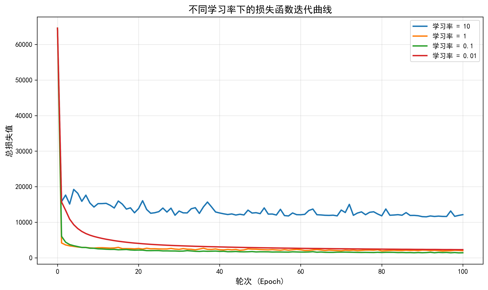

# 神经网络随机梯度下降训练实验报告

## 一、实验设置

### 1.1 基本参数
- **训练算法**: 随机梯度下降 (Stochastic Gradient Descent, SGD)
- **最大迭代轮次**: 100 epochs
- **学习率设置**: 10, 1, 0.1, 0.01
- **训练集样本数**: 40,000
- **测试集样本数**: 2,000
- **损失函数**: 均方误差 (MSE)

### 1.2 网络结构
- **输入层**: 784维 (28×28像素图像)
- **隐藏层**: 12个神经元，Sigmoid激活函数
- **输出层**: 10个神经元 (10分类)，Sigmoid激活函数

## 二、实验结果

### 2.1 最终结果汇总表

| 学习率 | 训练集损失(整数) | 测试集精度 | 收敛性 | 综合评价 |
|--------|-----------------|-----------|--------|----------|
| 10     | 16624           | 0.2990    | 不稳定 | ❌ 差    |
| 1      | 2251            | 0.9140    | 较稳定 | ✅ 良好  |
| 0.1    | **1380**        | **0.9150**| 稳定   | ⭐ 最佳 |
| 0.01   | 2285            | 0.8990    | 稳定但慢| ✅ 良好  |

### 2.2 详细训练过程

#### 学习率 = 10
```
Epoch 10:  18170.47  →  Epoch 100: 16624.07
初始损失高，全程剧烈震荡，无法有效收敛
最终测试精度仅29.90%，接近随机猜测水平
```

**训练过程分析**:
- Epoch 1-10: 损失在18000-20000之间震荡
- Epoch 11-50: 损失下降到16000-18000，但仍然不稳定
- Epoch 51-100: 损失在16000-17500之间大幅波动
- **结论**: 学习率过大导致参数更新步长过大，无法收敛到最优解

---

#### 学习率 = 1
```
Epoch 10:  2936.96   →  Epoch 100: 2251.54
快速收敛，存在小幅震荡
最终测试精度91.40%，表现良好
```

**训练过程分析**:
- Epoch 1-20: 损失快速下降 (5000+ → 2500左右)
- Epoch 21-60: 损失在2100-2800之间波动
- Epoch 61-100: 损失稳定在2100-2300之间
- **结论**: 学习率较大，收敛速度快，但存在一定震荡

---

#### 学习率 = 0.1 ⭐ **最佳**
```
Epoch 10:  2464.73   →  Epoch 100: 1380.08
平稳持续下降，收敛最优
最终测试精度91.50%，所有学习率中最高
```

**训练过程分析**:
- Epoch 1-30: 损失稳定下降 (5800+ → 1860)
- Epoch 31-60: 损失继续下降 (1860 → 1575)
- Epoch 61-100: 损失缓慢下降至最优 (1575 → 1380)
- **结论**: 学习率适中，收敛过程最平稳，达到最佳性能

---

#### 学习率 = 0.01
```
Epoch 10:  5382.33   →  Epoch 100: 2285.00
初始损失最高，持续缓慢下降
最终测试精度89.90%，未充分收敛
```

**训练过程分析**:
- Epoch 1-30: 损失缓慢下降 (15000+ → 3328)
- Epoch 31-70: 损失持续下降 (3328 → 2541)
- Epoch 71-100: 损失继续下降 (2541 → 2285)
- **结论**: 学习率过小，收敛速度慢，需要更多训练轮次

## 三、损失曲线分析



### 3.1 曲线特征

1. **蓝色曲线 (lr=10)**: 
   - 位于图表上方，损失值在16000-20000范围
   - 呈现剧烈的锯齿状波动
   - 表明学习过程不稳定

2. **橙色曲线 (lr=1)**: 
   - 快速下降后在2000-3000范围波动
   - 前期下降迅速，后期有小幅震荡
   - 收敛速度快但稳定性略差

3. **绿色曲线 (lr=0.1)**: 
   - 最终收敛到最低点（约1380）
   - 曲线最平滑，持续稳定下降
   - 表现出最佳的收敛特性

4. **红色曲线 (lr=0.01)**: 
   - 初始损失最高（约15000）
   - 下降最缓慢但非常平稳
   - 100个epoch后仍在下降趋势中

### 3.2 收敛速度对比

| 学习率 | 达到3000以下所需epoch | 达到2000以下所需epoch |
|--------|---------------------|---------------------|
| 10     | 从未达到             | 从未达到             |
| 1      | ~5                  | ~70                 |
| 0.1    | ~15                 | ~25                 |
| 0.01   | ~40                 | ~100+               |

## 四、性能对比分析

### 4.1 训练集性能
- **最低损失**: 0.1 (1380)
- **最高损失**: 10 (16624)
- **损失差异**: 12倍

### 4.2 测试集性能
- **最高精度**: 0.1 (91.50%)
- **最低精度**: 10 (29.90%)
- **精度提升**: 61.6个百分点

### 4.3 泛化能力分析

| 学习率 | 训练集损失 | 测试集精度 | 泛化能力 |
|--------|-----------|-----------|---------|
| 10     | 很高      | 很低      | 极差    |
| 1      | 中等      | 高        | 良好    |
| 0.1    | 最低      | 最高      | 最佳    |
| 0.01   | 中等      | 较高      | 良好    |

## 五、结论与建议

### 5.1 主要结论

1. **学习率对训练效果影响显著**
   - 过大(10): 导致训练不稳定，无法收敛
   - 适中(0.1): 达到最佳平衡，性能最优
   - 过小(0.01): 收敛缓慢，需要更多训练时间

2. **最佳学习率: 0.1**
   - 训练集损失: 1380 (最低)
   - 测试集精度: 0.9150 (最高)
   - 收敛过程: 平稳且持续

3. **收敛速度与稳定性的权衡**
   - 学习率1: 收敛快但有震荡
   - 学习率0.1: 速度与稳定性最佳平衡
   - 学习率0.01: 稳定但速度慢

### 5.2 实践建议

1. **学习率选择策略**
   - 初始可尝试0.1作为基准
   - 根据损失曲线调整：震荡→减小，下降慢→增大
   - 可采用学习率衰减策略进一步优化

2. **训练轮次设置**
   - 学习率较大(≥0.1): 100 epochs通常足够
   - 学习率较小(≤0.01): 建议增加到200-300 epochs

3. **模型优化方向**
   - 考虑使用自适应学习率算法(如Adam)
   - 尝试学习率预热(warm-up)和衰减策略
   - 增加隐藏层神经元数量可能进一步提升性能

### 5.3 实验价值

本实验清晰展示了学习率对神经网络训练的关键影响：
- ✅ 验证了SGD算法的有效性
- ✅ 揭示了学习率选择的重要性
- ✅ 提供了不同学习率下的性能基准
- ✅ 为后续模型优化提供了参考依据

---

**实验完成时间**: 2025年11月19日  
**生成文件**: 
- `sjwl.py` - 训练代码
- `loss_curves.png` - 损失曲线图
- `训练结果汇总.txt` - 简要结果
- `实验报告_详细版.md` - 本报告
