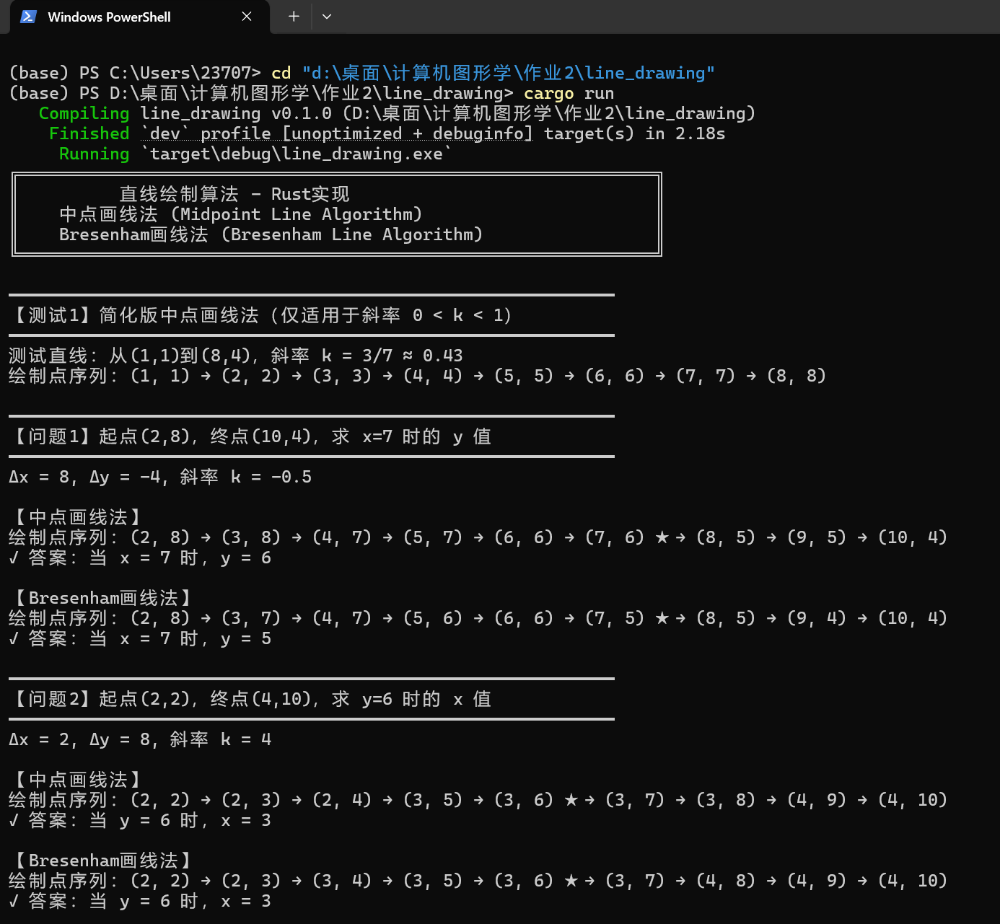
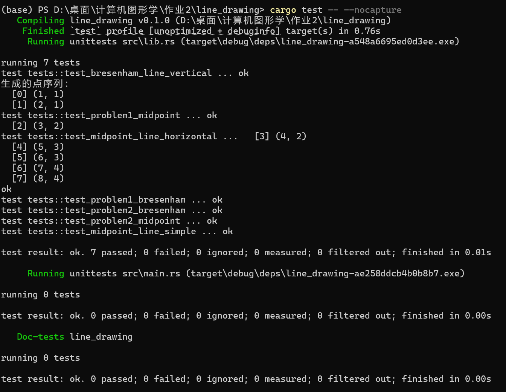

# line_drawing

所属课程：[计算机图形学与人机交互](../../README.md)。

感谢 **Cheng Zekai** 提供或整理本目录资料。原作者与第三方项目署名以文件原文为准。

## 本层导航

- [images/](images/README.md)
- [src/](src/README.md)
- [.gitignore](.gitignore)
- [Cargo.lock](Cargo.lock)
- [Cargo.toml](Cargo.toml)

[返回上级目录](../README.md)

## 原有项目说明

# 直线绘制算法 - Rust实现

这是一个用Rust实现的直线绘制算法项目，包含了两种经典的直线光栅化算法：

- **中点画线法 (Midpoint Line Algorithm)**
- **Bresenham画线法 (Bresenham Line Algorithm)**

## 项目结构

```
line_drawing/
├── Cargo.toml          # Rust项目配置文件
├── README.md           # 项目说明文档
└── src/
    ├── lib.rs          # 算法库实现
    └── main.rs         # 主程序（测试用例）
```

## 环境配置

### 1. 安装Rust

如果你还没有安装Rust，请访问 [https://www.rust-lang.org/](https://www.rust-lang.org/) 下载安装。

**Windows系统安装步骤：**

1. 访问 https://www.rust-lang.org/tools/install
2. 下载并运行 `rustup-init.exe`
3. 按照提示完成安装
4. 安装完成后，打开新的命令行窗口验证安装：
   ```bash
   rustc --version
   cargo --version
   ```

### 2. 验证Rust环境

打开终端或命令提示符，运行以下命令：

```bash
rustc --version
cargo --version
```

如果显示版本号，说明Rust环境配置成功。

## 编译和运行

### 方法1：使用Cargo运行

在项目根目录（`line_drawing/`）下执行：

```bash
# 编译并运行
cargo run

# 仅编译
cargo build

# 编译优化版本（运行更快）
cargo build --release
cargo run --release
```

### 方法2：运行测试

运行所有单元测试：

```bash
cargo test
```

运行测试并显示输出：

```bash
cargo test -- --nocapture
```

## 算法说明

### 中点画线法 (Midpoint Line Algorithm)

中点画线法通过判断中点位置来决定下一个像素的选择。算法特点：
- 只使用整数加减运算
- 避免浮点运算和乘除法
- 精度好，能选择最接近理想直线的像素

**函数签名：**
```rust
pub fn midpoint_line(x0: i32, y0: i32, x1: i32, y1: i32) -> Vec<Point>
```

### Bresenham画线法 (Bresenham Line Algorithm)

Bresenham算法通过误差累积的方式来决定下一个像素的位置。算法特点：
- 纯整数运算，效率极高
- 只需加减法，无需乘除法
- 误差可控，绘制质量高
- 易于硬件实现

**函数签名：**
```rust
pub fn bresenham_line(x0: i32, y0: i32, x1: i32, y1: i32) -> Vec<Point>
```

### 简化版中点画线法

严格按照教材步骤实现的简化版，仅适用于斜率 0 < k < 1 的情况：

```rust
pub fn midpoint_line_simple(x1: i32, y1: i32, x2: i32, y2: i32) -> Vec<Point>
```

## 使用示例

```rust
use line_drawing::{midpoint_line, bresenham_line};

fn main() {
    // 使用中点画线法绘制从(2,8)到(10,4)的直线
    let points1 = midpoint_line(2, 8, 10, 4);
    for p in &points1 {
        println!("({}, {})", p.x, p.y);
    }
    
    // 使用Bresenham画线法绘制从(2,2)到(4,10)的直线
    let points2 = bresenham_line(2, 2, 4, 10);
    for p in &points2 {
        println!("({}, {})", p.x, p.y);
    }
}
```

## 测试用例

项目包含了完整的单元测试，覆盖以下场景：

1. **水平线测试** - 测试斜率为0的情况
2. **垂直线测试** - 测试斜率为无穷大的情况
3. **问题1测试** - 起点(2,8)，终点(10,4)，验证x=7时的y值
4. **问题2测试** - 起点(2,2)，终点(4,10)，验证y=6时的x值
5. **简化版测试** - 测试斜率0<k<1的情况

运行测试：
```bash
cargo test
```

## 运行效果展示

### 程序运行截图



*将你的运行截图放在 `images/screenshot.png` 路径下*

### 测试结果截图



*将你的测试结果截图放在 `images/test_result.png` 路径下*

## 算法复杂度

- **时间复杂度**：O(max(Δx, Δy))，与直线长度成正比
- **空间复杂度**：O(max(Δx, Δy))，用于存储直线上所有点的坐标

## 算法对比

| 特性 | 中点画线法 | Bresenham法 |
|------|-----------|-------------|
| 时间复杂度 | O(n) | O(n) |
| 运算类型 | 整数加减 | 整数加减 |
| 判断条件 | d ≤ 0 | e < 0 |
| 实现难度 | 简单 | 简单 |

**注意**：两种算法在某些情况下会产生略微不同的结果，这是由于判断条件的细微差异造成的。

## 作者

程泽凯 - 2023112621

## 许可证

本项目仅用于学习和教学目的。

