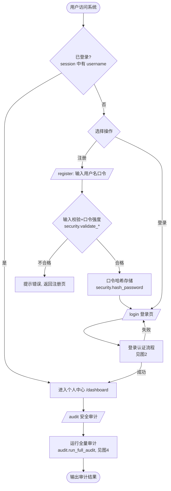
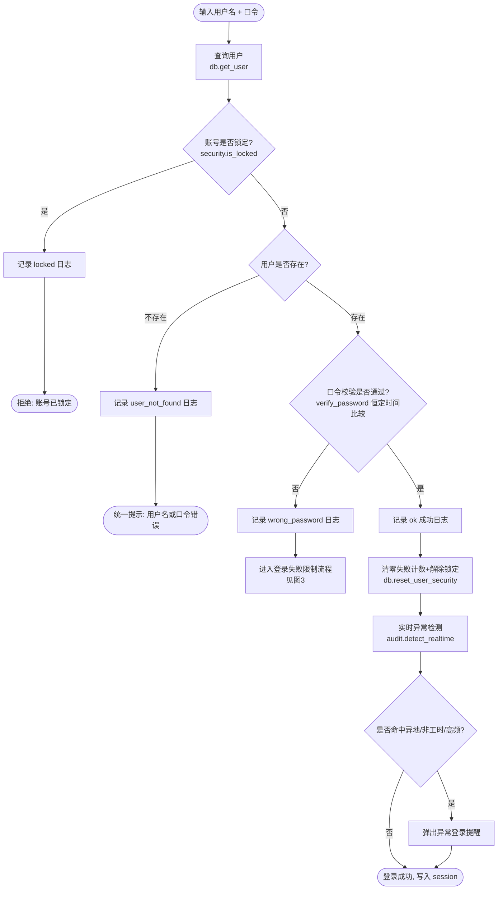
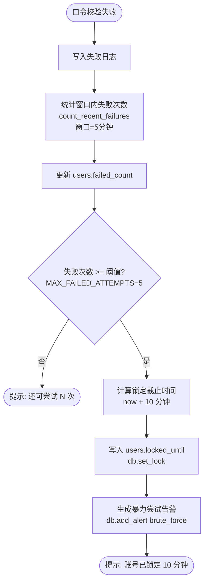
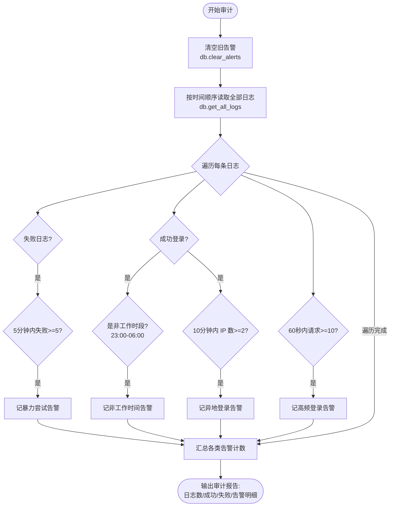
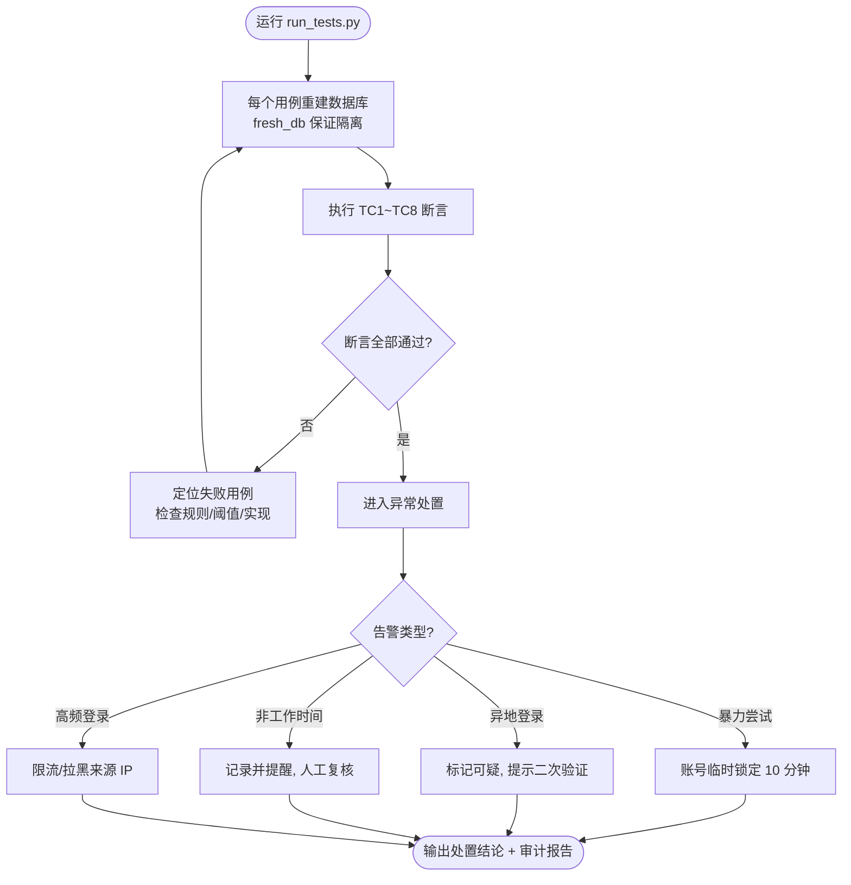

# 流程图（共 5 张）

> 设计者：程泽凯　学号：2023112621
> 说明：以下流程图均与本人实现的代码一一对应。每个判断分支后用括号标注了对应的代码位置，
> 答辩时可据此解释“流程图 — 代码 — 规则”三者的关系。
> 渲染方式：使用支持 Mermaid 的查看器（VS Code 插件、Typora、GitHub）可直接显示；
> 也可粘贴到 https://mermaid.live 导出 PNG 后贴入 Word 报告。

---

## 图 1　系统总体流程图

对应文件：`app.py`（路由分发）

---

## 图 2　用户登录认证流程图（核心）

对应函数：`security.authenticate()`

---

## 图 3　登录失败限制流程图

对应代码：`security.authenticate()` 中口令错误分支 + `count_recent_failures()`

---

## 图 4　异常登录审计流程图

对应函数：`audit.run_full_audit()`

---

## 图 5　测试与处置流程图

对应文件：`run_tests.py` + 异常处置策略

