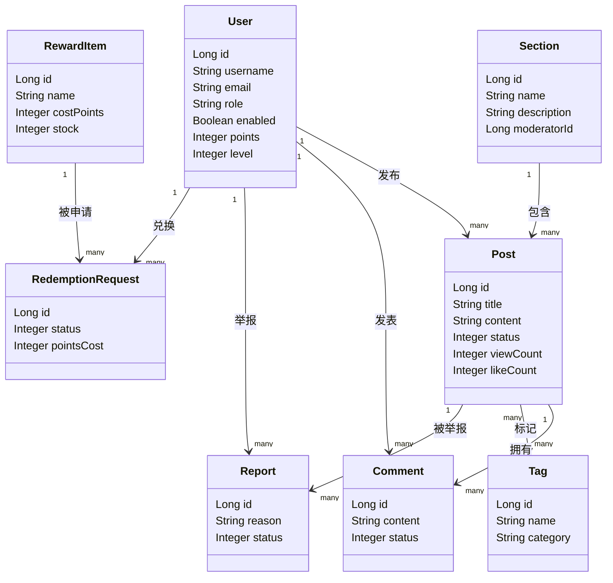
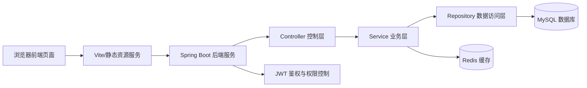
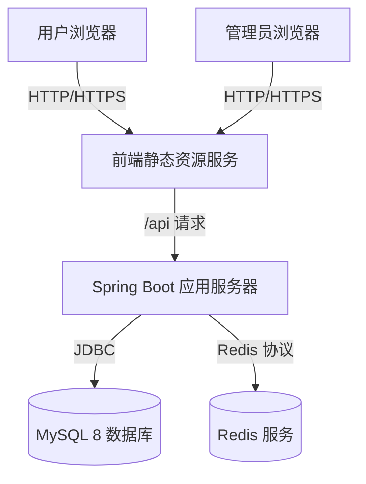
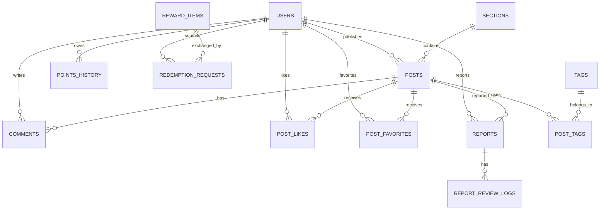

# 系统设计补充说明

## 2. 系统体系结构设计

### 2.1 系统特点分析

本系统是面向西南交通大学校内用户的校园论坛系统，主要提供帖子浏览、发帖评论、点赞收藏、个人中心、积分成长、举报治理、后台管理等功能。系统具有以下特点：

1. 用户角色明确：系统支持游客、普通用户、版主、管理员等角色，不同角色拥有不同访问权限。
2. 业务交互频繁：帖子、评论、点赞、收藏、浏览记录等数据更新频率较高，需要保证接口响应速度和数据一致性。
3. 数据关系清晰：用户、版块、帖子、评论、标签、举报、积分等实体之间存在较强关联，适合使用关系型数据库建模。
4. 安全性要求较高：登录认证采用 JWT Token，后台管理接口需要进行角色权限校验。
5. 可扩展性较强：推荐策略、成长体系、积分商城、内容治理等模块可以在核心论坛功能基础上继续扩展。

### 2.2 系统体系结构设计

#### 2.2.1 系统体系结构模式

系统采用前后端分离的 B/S 架构模式。前端负责页面展示、用户交互和请求发送；后端负责业务逻辑处理、权限校验和数据访问；数据库负责持久化存储论坛业务数据。

整体采用分层架构：

1. 表现层：HTML、CSS、JavaScript 页面，负责用户界面展示。
2. 控制层：Spring Boot Controller，负责接收 HTTP 请求并返回统一响应。
3. 业务层：Service，负责论坛、用户、成长、治理等核心业务规则。
4. 数据访问层：Repository，负责数据库读写。
5. 数据层：MySQL 存储核心业务数据，Redis 可用于缓存或临时状态。

#### 2.2.2 系统体系结构设计

##### （1）逻辑视图设计

逻辑视图说明：系统以用户、版块、帖子和评论为核心。用户可以在不同版块中发布帖子，也可以对帖子进行评论、点赞、收藏和举报。帖子可以绑定多个标签，用于分类展示和推荐。成长体系通过用户积分、积分流水、奖励项和兑换申请实现。后台治理模块围绕举报、帖子审核、用户封禁和推荐策略配置展开。

##### （2）开发及运行视图设计

开发及运行视图说明：前端通过浏览器运行，页面使用 JavaScript 调用 `/api` 接口。后端使用 Spring Boot 提供 RESTful API，并通过 JWT 完成登录状态识别。业务请求先进入 Controller，再由 Service 完成业务规则处理，最后通过 Repository 访问 MySQL。Redis 可作为缓存组件，用于扩展热点数据、会话辅助或短期状态存储。

##### （3）部署视图设计

部署视图说明：系统部署时，用户和管理员均通过浏览器访问前端页面。前端页面向后端应用服务器发送 API 请求。后端服务连接 MySQL 数据库存储用户、帖子、评论、举报、积分等数据，并可连接 Redis 提升部分高频数据访问性能。数据库与应用服务可以部署在同一台服务器，也可以在实际生产环境中拆分部署，以提高安全性和可维护性。

## 3. 接口设计

### 3.1 外部接口

| 接口类别 | 接口路径示例 | 请求方式 | 功能说明 |
|---|---|---|---|
| 用户认证接口 | `/api/auth/login` | POST | 用户登录，返回 JWT Token |
| 用户注册接口 | `/api/auth/register` | POST | 注册新用户 |
| 当前用户接口 | `/api/auth/me` | GET | 获取当前登录用户信息 |
| 版块接口 | `/api/sections` | GET | 获取论坛版块列表 |
| 帖子列表接口 | `/api/posts/hot`、`/api/posts/recommend` | GET | 获取热门或推荐帖子 |
| 帖子详情接口 | `/api/posts/{id}` | GET | 查看帖子详情 |
| 发帖接口 | `/api/posts` | POST | 登录用户发布帖子 |
| 评论接口 | `/api/posts/{id}/comments` | GET/POST | 查看或发布评论 |
| 点赞收藏接口 | `/api/posts/{id}/like`、`/api/posts/{id}/favorite` | POST | 对帖子点赞或收藏 |
| 成长体系接口 | `/api/growth/check-in` | POST | 用户签到并获得积分 |
| 积分商城接口 | `/api/growth/rewards` | GET | 获取可兑换奖励 |
| 后台帖子审核接口 | `/api/admin/posts/{id}/status` | PATCH | 管理员或版主审核帖子 |
| 后台用户管理接口 | `/api/admin/users/{id}/ban` | PATCH | 管理员封禁用户 |
| 推荐策略接口 | `/api/admin/recommendations/config` | GET/PUT | 查看或修改推荐策略 |

外部接口统一采用 JSON 格式传输数据。需要登录的接口通过请求头 `Authorization: Bearer <token>` 携带身份凭证。后端返回统一响应结构，包含状态码、提示信息和业务数据，便于前端统一处理成功、失败和异常状态。

### 3.2 内部接口

系统内部接口主要指后端各层之间的调用关系：

| 内部接口 | 调用方向 | 功能说明 |
|---|---|---|
| AuthController -> AuthService | 控制层调用业务层 | 登录、注册、获取当前用户 |
| PostController -> PostService | 控制层调用业务层 | 发帖、查帖、点赞、收藏、浏览记录 |
| CommentController -> CommentService | 控制层调用业务层 | 评论发布、评论查询、评论状态管理 |
| GrowthController -> GrowthService | 控制层调用业务层 | 签到、积分流水、奖励兑换 |
| AdminController -> AdminService | 控制层调用业务层 | 用户封禁、内容审核、举报处理 |
| Service -> Repository | 业务层调用数据访问层 | 查询、插入、更新、删除数据库记录 |
| SecurityFilter -> JwtService | 安全组件调用认证服务 | 解析 Token、校验用户身份和角色 |

内部接口设计遵循“控制层只负责请求转发，业务层负责业务规则，数据访问层只负责持久化”的原则，降低模块耦合度，便于后期维护和扩展。

## 4. 系统数据库设计

### 4.1 概念数据库设计

概念设计说明：数据库核心实体包括用户、版块、帖子、评论、标签、举报、积分记录、奖励项和兑换申请。用户与帖子是一对多关系，版块与帖子是一对多关系，帖子与评论是一对多关系，帖子与标签通过中间表形成多对多关系。用户可以对帖子点赞、收藏、举报，也可以产生积分流水和兑换申请。管理员处理举报时会产生举报处理日志，便于追踪后台操作。

### 4.2 逻辑数据库设计

逻辑数据库采用 MySQL 8，数据库名为 `swjtu_forum`，字符集为 `utf8mb4`，存储引擎为 `InnoDB`。主要数据表如下：

| 表名 | 说明 |
|---|---|
| `users` | 用户表，保存账号、角色、状态、积分、个人资料 |
| `sections` | 版块表，保存论坛版块信息 |
| `posts` | 帖子表，保存帖子标题、正文、状态、统计数据 |
| `comments` | 评论表，保存帖子评论及回复关系 |
| `tags` | 标签表，保存帖子和用户兴趣标签 |
| `post_tags` | 帖子标签关联表 |
| `user_tags` | 用户兴趣标签关联表 |
| `post_likes` | 帖子点赞表 |
| `comment_likes` | 评论点赞表 |
| `post_favorites` | 帖子收藏表 |
| `post_browse_history` | 帖子浏览记录表 |
| `reports` | 举报表 |
| `report_review_logs` | 举报处理日志表 |
| `operation_logs` | 后台操作日志表 |
| `points_history` | 积分流水表 |
| `reward_items` | 奖励项表 |
| `redemption_requests` | 积分兑换申请表 |
| `recommendation_configs` | 推荐策略配置表 |

系统通过 `schema.sql` 完成数据库逻辑设计和建表操作。建表脚本中设置了主键、外键、唯一约束和常用索引。例如，用户表中 `username` 和 `email` 设置唯一约束，帖子表通过 `user_id` 关联用户表，通过 `section_id` 关联版块表，点赞和收藏表通过唯一约束防止同一用户重复操作同一帖子。

## 5. 系统出错处理设计

### 5.1 出错信息

| 出错场景 | 系统输出信息 | 含义 | 前端提醒方式 |
|---|---|---|---|
| 用户名或密码错误 | `用户名或密码错误` | 登录凭证不正确 | 登录表单顶部显示红色提示 |
| 用户未登录 | `请先登录后再操作` | 当前接口需要登录权限 | 弹出提示并跳转登录页 |
| 权限不足 | `当前账号无权执行该操作` | 普通用户访问管理功能 | 页面提示并禁止继续操作 |
| Token 过期 | `登录状态已过期，请重新登录` | JWT 已失效 | 清除本地登录信息并跳转登录 |
| 表单内容为空 | `请填写完整信息` | 必填项未填写 | 在输入框附近显示校验信息 |
| 帖子不存在 | `帖子不存在或已被删除` | 查询的帖子无效 | 展示空状态页面 |
| 内容审核失败 | `内容包含不合规信息` | 发帖或评论内容不符合规则 | 保留输入内容并提示修改 |
| 重复点赞或收藏 | `请勿重复操作` | 数据库唯一约束冲突 | 弹出轻量提示 |
| 积分不足 | `积分不足，无法兑换` | 当前用户积分小于奖励所需积分 | 在兑换按钮旁显示原因 |
| 库存不足 | `奖励库存不足` | 奖励项已无可兑换库存 | 禁用兑换按钮 |
| 数据库连接失败 | `服务暂时不可用，请稍后重试` | 后端无法访问数据库 | 显示统一故障提示页 |
| 网络异常 | `网络连接失败，请检查网络后重试` | 前端请求未到达服务器 | Toast 提示并提供重试按钮 |
| 服务器内部错误 | `系统繁忙，请稍后再试` | 未预期后端异常 | 统一错误页或弹窗提示 |

错误提醒界面设计应遵循友好、明确、可恢复原则。对于用户可修改的问题，例如表单为空、密码错误、内容不合规，应在当前页面直接提示；对于登录过期、权限不足等问题，应引导用户重新登录或返回首页；对于服务器故障，应显示“稍后重试”按钮，避免直接暴露技术异常信息。

### 5.2 补救措施

1. 登录失败时，允许用户重新输入账号密码，并提供注册入口或返回首页入口。
2. Token 过期时，前端自动清除本地 Token 和用户信息，跳转登录页，登录成功后可返回原页面。
3. 网络请求失败时，前端保留用户已输入内容，并提供“重新提交”或“稍后再试”按钮。
4. 发帖或评论失败时，不清空编辑框内容，避免用户重复输入。
5. 数据库连接异常时，后端记录错误日志，前端显示统一服务异常提示，管理员检查 MySQL 服务、数据库账号和连接配置。
6. 权限不足时，系统阻止操作并提示当前账号无权限，避免执行越权数据修改。
7. 积分兑换失败时，系统不扣减积分，并提示失败原因，如积分不足、库存不足或申请重复。
8. 内容审核或举报处理失败时，后台页面保留当前筛选条件和列表状态，管理员可刷新后继续处理。
9. 对关键后台操作记录操作日志，便于故障后追踪责任和恢复数据。
10. 对数据库表设置外键、唯一约束和事务控制，防止重复点赞、重复收藏、积分扣减不一致等数据异常。
