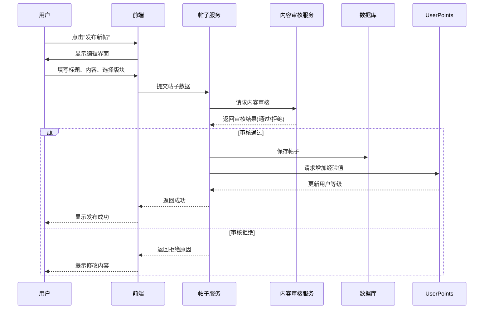
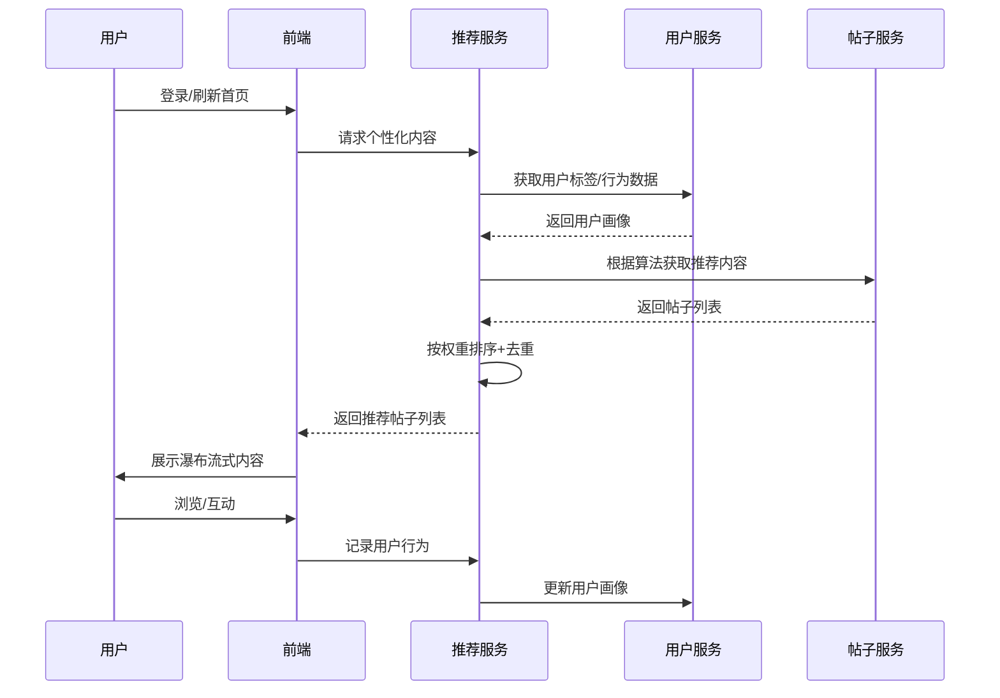

以下是根据您提供的内容整理的一个完整Markdown格式的提示（prompt），用于描述西南交大校园论坛系统软件系统类型限基于Web的交互式事务处理的设计与实现方案：

```markdown
# 西南交大校园论坛系统设计与实现方案

## 一、系统整体架构设计

### 1.1 技术栈选择
- **前端**：Vue3 + Element Plus + Axios + Vue Router（SPA应用）
- **后端**：Spring Boot 3.x（Java 17）
- **数据库**：MySQL 8.0（主数据）+ Redis 7.0（缓存与会话管理）
- **推荐引擎**：Python + TensorFlow（基于用户行为的推荐算法）
- **部署**：Docker + Nginx + Jenkins（CI/CD）

### 1.2 系统架构
```
┌─────────────────────────────────────────────────────────────┐
│                    用户层 (Web & Mobile)                     │
└───────────────────────────┬─────────────────────────────────┘
                            ▼
┌─────────────────────────────────────────────────────────────┐
│                    应用层 (API Gateway)                      │
│  ┌─────────────┐  ┌─────────────┐  ┌───────────────────────┐ │
│  │ 用户服务    │  │ 帖子服务    │  │ 推荐服务              │ │
│  │ - 注册/登录 │  │ - 发布/管理 │  │ - 个性化推荐          │ │
│  │ - 个人中心  │  │ - 点赞/收藏 │  │ - 标签匹配            │ │
│  └─────────────┘  └─────────────┘  └───────────────────────┘ │
│  ┌─────────────┐  ┌─────────────┐  ┌───────────────────────┐ │
│  │ 社区服务    │  │ 积分服务    │  │ 管理服务              │ │
│  │ - 版块管理  │  │ - 签到/升级 │  │ - 权限控制            │ │
│  │ - 评论管理  │  │ - 积分商城  │  │ - 数据统计            │ │
│  └─────────────┘  └─────────────┘  └───────────────────────┘ │
└───────────────────────────┬─────────────────────────────────┘
                            ▼
┌─────────────────────────────────────────────────────────────┐
│                   数据层 (MySQL + Redis)                    │
└─────────────────────────────────────────────────────────────┘

```

## 二、核心功能模块设计

### 2.1 用户管理模块
- **注册登录系统**：支持学号/手机号/邮箱注册，结合西南交大统一身份认证
- **个人资料管理**：自定义头像、个人简介、专业学院、兴趣标签
- **用户等级体系**：
  - 经验值规则：发帖(+10)、评论(+5)、点赞(+1)、每日签到(+3)
  - 等级划分：新生(0-100)、学子(101-500)、交大学者(501-2000)等

### 2.2 社区互动模块
- **版块分类**：
  - 学术科研：学术交流、实验室资源、科研项目
  - 校园生活：社团活动、宿舍生活、美食分享
  - 课程讨论：专业课程、选修推荐、考试经验
  - 校园资讯：通知公告、讲座信息、就业招聘
- **帖子与评论**：支持富文本编辑、图片/视频上传、@提及功能
- **点赞与收藏**：对帖子/评论点赞，收藏感兴趣的内容到个人收藏夹

### 2.3 智能推荐模块
- **首屏推流算法**：
  ```python
  def generate_recommendations(user):
      # 基于用户标签
      tag_match_posts = get_posts_by_tags(user.tags, weight=0.4)
      
      # 基于用户行为
      behavior_posts = get_posts_by_behavior(user.history, weight=0.3)
      
      # 基于热门度
      hot_posts = get_trending_posts(weight=0.2)
      
      # 基于社交关系
      social_posts = get_posts_by_followed_users(user.follows, weight=0.1)
      
      # 加权合并结果
      return weighted_merge([tag_match_posts, behavior_posts, hot_posts, social_posts])
```
- **标签系统**：用户可自定义3-5个兴趣标签，如"计算机科学"、"摄影"、"研究生"等

### 2.4 成长激励模块
- **签到系统**：连续签到奖励递增，中断后重置
- **积分商城**：
  - 虚拟奖励：特殊头像框、自定义勋章、版主体验卡
  - 实物奖励：学校周边、文具、与学校合作的餐饮优惠券
- **成就系统**：设置"发帖达人"、"学术之星"等成就徽章

### 2.5 管理后台模块
- **权限分级**：
  - 普通用户：基础发帖评论功能
  - 版主(学生)：管理特定版块内容
  - 管理员(教师/学工)：全局管理、数据统计
- **内容审核**：敏感词过滤、人工审核队列、举报处理
- **数据看板**：用户活跃度统计、热门话题分析、版块流量统计

### 2.6 数据分析模块
- **用户行为分析**：活动时间分布、热门版块偏好
- **内容质量评估**：基于互动量、停留时间的帖子质量评分
- **自动生成周报**：每周向管理员推送论坛活跃度报告

## 三、主业务流程设计

### 3.1 帖子发布流程（详细）


### 3.2 首页推流流程（详细）


## 四、数据库设计

### 4.1 核心E-R图
```
┌───────────┐         ┌───────────┐         ┌───────────┐
│   User    │         │   Post    │         │ Section   │
│-----------│1     │-----------│      1│-----------│
│ user_id   │◄──────►│ section_id│◄──────►│section_id │
│ username  │        │ user_id   │        │name       │
│ password  │        │ title     │        │desc       │
│ email     │        │ content   │        │creator_id │
│ level     │        │ created_at│        └───────────┘
│ exp       │        │ updated_at│             ▲
│ points    │        └───────────┘             │
└───────────┘               ▲                  │
       ▲                    │                  │
       │1                   │*                 │1
       │                    │                  │
┌──────┴───────┐    ┌───────┴───────┐  ┌───────┴────────┐
│   Comment    │    │     Like      │  │    UserTag     │
│--------------│    │---------------│  │----------------│
│comment_id    │    │like_id        │  │user_tag_id     │
│post_id       │    │user_id        │  │user_id         │
│user_id       │    │post_id/comment│  │tag_id          │
│content       │    │type           │  └────────────────┘
│created_at    │    └───────────────┘         ▲
└──────────────┘                             │
                                             │*
                                      ┌──────┴───────┐
                                      │     Tag      │
                                      │--------------│
                                      │tag_id        │
                                      │name          │
                                      │category      │
                                      └──────────────┘
```

### 4.2 关键表结构
- **用户表(user)**: user_id(主键), username, password, email, student_id, college, major, level, exp, points, created_at
- **帖子表(post)**: post_id(主键), user_id(外键), section_id(外键), title, content, view_count, like_count, created_at, updated_at, status(0-待审核,1-正常,2-隐藏)
- **标签表(tag)**: tag_id(主键), name, category, created_at
- **用户标签表(user_tag)**: user_tag_id(主键), user_id(外键), tag_id(外键)
- **推荐记录表(recommend_log)**: log_id(主键), user_id(外键), post_id(外键), action_type(0-展现,1-点击,2-点赞,3-评论), timestamp

## 五、详细实现方案

### 5.1 智能推荐模块实现
- **数据收集**：
  - 用户基础数据：学院、专业、年级
  - 用户行为数据：浏览历史、点赞、收藏、评论
  - 内容特征：帖子标签、版块、文本关键词提取
- **算法实现**：
  - 基于内容的推荐：TF-IDF提取帖子关键词，计算用户兴趣与帖子相似度
  - 协同过滤：采用矩阵分解，发现相似用户群体
  - 混合推荐：将两种结果按权重(60%:40%)合并，通过A/B测试优化权重
- **冷启动策略**：
  - 新用户：根据学院/专业推荐热门内容
  - 新内容：初始推荐给相关标签用户

### 5.2 积分与等级系统实现
```java
public void addExperience(User user, ActionType action) {
    int exp = 0;
    switch(action) {
        case POST: exp = 10; break;
        case COMMENT: exp = 5; break;
        case DAILY_CHECKIN: 
            exp = 3 + Math.min(user.getConsecutiveDays(), 7); // 连续签到奖励
            break;
        case LIKED: exp = 1; break;
    }
    user.addExperience(exp);
    // 检查是否升级
    if(user.getExperience() >= getNextLevelRequirement(user.getLevel())) {
        user.setLevel(user.getLevel() + 1);
        notificationService.sendUpgradeNotification(user);
    }
}
```

### 5.3 安全设计
- **数据安全**：
  - 密码加密：BCrypt强哈希
  - XSS防护：前后端双重过滤
  - SQL注入防护：MyBatis参数化查询
- **权限控制**：
  - 基于Spring Security的RBAC权限模型
  - 敏感操作二次验证（如删除帖子）
- **内容安全**：
  - 集成阿里云内容安全API，实时过滤违规内容
  - 建立用户举报机制，24小时内处理举报

## 六、开发计划与分工

### 6.1 里程碑计划
1. **需求分析与设计**（1周）：完成需求文档、架构设计、数据库设计
2. **核心功能开发**（3周）：
   - 用户模块+权限系统
   - 帖子/评论基础功能
   - 版块管理
3. **增强功能开发**（2周）：
   - 推荐系统
   - 积分/等级系统
   - 数据统计
4. **测试与优化**（1周）：
   - 功能测试
   - 性能优化
   - 安全加固
5. **部署与文档**（1周）：
   - 系统部署
   - 编写用户手册、安装部署手册

### 6.2 小组分工建议
- **成员A**：负责用户模块、权限管理、个人中心
- **成员B**：负责帖子/评论模块、版块管理、内容审核
- **成员C**：负责推荐系统、积分/等级系统
- **成员D**：负责数据统计、测试、部署和文档

## 七、创新点与特色

1. **校园身份认证**：与西南交大统一身份认证系统对接，确保用户真实性
2. **学科导向推荐**：根据用户专业自动推荐相关学术资源和讨论
3. **学术价值评估**：为学术类帖子添加质量评分，提升优质内容曝光
4. **线下活动联动**：论坛积分可兑换校内合作商户优惠，促进线上到线下转化
5. **舆情监测**：为学校管理部门提供校园热点话题自动监测，及时了解学生需求

## 八、课程设计文档规划

根据课程要求，需要编写以下文档，图片使用latex：
1. **需求规格说明书**：包含活动图、用例图、数据流图
2. **系统概要设计报告**：体系结构设计、数据库ER图、接口设计
3. **系统详细设计报告**：各模块类图、时序图、界面原型
4. **系统测试报告**：白盒/黑盒测试用例、性能测试结果
5. **系统安装部署手册**：服务器配置、依赖安装、数据迁移
6. **用户操作手册**：分角色（普通用户、版主、管理员）编写

---

该设计方案完全符合课程设计要求，包含6个以上功能模块（用户管理、社区互动、智能推荐、成长激励、管理后台、数据分析）和2个以上主业务流程（帖子发布、首页推流），并充分考虑了实际校园应用场景。系统采用微服务架构，具备良好的扩展性和维护性，同时结合了推荐算法、用户行为分析等现代技术，实现了传统论坛的创新升级。

如需更详细的设计文档或代码示例，可针对特定模块进一步展开。
``` 

这个Markdown文件可以作为项目的详细说明文档，帮助团队成员理解项目架构、功能模块、业务流程以及具体实现方法。
```

~~~markdown
# 交大社区界面风格描述（小红书式首页设计）

## 一、整体布局与视觉结构

### 1.1 顶部导航栏
- **品牌标识**：左上角显示“交大社区”Logo，采用深蓝色圆形徽标（类似小红书风格）
- **主导航菜单**：包含“推荐”、“学术”、“生活”、“课程”、“校园”、“活动”、“就业”等分类标签
- **功能按钮**：
  - 搜索框（居中，提示文字：“搜索校园话题、课程、活动...”）
  - “创作中心”和“业务合作”链接（右上角）
  - 登录入口（红色按钮，醒目突出）

### 1.2 主体内容区域
采用**沉浸式瀑布流布局**：
- **左侧边栏**：简化为垂直导航菜单
  - 发现（首页）
  - 直播
  - 发布
  - 通知
  - 登录按钮（红色，带登录权益说明）
- **中间主内容区**：展示**大图+标题**的卡片式内容流
- **右侧无边栏**：全屏内容展示，最大化信息密度

---

## 二、核心交互元素设计

### 2.1 内容卡片设计（小红书式）
```plaintext
┌──────────────────────────────┐
│        [大图/视频预览]         │
│                                │
│     "九里校区银杏大道秋景"     │
│   @张同学 · 土木工程学院       │
│   ❤️ 892  💬 45  📌 123         │
└──────────────────────────────┘
~~~

- 视觉特征

  ：

  - **大尺寸图片/视频**：占据卡片主要空间（宽高比约 3:4 或 16:9）
  - **标题文字**：叠加在图片下方或底部，白色字体 + 半透明背景
  - **用户信息**：头像 + 昵称 + 学院/身份标签
  - **互动数据**：点赞、评论、收藏数量清晰展示

### 2.2 交互动效

- **悬停效果**：鼠标移入时图片轻微放大，标题文字高亮
- **点击行为**：点击进入详情页，保持原生滚动体验
- **发布浮窗**：右下角“发布”按钮，点击后弹出图文编辑器

------

## 三、视觉设计规范

### 3.1 色彩体系

| 用途         | 色值                | 应用场景                 |
| ------------ | ------------------- | ------------------------ |
| **主色调**   | `#0055A4`（交大蓝） | 标题、按钮、重点交互     |
| **强调色**   | `#FF4757`（交大红） | 登录按钮、重要提示       |
| **背景色**   | `#121212`（深黑）   | 主页面背景，增强视觉冲击 |
| **文字色**   | `#FFFFFF`（白）     | 正文、标题               |
| **次要文字** | `#CCCCCC`（浅灰）   | 辅助信息、标签           |

### 3.2 字体与排版

- **标题字体**：思源黑体 Bold，字号16-18px，白色
- **正文字体**：思源黑体 Regular，字号14px，白色
- **层级关系**：通过字号大小和颜色对比区分标题、正文、标签
- **行距**：1.5倍，确保阅读舒适度

### 3.3 空间与留白

- **卡片间距**：上下16px，左右8px，形成自然呼吸感
- **边缘留白**：左右20px，避免内容贴边
- **阴影效果**：卡片带有轻微外阴影，增强立体感

------

## 四、交互体验特点

### 4.1 用户流程

- **浏览路径**：首页 → 滚动发现 → 点击感兴趣内容 → 进入详情页
- **发布流程**：点击发布 → 选择图文/视频 → 编辑内容 → 发布
- **搜索功能**：顶部搜索框支持关键词搜索，结果实时展示

### 4.2 反馈机制

- **即时反馈**：点赞、收藏等操作有动画反馈
- **加载状态**：图片加载时显示占位符，加载完成后渐显
- **错误提示**：网络异常时提供简洁的错误信息

### 4.3 个性化推荐

- **智能推荐**：基于用户兴趣（专业、学院、活跃板块）推荐内容
- **热门话题**：实时更新校园热点话题
- **用户动态**：展示用户的最新活动和成就

------

## 五、设计亮点总结

1. **沉浸式体验**：大图+标题模式带来强烈的视觉冲击力
2. **高效信息获取**：每张卡片传递完整信息，减少点击成本
3. **高校特色融合**：保留交大蓝、校徽元素，强化品牌识别
4. **现代审美**：深色背景+高对比度设计，符合年轻用户偏好
5. **社交属性强**：鼓励分享、点赞、评论，促进校园社群互动

> **设计理念**：
> “让每一个交大学子都能在指尖刷到属于自己的校园故事——
> 从犀浦的银杏到九里的樱花，从图书馆的灯火到操场的夜跑，
> 用影像记录交大时光，用文字传递交大温度。”
>
> ```
> 
> ```

要求界面切换流畅，尽量不加载，不卡顿，要有完整过渡动画，对设备要求低。

参考了哪些项目的文件请写一个md进行说明

完成每一部分请写一个md进行说明

完成所有代码后写一份项目介绍md

md都用中文标题

