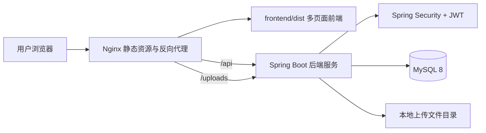
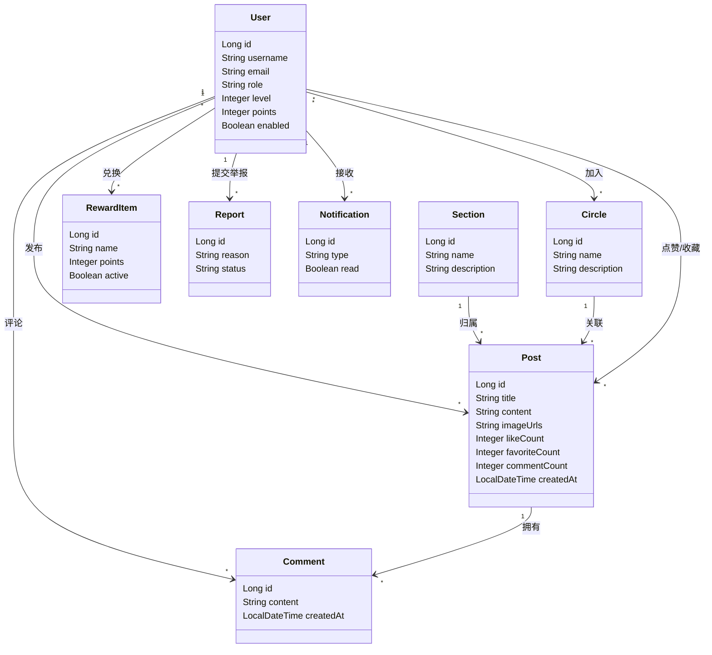
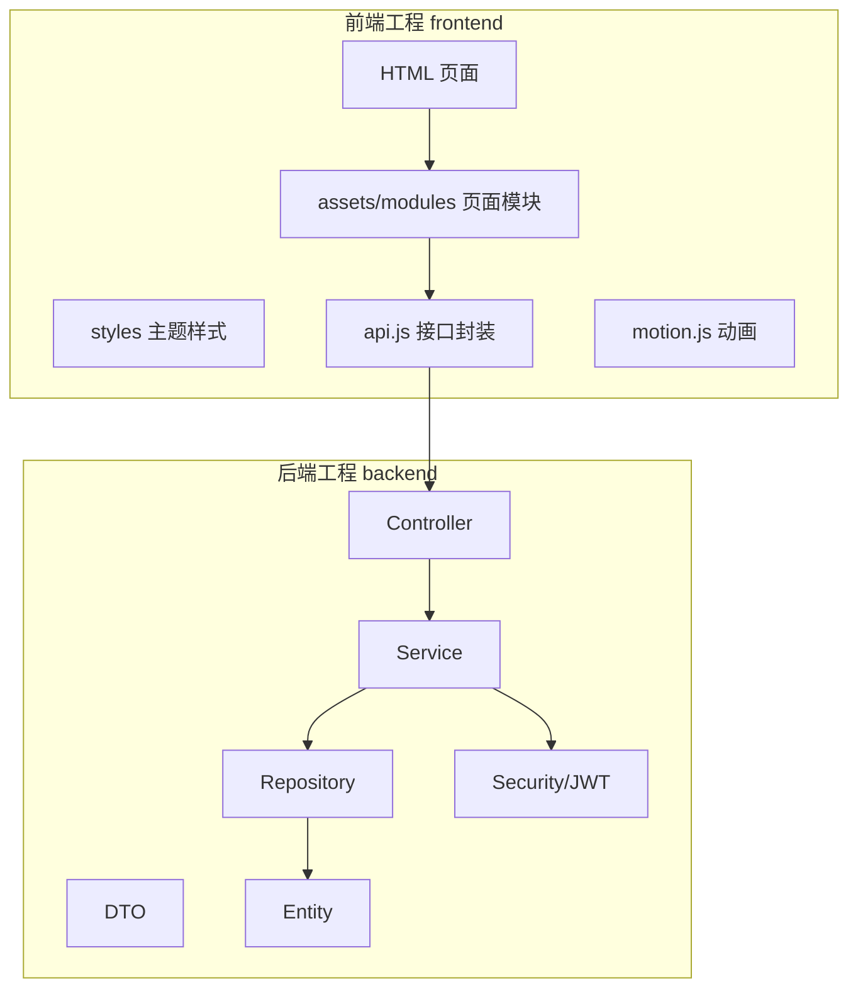
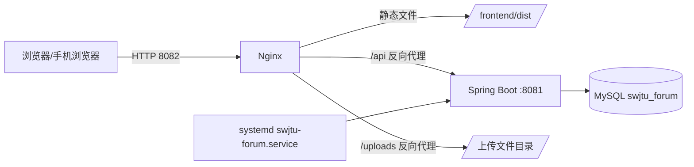
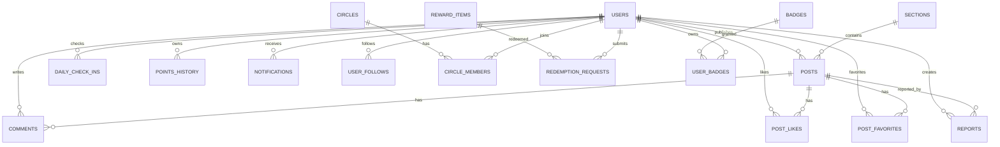

# jiaodaluntan

<!-- directory-guide:start -->
## 本层内容介绍

这里是“软件系统综合课程设计”课程下的“jiaodaluntan”目录，主要用于整理该主题的文档与参考材料。

**阅读建议：**先根据下方文件名选择相关文档，再结合上级介绍理解背景；原文件中的说明优先。

**项目背景与使用步骤：**请继续阅读本页下方的“原有项目说明”，其中保留了项目自己的功能介绍、环境要求或运行方法。

### 本层有哪些内容

本目录及子目录共收录 **612 份文件**（不含各层 README）；下面先介绍本层直接可见的内容。

| 子目录 | 内容与用途 |
| --- | --- |
| [assets](assets/README.md) | 图像、插图或配套素材 |
| [backend](backend/README.md) | 项目的后端服务实现 |
| [data](data/README.md) | 项目使用的数据或样例输入 |
| [docs](docs/README.md) | 项目说明或参考文档 |
| [frontend](frontend/README.md) | 项目的应用或界面相关文件 |
| [openspec](openspec/README.md) | 项目中该主题的需求、设计或任务记录 |
| [packaging](packaging/README.md) | 此模块的源码及配套文件 |
| [stitch_](stitch_/README.md) | 该主题的文档与参考材料 |
| [日志](%E6%97%A5%E5%BF%97/README.md) | 运行日志或过程记录 |
| [要求](%E8%A6%81%E6%B1%82/README.md) | 教学任务、通知或提交要求的参考材料 |

- **配置及其他配套文件（3 份）**：[.gitignore](.gitignore)、[jiaodaluntan.iml](jiaodaluntan.iml)等；完整列表见本页导航。
- **文档与说明（9 份）**：[CLAUDE.md](CLAUDE.md)、[DELIVERY.md](DELIVERY.md)等；完整列表见本页导航。
- **代码与脚本（6 份）**：[build-portable.ps1](build-portable.ps1)、[check-environment.ps1](check-environment.ps1)等；完整列表见本页导航。

<!-- directory-guide:end -->

所属课程：[软件系统综合课程设计](../../README.md)。

感谢 **Cheng Zekai** 提供或整理本目录资料。原作者与第三方项目署名以文件原文为准。

## 本层导航

- [assets/](assets/README.md)
- [backend/](backend/README.md)
- [data/](data/README.md)
- [docs/](docs/README.md)
- [frontend/](frontend/README.md)
- [openspec/](openspec/README.md)
- [packaging/](packaging/README.md)
- [stitch_/](stitch_/README.md)
- [日志/](%E6%97%A5%E5%BF%97/README.md)
- [要求/](%E8%A6%81%E6%B1%82/README.md)
- [.gitignore](.gitignore)
- [build-portable.ps1](build-portable.ps1)
- [check-environment.ps1](check-environment.ps1)
- [CLAUDE.md](CLAUDE.md)
- [DELIVERY.md](DELIVERY.md)
- [DESIGN.md](DESIGN.md)
- [init-database.sql](init-database.sql)
- [jiaodaluntan.iml](jiaodaluntan.iml)
- [P0P1_COMPLETION_SUMMARY.md](P0P1_COMPLETION_SUMMARY.md)
- [PRODUCT.md](PRODUCT.md)
- [seed-mock-data.ps1](seed-mock-data.ps1)
- [skills-lock.json](skills-lock.json)
- [start.bat](start.bat)
- [start.ps1](start.ps1)
- [创新功能实现计划.md](%E5%88%9B%E6%96%B0%E5%8A%9F%E8%83%BD%E5%AE%9E%E7%8E%B0%E8%AE%A1%E5%88%92.md)
- [用户手册.md](%E7%94%A8%E6%88%B7%E6%89%8B%E5%86%8C.md)
- [视觉素材生成清单.md](%E8%A7%86%E8%A7%89%E7%B4%A0%E6%9D%90%E7%94%9F%E6%88%90%E6%B8%85%E5%8D%95.md)
- [需求规格说明书.docx](%E9%9C%80%E6%B1%82%E8%A7%84%E6%A0%BC%E8%AF%B4%E6%98%8E%E4%B9%A6.docx)

[返回上级目录](../README.md)

## 原有项目说明

# 西南交大校园论坛

西南交大校园论坛是一个面向校园场景的综合社区系统，围绕“浏览、发帖、评论、互动、圈子、成长、积分、内容治理、运营管理”构建完整的前后端功能闭环。项目采用前后端分离架构：前端使用 Vite 多页面应用，后端使用 Spring Boot 3.2，数据库采用 MySQL 8 作为本地开发和正式部署的一致数据方案。

本文档作为项目交付入口，包含项目说明、详细设计报告、测试报告、用户手册和部署手册。部署手册部分按实际阿里云轻量服务器部署流程整理，可直接用于服务器上线。

## 1. 项目概览

### 1.1 项目目标

本项目希望实现一个“像真实校园论坛”的可运行系统，而不是静态页面或答辩演示壳。系统支持普通用户、版主和管理员三类主要角色，普通用户可以浏览校园内容、发布图文帖子、评论、点赞、收藏、关注用户、加入圈子、签到成长、兑换积分商品；管理员可以在后台查看运营数据、管理用户、审核内容、维护积分商品和调整推荐策略。

### 1.2 核心功能

| 模块 | 功能说明 |
|---|---|
| 账号认证 | 用户注册、登录、JWT 鉴权、角色权限控制、管理员入口保护 |
| 首页信息流 | 最新/最热排序、刷新帖子列表、校园热词云、帖子卡片、图片预览 |
| 发帖系统 | 支持标题、正文、板块、标签、PNG/JPG 图片上传，最多 9 张图片 |
| 帖子详情 | 浏览帖子、查看评论、发表评论、点赞、收藏、举报 |
| 用户主页 | 点击头像进入对方主页，查看用户资料、等级、徽章、发帖列表 |
| 关注系统 | 关注/取消关注用户，个人中心查看关注列表 |
| 圈子系统 | 浏览圈子、加入圈子、圈子帖子筛选、创建圈子弹窗 |
| 成长中心 | 每日签到、积分流水、等级成长、徽章展示 |
| 积分商城 | 普通用户查看商品并兑换；管理员上架、下架、维护积分商品 |
| 通知系统 | 评论、点赞、收藏、系统通知入口和未读提示 |
| 内容治理 | 举报处理、帖子隐藏/恢复、内容审核记录 |
| 用户管理 | 管理用户状态、角色、禁用/恢复账号 |
| 推荐策略 | 管理推荐权重，预览推荐策略效果 |
| 数据看板 | 后台总览统计、近期趋势、内容运营指标 |

### 1.3 默认账号

| 账号 | 密码 | 角色 | 用途 |
|---|---|---|---|
| `admin` | `admin123456` | 管理员 | 进入管理后台、用户管理、内容治理、积分商品管理 |

普通用户可以直接在注册页创建。正式部署时请在上线后及时修改管理员密码，避免使用默认密码作为长期生产密码。

### 1.4 技术栈

| 层级 | 技术 |
|---|---|
| 前端 | Vite 5、多页面应用、HTML、CSS、JavaScript ES Modules、Anime.js |
| 后端 | Java 17、Spring Boot 3.2、Spring MVC、Spring Security、Spring Data JPA |
| 数据库 | MySQL 8 |
| 鉴权 | JWT Bearer Token、角色权限控制 |
| 构建 | Maven、npm、Vite |
| 部署 | Linux、systemd、Nginx、MySQL、Gitee |

### 1.5 目录结构

```text
jiaodaluntan/
├─ backend/                         # Spring Boot 后端工程
│  ├─ src/main/java/com/swjtu/forum/
│  │  ├─ config/                    # 跨域、启动数据、Web 配置
│  │  ├─ controller/                # REST API 控制器
│  │  ├─ dto/                       # 请求/响应 DTO
│  │  ├─ entity/                    # JPA 实体
│  │  ├─ exception/                 # 全局异常与业务异常
│  │  ├─ repository/                # JPA Repository
│  │  ├─ security/                  # JWT、安全配置、登录保护
│  │  └─ service/                   # 业务服务层
│  ├─ src/main/resources/
│  │  ├─ application.yml            # 默认配置
│  │  ├─ application-mysql.yml      # MySQL 正式部署模式
│  │  └─ schema.sql                 # 数据库结构脚本
│  └─ pom.xml
├─ frontend/                        # Vite 前端工程
│  ├─ assets/
│  │  ├─ app.js                     # 应用入口
│  │  ├─ modules/                   # API、页面模块、UI、动画、会话管理
│  │  └─ generated/                 # 打包随项目携带的图片、图标、徽章、插画
│  ├─ styles/                       # 主题变量与全站样式
│  ├─ vendor/animejs/               # 随包携带的 Anime.js，避免依赖本机路径
│  ├─ home_recommended/             # 首页
│  ├─ login_register/               # 登录注册页
│  ├─ create_post/                  # 发帖页
│  ├─ post_details/                 # 帖子详情页
│  ├─ profile_overview/             # 个人中心/公开主页
│  ├─ circle_center/                # 圈子页
│  ├─ growth_center/                # 成长中心
│  ├─ rewards_mall/                 # 普通用户积分商城
│  ├─ admin_overview/               # 管理后台总览
│  ├─ admin_rewards/                # 管理员积分商品管理
│  ├─ content_governance/           # 内容治理
│  ├─ user_management/              # 用户管理
│  └─ recommendation_strategy/      # 推荐策略
├─ docs/                            # 过程文档和设计材料
├─ openspec/                        # OpenSpec 变更提案和实施记录
├─ start.ps1                        # Windows 本地一键启动脚本
├─ init-database.sql                # MySQL 初始化入口脚本
└─ README.md                        # 当前交付总文档
```

## 2. 快速启动

### 2.1 Windows 本地一键启动

在项目根目录执行：

```powershell
.\start.ps1
```

脚本会自动处理以下工作：

| 步骤 | 说明 |
|---|---|
| 端口清理 | 清理本地 8080 / 5173 残留进程 |
| 前端依赖 | 如果缺少 `node_modules`，自动执行 `npm install` |
| 后端启动 | 启动 Spring Boot，连接本地 MySQL 数据库 |
| 前端启动 | 启动 Vite 开发服务器 |
| 健康检查 | 轮询后端接口，确认服务可用 |
| 输出入口 | 打印前端访问地址和默认管理员账号 |

常用访问地址：

| 服务 | 地址 |
|---|---|
| 前端 | `http://127.0.0.1:5173` |
| 后端 API | `http://127.0.0.1:8080/api` |

### 2.2 手动启动前端

```powershell
cd frontend
npm install
npm run dev
```

### 2.3 手动启动后端 MySQL 模式

```powershell
cd backend
$env:DB_URL = "jdbc:mysql://127.0.0.1:3306/swjtu_forum?useUnicode=true&characterEncoding=utf8&useSSL=false&serverTimezone=Asia/Shanghai&allowPublicKeyRetrieval=true"
$env:DB_USERNAME = "swjtu_forum"
$env:DB_PASSWORD = "你的数据库密码"
$env:JWT_SECRET = "至少32位的随机密钥"
mvn spring-boot:run -Dspring-boot.run.profiles=mysql
```

## 3. 详细设计报告

### 3.1 系统特点分析

系统具有以下特点：

| 特点 | 说明 |
|---|---|
| 校园场景明确 | 板块、圈子、热词、积分和成长体系均围绕西南交大校园生活组织 |
| 前后端分离 | 前端负责交互体验，后端负责业务规则、权限控制和数据持久化 |
| 多角色权限 | 普通用户、版主、管理员具备不同的访问范围和操作权限 |
| 数据闭环完整 | 从注册、发帖、评论、互动到后台治理形成完整业务链路 |
| 支持真实部署 | 支持 MySQL、Nginx、systemd 和公网访问，不依赖开发环境 |
| 移动端适配 | 顶部栏、导航、通知和信息流针对手机端进行了响应式优化 |
| 交互稳定性优化 | 点赞、收藏、关注、签到等操作采用局部更新，避免频繁整页刷新 |
| 可维护性增强 | 前端已拆分页面模块，后端按 Controller-Service-Repository 分层 |

### 3.2 系统体系结构模式

系统采用 Browser/Server 架构和前后端分离模式。



核心分层如下：

| 层级 | 职责 |
|---|---|
| 表现层 | Vite 多页面前端，负责页面渲染、表单交互、动画、响应式布局 |
| 接口层 | Spring MVC Controller，负责接收请求、参数校验、返回统一响应 |
| 业务层 | Service，负责发帖、评论、互动、签到、审核、推荐等业务规则 |
| 数据访问层 | Repository，负责实体查询、分页、排序和持久化 |
| 安全层 | JWT Filter、SecurityConfig、权限处理器，负责登录态和访问控制 |
| 存储层 | MySQL 保存业务数据，本地目录保存上传图片 |

### 3.3 逻辑视图设计



逻辑视图说明：

| 对象 | 说明 |
|---|---|
| User | 系统用户，包含登录信息、角色、等级、积分、头像、个人简介 |
| Post | 帖子主体，包含标题、正文、图片、板块、热度和互动统计 |
| Comment | 评论数据，关联用户和帖子 |
| Section | 论坛板块，如课程互助、考研保研、犀浦生活、二手闲置 |
| Circle | 兴趣圈子，用于组织更小范围的主题讨论 |
| RewardItem | 积分商城商品，管理员可上架或下架 |
| Report | 用户举报记录，后台用于内容治理 |
| Notification | 通知消息，用于提示评论、互动和系统事件 |

### 3.4 开发及运行视图设计



开发运行说明：

| 模块 | 说明 |
|---|---|
| `frontend/assets/modules/api.js` | 统一封装 API 请求、Token 携带、错误处理 |
| `frontend/assets/modules/session.js` | 管理登录状态、当前用户、权限判断 |
| `frontend/assets/modules/pages/*.js` | 各页面业务逻辑，避免单文件过长 |
| `frontend/assets/modules/motion.js` | 页面进入、卡片上浮、提示淡入淡出等动画 |
| `backend/controller` | 提供 `/api` 下的 REST 接口 |
| `backend/service` | 承载业务逻辑和事务处理 |
| `backend/security` | JWT 解析、登录保护、权限不足响应 |
| `backend/exception` | 统一返回友好的错误信息 |

### 3.5 部署视图设计



部署说明：

| 节点 | 说明 |
|---|---|
| 浏览器 | 访问 `http://服务器IP:8082` |
| Nginx | 监听 8082，负责静态资源和接口代理 |
| Spring Boot | 监听 127.0.0.1:8081，只允许服务器本机访问 |
| MySQL | 保存系统业务数据 |
| systemd | 保证后端服务开机自启、异常自动重启 |

### 3.6 接口设计

#### 3.6.1 外部接口

系统对浏览器暴露统一 API 根路径 `/api`。

| 接口类别 | 路径示例 | 说明 |
|---|---|---|
| 认证 | `POST /api/auth/register` | 用户注册 |
| 认证 | `POST /api/auth/login` | 用户登录，返回 JWT |
| 板块 | `GET /api/sections` | 获取论坛板块 |
| 帖子 | `GET /api/posts` | 获取帖子列表，支持排序、分页、筛选 |
| 帖子 | `POST /api/posts` | 发布帖子 |
| 图片 | `POST /api/posts/image` | 上传 PNG/JPG 帖子图片 |
| 评论 | `POST /api/posts/{id}/comments` | 发布评论 |
| 互动 | `POST /api/posts/{id}/like` | 点赞或取消点赞 |
| 互动 | `POST /api/posts/{id}/favorite` | 收藏或取消收藏 |
| 用户 | `GET /api/users/{id}/profile` | 查看公开用户主页 |
| 关注 | `POST /api/users/{id}/follow` | 关注或取消关注 |
| 圈子 | `GET /api/circles` | 获取圈子列表 |
| 成长 | `POST /api/growth/check-in` | 每日签到 |
| 商城 | `GET /api/rewards/items` | 获取积分商品 |
| 管理 | `GET /api/admin/overview` | 管理后台总览 |
| 管理 | `PUT /api/admin/rewards/{id}` | 维护积分商品 |
| 治理 | `GET /api/admin/reports` | 查看举报列表 |

#### 3.6.2 内部接口

| 内部接口 | 调用关系 | 说明 |
|---|---|---|
| Controller -> Service | 控制器调用业务服务 | 参数转换、权限上下文传递 |
| Service -> Repository | 业务服务调用数据访问 | 查询、分页、保存、删除 |
| Service -> NotificationService | 业务事件触发通知 | 评论、点赞、收藏、审核等通知 |
| Service -> BadgeService | 成长事件触发徽章 | 签到、发帖、评论等行为产生徽章 |
| JwtAuthenticationFilter -> JwtUtil | 请求过滤器解析令牌 | 获取当前登录用户 |
| GlobalExceptionHandler -> ApiResponse | 异常统一响应 | 保持前端错误处理一致 |

### 3.7 数据库设计

#### 3.7.1 概念数据库设计



实体说明：

| 实体 | 主要字段 | 说明 |
|---|---|---|
| users | id, username, password, email, role, level, points, avatar | 用户账号、角色、成长信息 |
| sections | id, name, description, icon | 论坛板块 |
| posts | id, user_id, section_id, title, content, image_urls, status | 帖子 |
| comments | id, post_id, user_id, content | 评论 |
| post_likes | id, post_id, user_id | 点赞关系 |
| post_favorites | id, post_id, user_id | 收藏关系 |
| user_follows | id, follower_id, following_id | 关注关系 |
| circles | id, name, description, owner_id | 圈子 |
| circle_members | id, circle_id, user_id, role | 圈子成员 |
| daily_check_ins | id, user_id, check_date | 每日签到 |
| points_history | id, user_id, delta, reason | 积分流水 |
| reward_items | id, name, points, stock, active | 积分商品 |
| redemption_requests | id, user_id, reward_item_id, status | 兑换记录 |
| reports | id, reporter_id, post_id, reason, status | 举报 |
| badges | id, code, name, description | 徽章定义 |
| user_badges | id, user_id, badge_id | 用户徽章 |
| notifications | id, user_id, type, title, read | 通知 |
| recommendation_configs | id, key, value, enabled | 推荐策略配置 |

#### 3.7.2 逻辑数据库设计

数据库逻辑设计由 JPA Entity 与 `schema.sql` 共同表达。正式部署建议使用 MySQL 8，字符集统一使用 `utf8mb4`，排序规则使用 `utf8mb4_unicode_ci`，避免中文、Emoji 和校园昵称存储异常。

初始化数据库：

```sql
CREATE DATABASE IF NOT EXISTS swjtu_forum
  CHARACTER SET utf8mb4
  COLLATE utf8mb4_unicode_ci;

CREATE USER IF NOT EXISTS 'swjtu_forum'@'localhost' IDENTIFIED BY '请替换为强密码';
GRANT ALL PRIVILEGES ON swjtu_forum.* TO 'swjtu_forum'@'localhost';
FLUSH PRIVILEGES;
```

执行项目 SQL：

```bash
cd /opt/swjtu-forum
mysql -u swjtu_forum -p swjtu_forum < backend/src/main/resources/schema.sql
```

### 3.8 安全设计

| 安全点 | 设计 |
|---|---|
| 密码存储 | 后端使用 Spring Security 密码编码器，不明文保存密码 |
| 登录态 | 登录成功后返回 JWT，前端请求自动携带 Bearer Token |
| 权限控制 | 普通接口、登录接口、管理员接口分级保护 |
| 跨域控制 | 通过 `APP_CORS_ALLOWED_ORIGIN_PATTERNS` 显式配置允许来源 |
| SQL 注入防护 | 使用 JPA Repository 和参数化查询，避免拼接 SQL |
| XSS 防护 | 前端尽量使用安全文本渲染，避免直接插入未转义 HTML |
| 上传限制 | 仅允许 PNG/JPG，单图大小受后端限制，上传路径由服务端生成 |
| 错误响应 | 统一异常处理，不向前端暴露敏感堆栈 |
| 管理入口 | 管理后台仅管理员角色可访问，普通用户自动提示无权访问 |

### 3.9 出错处理设计

#### 3.9.1 出错信息

| 场景 | HTTP 状态 | 前端提示 | 含义 |
|---|---|---|---|
| 未登录访问受保护接口 | 401 | 请先登录后继续操作 | 当前请求缺少有效登录态 |
| 普通用户访问管理员功能 | 403 | 当前账号无权访问该功能 | 角色权限不足 |
| 注册用户名重复 | 400 | 用户名已存在 | 输入数据与已有用户冲突 |
| 登录密码错误 | 401 | 用户名或密码错误 | 认证失败 |
| 请求数据缺失 | 400 | 请检查输入内容 | 表单字段不完整或格式错误 |
| 访问不存在的帖子 | 404 | 内容不存在或已被删除 | 资源不存在 |
| 上传非图片文件 | 400 | 仅支持 PNG/JPG 图片 | 文件类型不符合要求 |
| 图片过大 | 400 | 图片大小超过限制 | 文件大小超过后端配置 |
| 数据库异常 | 500 | 请求失败，请稍后重试 | 服务端持久化异常 |
| 后端服务不可达 | 502 | 服务暂不可用 | Nginx 无法连接后端服务 |
| 请求超时 | 504/前端超时 | 请求超时，请检查网络或后端服务 | 网络或服务响应过慢 |

#### 3.9.2 补救措施

| 故障 | 补救措施 |
|---|---|
| 403 CORS | 检查 systemd 环境变量 `APP_CORS_ALLOWED_ORIGIN_PATTERNS`，确认包含当前访问域名和端口，重启后端 |
| 502 Bad Gateway | 检查 `sudo systemctl status swjtu-forum`，确认后端在 8081 正常运行 |
| 前端白屏 | 重新构建前端，检查浏览器缓存，确认 Nginx `root` 指向 `frontend/dist` |
| 登录失败 | 检查数据库用户表是否存在，确认密码、JWT_SECRET 和后端日志 |
| 注册失败 | 检查 `/api/auth/register` 是否被代理到 8081，确认 CORS 和 Security 配置 |
| 图片无法显示 | 检查 `/uploads/` Nginx 代理，确认上传目录存在且后端可读写 |
| MySQL 连接失败 | 检查数据库账号、密码、授权、端口和 `DB_URL` |
| Node 构建失败 | 确认 Node.js 版本为 18 或 20，Vite 5 不支持 Node 12 |
| 端口冲突 | 使用 `sudo ss -tulpn` 查看端口占用，避免覆盖已有项目 |

## 4. 测试报告

### 4.1 测试环境

| 项目 | 环境 |
|---|---|
| 操作系统 | Windows 本地开发环境、Ubuntu 22.04 阿里云轻量服务器 |
| 前端运行时 | Node.js 18+ / 20 |
| 后端运行时 | Java 17 |
| 数据库 | MySQL 8 |
| 浏览器 | Edge/Chrome 桌面端与移动端模拟 |

### 4.2 测试范围

| 测试类型 | 覆盖内容 |
|---|---|
| 后端单元测试 | 帖子、用户、认证、权限、互动状态、业务服务 |
| 前端脚本测试 | 页面模块、运行时安全、XSS 防护检查 |
| 构建测试 | Vite 生产构建、Maven 打包 |
| 手工功能测试 | 注册、登录、发帖、评论、点赞、收藏、签到、圈子、后台管理 |
| 部署测试 | 阿里云 Nginx + systemd + MySQL 部署链路 |
| 移动端测试 | 顶部栏响应式、通知位置、导航入口、滚动收起效果 |

### 4.3 测试命令

前端测试：

```bash
cd frontend
npm test
npm run build
```

后端测试：

```bash
cd backend
mvn test
```

后端打包：

```bash
cd backend
mvn clean package -DskipTests
```

### 4.4 最近一次验证结果

| 时间 | 命令 | 结果 |
|---|---|---|
| 2026-06-11 | `cd frontend && npm test` | 通过 |
| 2026-06-11 | `cd frontend && npm run build` | 通过 |
| 2026-06-11 | `cd backend && mvn test` | 通过，后端测试 74 项 |
| 2026-06-11 | Gitee 推送 | 通过，分支 `innovation/media-admin-base` 已更新 |

### 4.5 主要测试用例

| 编号 | 用例 | 操作 | 期望结果 | 状态 |
|---|---|---|---|---|
| T-001 | 用户注册 | 输入用户名、邮箱、密码提交 | 注册成功并可登录 | 通过 |
| T-002 | 管理员登录 | 使用 `admin/admin123456` 登录 | 可进入后台 | 通过 |
| T-003 | 普通用户访问后台 | 普通用户打开后台页 | 显示权限不足并可返回论坛 | 通过 |
| T-004 | 首页排序 | 切换最新/最热并点击刷新 | 帖子列表局部刷新，不整页跳转 | 通过 |
| T-005 | 发图文帖子 | 上传 PNG/JPG 图片并发布 | 帖子详情和首页显示图片 | 通过 |
| T-006 | 多图限制 | 上传多张图片 | 最多 9 张，超出给出提示 | 通过 |
| T-007 | 点赞 | 点击点赞按钮 | 按钮变深蓝，数量变化，不刷新页面 | 通过 |
| T-008 | 取消点赞 | 再次点击点赞按钮 | 状态取消，不造成页面卡死 | 通过 |
| T-009 | 收藏 | 点击收藏按钮 | 状态回显正确，再进详情仍显示已收藏 | 通过 |
| T-010 | 取消收藏 | 再次点击收藏按钮 | 状态取消，不造成页面卡死 | 通过 |
| T-011 | 评论 | 在详情页发表评论 | 评论即时展示 | 通过 |
| T-012 | 点击头像 | 点击帖子作者头像 | 进入对方公开主页 | 通过 |
| T-013 | 关注用户 | 在用户主页点击关注 | 关注列表新增该用户 | 通过 |
| T-014 | 每日签到 | 点击签到按钮 | 获得积分，按钮置灰，次日可再次签到 | 通过 |
| T-015 | 创建圈子 | 圈子页点击创建按钮 | 弹窗填写信息并创建 | 通过 |
| T-016 | 积分商品管理 | 管理员上架/下架商品 | 普通用户商城同步变化 | 通过 |
| T-017 | 内容举报 | 用户举报帖子 | 后台内容治理出现记录 | 通过 |
| T-018 | 举报处理 | 管理员处理举报 | 帖子状态和处理记录更新 | 通过 |
| T-019 | 移动端顶部栏 | 手机端浏览首页 | 顶部栏不挤出屏幕，滚动时收起/显示 | 通过 |
| T-020 | 服务器注册 | 公网 8082 注册用户 | 不再出现 CORS 403 | 通过 |

### 4.6 遗留风险

| 风险 | 说明 | 建议 |
|---|---|---|
| 大量图片上传 | 当前使用本地文件目录保存图片，适合课程设计和单机部署 | 后续可接入对象存储 |
| 默认管理员密码 | 默认密码便于验收，但不适合长期公网运行 | 上线后立即修改 |
| 单机部署 | 当前为单服务器部署 | 后续可拆分数据库、文件存储和应用服务 |
| 浏览器缓存 | 前端更新后部分浏览器可能缓存旧 JS | 部署后建议强制刷新或配置缓存策略 |

## 5. 用户手册

### 5.1 访问入口

| 页面 | 路径 | 说明 |
|---|---|---|
| 首页 | `/home_recommended/code.html` | 浏览帖子、搜索、排序、热词云 |
| 登录注册 | `/login_register/code.html` | 注册新用户、登录已有用户 |
| 发帖 | `/create_post/code.html` | 发布文字或图文帖子 |
| 帖子详情 | `/post_details/code.html?id=帖子ID` | 查看正文、图片、评论、互动 |
| 个人中心 | `/profile_overview/code.html` | 查看个人资料、帖子、收藏、关注 |
| 圈子 | `/circle_center/code.html` | 浏览、加入、创建圈子 |
| 成长中心 | `/growth_center/code.html` | 签到、积分、等级、徽章 |
| 积分商城 | `/rewards_mall/code.html` | 兑换积分商品 |
| 管理总览 | `/admin_overview/code.html` | 管理员数据看板 |
| 积分商品管理 | `/admin_rewards/code.html` | 管理员维护积分商品 |
| 内容治理 | `/content_governance/code.html` | 管理员审核举报和帖子 |
| 用户管理 | `/user_management/code.html` | 管理员管理用户 |
| 推荐策略 | `/recommendation_strategy/code.html` | 管理员配置推荐权重 |

### 5.2 普通用户操作

#### 5.2.1 注册与登录

1. 打开登录注册页。
2. 切换到注册模式。
3. 输入用户名、邮箱和密码。
4. 提交注册。
5. 注册成功后使用账号密码登录。

如果出现“权限不足”，说明当前页面是管理后台入口。普通用户应返回首页、圈子、成长中心或积分商城。

#### 5.2.2 浏览帖子

1. 进入首页。
2. 可以通过搜索框输入关键词。
3. 可以按“最新时间”或“最热”排序。
4. 点击刷新按钮后，仅刷新下面的帖子列表，不会整页刷新。
5. 点击帖子卡片进入详情页。

#### 5.2.3 发布帖子

1. 登录后点击“发帖”。
2. 输入标题和正文。
3. 选择板块。
4. 可上传 PNG/JPG 图片，最多 9 张。
5. 点击发布。
6. 发布成功后可在首页和个人主页看到帖子。

#### 5.2.4 点赞与收藏

1. 在首页或详情页点击点赞按钮。
2. 点赞后按钮变为深蓝色。
3. 再次点击取消点赞。
4. 收藏操作同理。
5. 重新进入帖子详情时，系统会回显已点赞和已收藏状态。

#### 5.2.5 评论

1. 打开帖子详情。
2. 在评论输入框填写内容。
3. 点击发布评论。
4. 评论会展示在帖子评论区。

#### 5.2.6 查看他人主页和关注

1. 点击帖子作者头像或用户名。
2. 进入该用户公开主页。
3. 可查看该用户等级、徽章和发布过的帖子。
4. 点击关注后可在个人中心关注列表查看。

#### 5.2.7 圈子使用

1. 打开圈子页。
2. 浏览已有圈子。
3. 点击加入圈子。
4. 可按圈子查看相关帖子。
5. 点击创建圈子按钮，通过弹窗填写圈子名称和介绍。

#### 5.2.8 成长中心与签到

1. 打开成长中心。
2. 点击签到。
3. 签到成功后获得积分。
4. 当天签到按钮变灰，不能重复签到。
5. 次日重新进入后可再次签到。

#### 5.2.9 积分商城

1. 打开积分商城。
2. 查看可兑换商品。
3. 积分足够时点击兑换。
4. 兑换记录由系统保存，管理员可在后台处理。

### 5.3 管理员操作

#### 5.3.1 登录后台

1. 使用管理员账号登录。
2. 打开 `/admin_overview/code.html`。
3. 进入管理总览。

默认管理员账号：

```text
用户名：admin
密码：admin123456
```

#### 5.3.2 管理总览

管理总览展示用户、帖子、评论、举报、积分商品等统计信息。管理员可切换时间范围查看趋势，也可通过侧边栏进入不同后台子模块。

#### 5.3.3 用户管理

管理员可以查看用户列表，识别异常账号，执行禁用、恢复、角色调整等操作。

#### 5.3.4 内容治理

管理员可以查看举报记录，审核帖子，隐藏违规内容，恢复误判内容，并保留处理记录。

#### 5.3.5 积分商品管理

管理员维护积分商城商品。这里的操作是“上架/下架积分商品”，不是普通用户兑换。商品上架后普通用户可以在积分商城看到；下架后普通用户不可兑换。

#### 5.3.6 推荐策略

管理员可以调整推荐策略权重，例如热度、时间、互动、板块等因素，并查看推荐预览。

## 6. 部署手册

### 6.1 部署目标

本项目支持部署到已有网站的同一台阿里云轻量应用服务器。为了不影响服务器上已有的 80 端口网站，论坛采用如下端口规划：

| 服务 | 端口 | 暴露范围 | 说明 |
|---|---|---|---|
| 原网站 Nginx | 80 | 公网 | 保持不动 |
| 原网站后端 | 8000 | 127.0.0.1 | 原有 uvicorn 服务 |
| 西南交大论坛前端入口 | 8082 | 公网 | Nginx 监听，浏览器访问 |
| 西南交大论坛后端 | 8081 | 127.0.0.1 | Spring Boot，仅 Nginx 反代 |
| MySQL | 3306 | 本机 | 数据库存储，不建议公网开放 |
| SSH | 22 | 公网 | 远程管理 |

查看端口占用：

```bash
sudo ss -tulpn
```

查看 Nginx 配置：

```bash
sudo nginx -T | grep -nE 'server_name|listen|root|proxy_pass'
```

### 6.2 服务器环境安装

更新软件包：

```bash
sudo apt update
```

安装基础工具：

```bash
sudo apt install -y git curl wget unzip nginx mysql-server maven openjdk-17-jdk
```

安装 Node.js 20：

```bash
curl -fsSL https://deb.nodesource.com/setup_20.x | sudo -E bash -
sudo apt install -y nodejs
node -v
npm -v
```

如果服务器原来是 Node.js 12，安装 Node 20 时可能出现 `libnode-dev` 冲突，可执行：

```bash
sudo apt remove -y nodejs libnode-dev
sudo apt --fix-broken install -y
curl -fsSL https://deb.nodesource.com/setup_20.x | sudo -E bash -
sudo apt install -y nodejs
```

Vite 5 要求 Node.js 18 或更高版本，Node 12 会导致 `Unexpected reserved word` 或 Rollup/Vite 构建失败。

### 6.3 创建 MySQL 数据库

进入 MySQL：

```bash
sudo mysql
```

执行 SQL。请把示例密码换成自己的强密码，不要使用公开文档里的示例密码作为生产密码。

```sql
CREATE DATABASE IF NOT EXISTS swjtu_forum CHARACTER SET utf8mb4 COLLATE utf8mb4_unicode_ci;
CREATE USER IF NOT EXISTS 'swjtu_forum'@'localhost' IDENTIFIED BY '请替换为强密码';
GRANT ALL PRIVILEGES ON swjtu_forum.* TO 'swjtu_forum'@'localhost';
FLUSH PRIVILEGES;
EXIT;
```

### 6.4 拉取项目代码

首次部署：

```bash
sudo mkdir -p /opt/swjtu-forum
sudo chown -R $USER:$USER /opt/swjtu-forum
git clone -b innovation/media-admin-base https://gitee.com/czk2370708935/swjtu-forum.git /opt/swjtu-forum
```

已有目录更新：

```bash
cd /opt/swjtu-forum
git pull origin innovation/media-admin-base
```

如果服务器 remote 名称不是 `origin`，先查看：

```bash
git remote -v
```

### 6.5 构建后端

```bash
cd /opt/swjtu-forum/backend
mvn clean package -DskipTests
```

构建成功后会生成：

```text
/opt/swjtu-forum/backend/target/forum-1.0.0.jar
```

### 6.6 配置 systemd 后端服务

创建服务文件：

```bash
sudo nano /etc/systemd/system/swjtu-forum.service
```

写入以下内容。请替换数据库密码和 JWT 密钥。

```ini
[Unit]
Description=SWJTU Forum Backend
After=network.target mysql.service

[Service]
WorkingDirectory=/opt/swjtu-forum/backend
ExecStart=/usr/bin/java -Dfile.encoding=UTF-8 -Dspring.profiles.active=mysql -jar /opt/swjtu-forum/backend/target/forum-1.0.0.jar --server.port=8081
Environment=DB_URL=jdbc:mysql://127.0.0.1:3306/swjtu_forum?useUnicode=true&characterEncoding=utf8&useSSL=false&serverTimezone=Asia/Shanghai&allowPublicKeyRetrieval=true
Environment=DB_USERNAME=swjtu_forum
Environment=DB_PASSWORD=请替换为数据库密码
Environment=JWT_SECRET=请替换为至少32位随机密钥
Environment=APP_CORS_ALLOWED_ORIGIN_PATTERNS=http://47.108.218.39:8082,http://localhost:*,http://127.0.0.1:*
Restart=always
RestartSec=5

[Install]
WantedBy=multi-user.target
```

启动服务：

```bash
sudo systemctl daemon-reload
sudo systemctl enable --now swjtu-forum
sudo systemctl status swjtu-forum
```

查看后端日志：

```bash
sudo journalctl -u swjtu-forum -f
```

如果修改了 service 文件，需要重新加载并重启：

```bash
sudo systemctl daemon-reload
sudo systemctl restart swjtu-forum
```

### 6.7 构建前端

```bash
cd /opt/swjtu-forum/frontend
npm install
npm run build
```

构建产物目录：

```text
/opt/swjtu-forum/frontend/dist
```

### 6.8 配置 Nginx

创建 Nginx 配置：

```bash
sudo nano /etc/nginx/conf.d/swjtu-forum.conf
```

写入以下内容：

```nginx
server {
    listen 8082;
    server_name _;

    root /opt/swjtu-forum/frontend/dist;
    index index.html;

    location /api/ {
        proxy_pass http://127.0.0.1:8081/api/;
        proxy_set_header Host $host;
        proxy_set_header X-Real-IP $remote_addr;
        proxy_set_header X-Forwarded-For $proxy_add_x_forwarded_for;
    }

    location /uploads/ {
        proxy_pass http://127.0.0.1:8081/uploads/;
    }

    location / {
        try_files $uri $uri/ /index.html;
    }
}
```

检查并重载 Nginx：

```bash
sudo nginx -t
sudo systemctl reload nginx
```

### 6.9 开放服务器防火墙

阿里云轻量应用服务器需要在控制台防火墙中添加规则：

| 协议 | 端口 | 来源 | 说明 |
|---|---|---|---|
| TCP | 8082 | 0.0.0.0/0 | 西南交大论坛公网访问入口 |

已有规则 22、80、443 可以保留。8081 是后端内部端口，不需要在公网防火墙开放。

Ubuntu 本机如果启用了 UFW，也需要放行：

```bash
sudo ufw allow 8082/tcp
sudo ufw status
```

### 6.10 部署后验证

检查前端：

```bash
curl -I http://127.0.0.1:8082/
```

检查后端代理：

```bash
curl -i http://127.0.0.1:8082/api/sections
```

检查公网访问：

```bash
curl -I http://47.108.218.39:8082/
```

浏览器访问：

```text
http://47.108.218.39:8082
```

### 6.11 后续更新流程

每次本地提交并推送到 Gitee 后，服务器执行：

```bash
cd /opt/swjtu-forum
git pull origin innovation/media-admin-base
```

重新构建后端并重启：

```bash
cd /opt/swjtu-forum/backend
mvn clean package -DskipTests
sudo systemctl restart swjtu-forum
sudo systemctl status swjtu-forum
```

重新构建前端并重载 Nginx：

```bash
cd /opt/swjtu-forum/frontend
npm install
npm run build
sudo nginx -t
sudo systemctl reload nginx
```

### 6.12 常见部署问题

| 问题 | 原因 | 处理 |
|---|---|---|
| `git pull gitee ...` 报错 | 服务器 remote 叫 `origin`，不是 `gitee` | 使用 `git remote -v` 查看，执行 `git pull origin innovation/media-admin-base` |
| 注册接口 403 | CORS 允许来源未包含公网地址 | 修改 `APP_CORS_ALLOWED_ORIGIN_PATTERNS`，重启后端 |
| 502 Bad Gateway | Nginx 找不到后端 8081 | 检查 `sudo systemctl status swjtu-forum` |
| 前端构建失败 | Node 版本过低 | 升级 Node.js 18/20 |
| nano 不会退出 | 正在保存时按 `Ctrl+O` 回车，再按 `Ctrl+X` | 如果不保存，按 `Ctrl+X` 后选 `N` |
| 旧页面仍然显示 | 浏览器缓存旧资源 | 强制刷新或清理缓存 |
| 图片上传后不显示 | `/uploads/` 代理缺失或后端目录权限不足 | 检查 Nginx 配置和后端日志 |

## 7. 开发说明

### 7.1 前端开发命令

```bash
cd frontend
npm install
npm run dev
npm test
npm run build
```

### 7.2 后端开发命令

```bash
cd backend
mvn spring-boot:run
mvn test
mvn clean package
```

### 7.3 Git 提交流程

```bash
git status
git add README.md
git commit -m "完善项目交付 README 文档"
git push gitee innovation/media-admin-base
```

服务器更新时使用：

```bash
cd /opt/swjtu-forum
git pull origin innovation/media-admin-base
```

## 8. 交付清单

| 内容 | 状态 | 说明 |
|---|---|---|
| 前端源代码 | 已完成 | 位于 `frontend/` |
| 后端源代码 | 已完成 | 位于 `backend/` |
| 数据库脚本 | 已完成 | `backend/src/main/resources/schema.sql` 与 `init-database.sql` |
| 详细设计报告 | 已写入 README | 第 3 章 |
| 测试报告 | 已写入 README | 第 4 章 |
| 用户手册 | 已写入 README | 第 5 章 |
| 部署手册 | 已写入 README | 第 6 章 |
| 阿里云部署流程 | 已整理 | 8082 前端入口、8081 后端服务、MySQL 数据库 |
| Gitee 仓库 | 已配置 | `https://gitee.com/czk2370708935/swjtu-forum.git` |

## 9. 维护建议

| 建议 | 说明 |
|---|---|
| 上线后修改默认管理员密码 | 防止默认账号被猜测 |
| 不要把真实数据库密码提交到仓库 | README 和 service 示例只使用占位符 |
| 定期备份 MySQL | 课程验收前建议导出一份 SQL |
| 更新后先执行测试 | 至少运行 `npm test`、`npm run build` 和 `mvn test` |
| 服务器只开放必要端口 | 公网开放 8082，后端 8081 保持本机访问 |
| 图片目录定期清理 | 防止长期运行后磁盘被上传图片占满 |

---

项目当前分支：`innovation/media-admin-base`

推荐公网访问方式：`http://服务器IP:8082`

推荐本地开发方式：执行 `.\start.ps1` 后访问 `http://127.0.0.1:5173`

